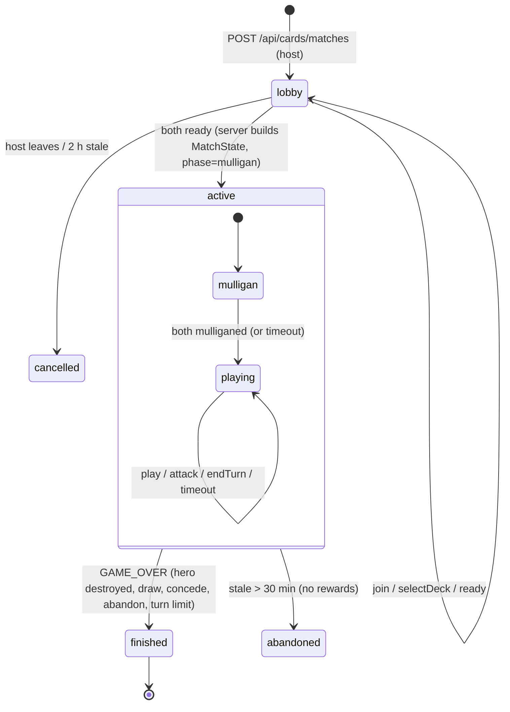
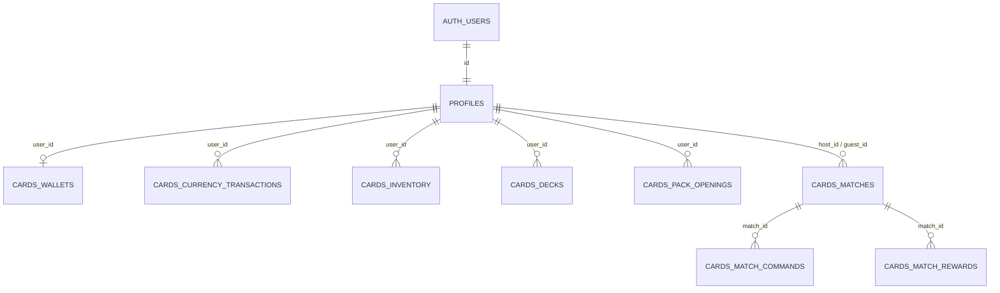
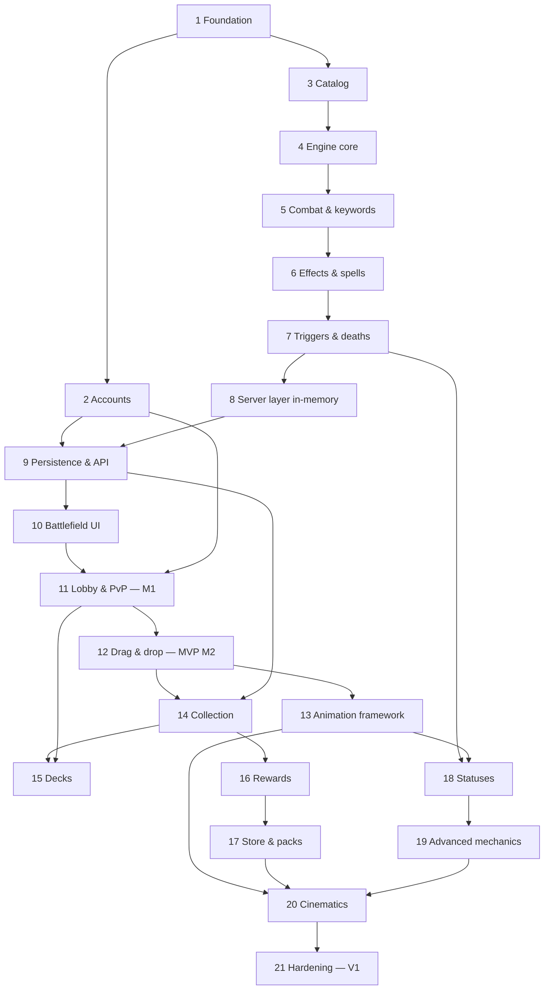

# Duelo Arcano — Card Game Implementation Plan

> **Document status:** Architecture & execution specification v1.0 (2026-11-12).
> **Audience:** AI coding agents (primarily Claude Sonnet) implementing one phase per fresh session, plus the project owner.
> **Working title:** *Duelo Arcano* (player-facing name lives in the i18n dictionary and can be renamed in one place).
> **Rule for every agent:** this document is the source of truth. You may not silently change an architectural decision. If you must deviate, record it in `docs/cards/DECISIONS.md` (see §22) and explain why in your final report.

---

## Table of contents

1. [How to use this document](#1-how-to-use-this-document)
2. [Executive summary](#2-executive-summary)
3. [Repository audit findings](#3-repository-audit-findings)
4. [Architectural decisions (ADRs)](#4-architectural-decisions-adrs)
5. [Scope: MVP vs Full V1 vs Future](#5-scope-mvp-vs-full-v1-vs-future)
6. [Complete gameplay rules](#6-complete-gameplay-rules)
7. [Keywords, statuses and their interactions](#7-keywords-statuses-and-their-interactions)
8. [Deterministic resolution model](#8-deterministic-resolution-model)
9. [Data-driven ability architecture & TypeScript interfaces](#9-data-driven-ability-architecture--typescript-interfaces)
10. [Match state, commands, events and views](#10-match-state-commands-events-and-views)
11. [Card versioning](#11-card-versioning)
12. [Supabase data model & security](#12-supabase-data-model--security)
13. [Multiplayer architecture & synchronization](#13-multiplayer-architecture--synchronization)
14. [Authentication design](#14-authentication-design)
15. [Collection & deckbuilding design](#15-collection--deckbuilding-design)
16. [Currency & card pack economy](#16-currency--card-pack-economy)
17. [UI architecture & interaction specification](#17-ui-architecture--interaction-specification)
18. [Animation architecture](#18-animation-architecture)
19. [Performance & security requirements](#19-performance--security-requirements)
20. [Initial card catalog & starter decks](#20-initial-card-catalog--starter-decks)
21. [Phase-by-phase implementation plan](#21-phase-by-phase-implementation-plan)
22. [Documentation & handoff protocol](#22-documentation--handoff-protocol)
23. [Cross-phase dependency map](#23-cross-phase-dependency-map)
24. [Future expansion strategy](#24-future-expansion-strategy)
25. [Reusable Sonnet session prompt](#25-reusable-sonnet-session-prompt)

---

## 1. How to use this document

* **Sections 2–20** are reference material: rules, architecture, schemas. They are normative — code must match them.
* **Section 21** contains 21 phases. Each phase is designed to be implemented in **one fresh Claude Sonnet session**. Each phase lists its objective, prerequisites, scope, explicit non-goals, files, data models, numbered steps, edge cases, automated tests, manual tests, acceptance criteria, definition of done and handoff.
* When a phase says "see §X", the agent **must read §X** before writing code.
* **MVP** (first playable friend-vs-friend release) = Phases 1–12. **Full V1** = Phases 13–21.
* Player-facing text is **Spanish**. Code, identifiers, comments, DB columns and docs are **English**.
* Words in `code font` are exact identifiers. Use them verbatim.

### 1.1 Glossary (use these words consistently)

| Term | Meaning |
|---|---|
| **Card Definition** (`CardDef`) | Static catalog data for a card (`id`, cost, stats, abilities). Lives in code. Immutable during a match. |
| **Card Instance** (`CardInstance`) | One physical copy inside a match (deck/hand), with an instance id `iid` like `"c17"`. |
| **Owned Card** | A row in `cards_inventory` (`user_id`, `card_id`, `quantity`). Persistent. |
| **Deck Entry** | `{ cardId, count }` inside a saved deck (`cards_decks.entries`). |
| **Board Unit** (`Unit`) | A live mob on the battlefield with mutable damage, modifiers, statuses, combat state. Keeps the `iid` of the card that became it. |
| **Mob** (Spanish UI: *criatura*) | A creature card / unit. |
| **Character** | A mob **or** a hero. |
| **Hero** | A player's avatar with health. Entity ids `"h0"` (seat 0) and `"h1"` (seat 1). |
| **Seat** | `0` = match host, `1` = guest. Seat is *not* turn order. |
| **Controller** | The seat that currently controls a unit (can differ from original owner after control change). |
| **Command** | A request from a client (or the server's timer) to change the match (`play`, `attack`, `endTurn`, …). |
| **Event** | An immutable record of something that happened (`DAMAGE`, `MOB_DESTROYED`, …) emitted by the engine. Drives animations. |
| **View** | The redacted, per-seat projection of the authoritative match state that is sent to a client. |
| **Engine** | Pure TypeScript game logic in `src/game/cards/engine/`. No I/O, no time, no `Math.random`. |

---

## 2. Executive summary

**What we are building.** A Spanish-language, landscape-only, mobile-first collectible card game ("Duelo Arcano") inside the existing *Pikaboom* PWA. Two friends play a private online match: 30-card decks, 30-health heroes, 1→10 mana crystals, up to 6 mobs per side, mob and spell cards, keywords (Provocar, Escudo, Robo de Vida, Embestida, Carga, …), triggered abilities (Grito de Guerra, Último Aliento, …). Full V1 adds collection, deckbuilding, a virtual currency ("Oro"), rewards, card packs ("Sobre Arcano") and cinematic animations.

**How it fits the repo.** The repo is a Next.js 16 App Router app (React 19, Tailwind 4) deployed on Vercel, with Supabase Postgres accessed **directly from server code via `pg`** (`src/lib/db.ts`). The existing *Batalla Naval* game already proves the right multiplayer pattern for serverless: **authoritative state in a Postgres JSONB row, optimistic version-checked writes, idempotent action ids, per-seat redacted views, ~1 s polling plus a Supabase Realtime Broadcast "nudge"**. The card game reuses that pattern, hardened (command log table, unique command ids, turn deadlines, auth).

**Key architecture in one paragraph.** A **pure, deterministic TypeScript engine** (`applyCommand(state, seat, command) → { state, events }`, seeded RNG stored inside the state) runs inside **Next.js Route Handlers** on Vercel. Each command loads the match row, applies the engine, and writes back with `update … where version = $n` in a single statement that also inserts the command id into `cards_match_commands` (primary key = idempotency). Clients never see the raw state; they get `viewFor(state, seat)` which strips the opponent's hand, both decks and the RNG. Cards and abilities are **data** (typed TS objects validated by a catalog validator); keywords, statuses and effect primitives are implemented once in the engine. Identity uses **Supabase Auth** (email + password) via the already-installed `@supabase/ssr`, but **only** the card game requires login — Charades and Batalla Naval stay guest-friendly. Economy operations (pack purchase, rewards, starter grant) are **single-call PL/pgSQL functions** invoked by the server, so they are atomic and idempotent; all card-game tables are locked behind RLS with **no** browser access.

**Order of work.** Foundation → Accounts → Card model → Engine (4 phases) → Server match layer → Persistence/API → Battlefield UI → Lobby/PvP flow → Drag & drop (**MVP playable**) → Animation framework → Collection → Decks → Currency → Store → Statuses → Advanced mechanics → Cinematics → Hardening.

---

## 3. Repository audit findings

Audit performed on branch `main` at commit `8dc07ac` (working tree had uncommitted Batalla Naval edits in `src/components/battleship/Battle.tsx` and `src/game/battleship/logic.ts` — **card-game agents must never touch Batalla Naval files**).

### 3.1 Stack

| Item | Finding | Consequence |
|---|---|---|
| Framework | **Next.js 16.3.6** App Router, `src/` dir, Turbopack default. `AGENTS.md` warns APIs differ from training data; docs in `node_modules/next/dist/docs/`. | Agents must read the relevant doc before using a Next API. `middleware.ts` is **deprecated → `proxy.ts`** (Node runtime by default). Route handler context type `RouteContext<'/path/[id]'>` and page props `PageProps<'/path/[id]'>` are global helpers (already used in `src/app/api/battleship/[code]/route.ts`). |
| React | 19.2.8 | `useSyncExternalStore`, `useActionState`, `useOptimistic` available. |
| Language | TypeScript 5, `strict: true`, path alias `@/* → src/*`, `moduleResolution: bundler`. | Engine must compile under strict. |
| Styling | Tailwind CSS 4 (`@import "tailwindcss"` in `src/app/globals.css`), shadcn (`components.json`, style `base-nova`, `@base-ui/react`), `class-variance-authority`, `tw-animate-css`, `lucide-react` icons. CSS conventions: global game classes prefixed `pb-` (app) and `bs-` (battleship). Fonts: **Lilita One** (`--font-display`) and **Nunito** (`--font-body`) via `next/font`. | Card game uses prefix **`cg-`** for CSS classes and **`--cg-*`** for tokens, in its own stylesheet `src/components/cards/cards.css`. |
| State mgmt | Plain React hooks; no Redux/Zustand. | Use hooks + a tiny external store with `useSyncExternalStore`. No new state library. |
| Animation | CSS keyframes in `globals.css` (`pb-shake`, `pb-pop-in`, …), `prefers-reduced-motion` blocks exist, SVG components, no animation library. | Use CSS + **Web Animations API** (`element.animate`) + one `<canvas>` FX layer. No new animation dependency. |
| Gestures | Hand-written Pointer Events (`src/components/battleship/ZoomPan.tsx`: pointer capture, slop threshold, pinch). | Same approach for drag & drop. No gesture library. |
| Audio / haptics | `src/game/audio.ts` (procedural WebAudio sounds: `playClick`, `playHit`, `playExplosion`, `playFanfare`, `playCoin`, `playError`, `playPowerUp`, …, `setMuted`, `unlockAudio`), `src/lib/haptic.ts`, global `<Haptics/>` (tap feedback on every button), `src/game/wakeLock.ts` (`keepAwake(on)`). | Reuse all of them. |
| Testing | **None.** No test runner, no test script. | Phase 1 adds **Vitest** (only new dev dependency for unit tests). Phase 9 adds **`@electric-sql/pglite`** (dev) to run SQL migrations/functions in-process for DB tests. |
| Lint | `eslint` 9 with `eslint-config-next` (`npm run lint`). | Keep lint clean. |
| Node | v24 locally (`scripts/db-setup.mts` runs TS directly with `node`). | Fine. |

### 3.2 Project structure & routing conventions

```
src/app/                    App Router pages (routes are English: /battleship, /charades, /admin)
src/app/api/<game>/...      Route Handlers (JSON, `export const dynamic = "force-dynamic"`, Cache-Control: no-store)
src/components/<game>/      Client components per game
src/components/ui/          shadcn primitives (button.tsx)
src/game/<game>/            Game logic per game (battleship/logic.ts is pure; rooms.ts is server-only)
src/lib/                    db.ts (server-only pg Pool), client.ts/server.ts (Supabase SSR clients, unused), middleware.ts (Supabase template, unused), haptic.ts, utils.ts
supabase/migrations/        Plain SQL files, applied by `npm run db:setup`
scripts/db-setup.mts        Applies EVERY migration file on EVERY run, then seeds charades words
public/sw.js                Hand-written service worker
```

Query-string params in player-facing URLs are Spanish (`/battleship?sala=ABCD`). UI copy is Spanish and currently **hardcoded inline** in components (no i18n system exists).

### 3.3 Existing games

* **Charades / "Pikaboom" bomb party** (`/charades`): single-device, words from `charades_words` via `GET /api/words` (server `db()`), offline-capable via SW.
* **Batalla Naval** (`/battleship`): 2 phones online. **This is the template for the card game's networking**:
  * `src/game/battleship/logic.ts` — pure rules, `applyAction(state, seat, action)`, `viewFor(state, seat, …)` redacts hidden info, `rememberAction` keeps recent action ids for idempotency.
  * `src/game/battleship/rooms.ts` — `server-only`; Postgres store (`battleship_rooms`: `code`, `version`, `state jsonb`, `seen0/seen1`), **optimistic concurrency** (`update … where code=$1 and version=$2`, retry up to 6×), in-memory store fallback when DB creds are missing (dev only).
  * `src/app/api/battleship/...` — `POST` create, `GET ?v=` poll returning `{ same: true }` when unchanged, `POST` action `{ id, action }`.
  * `src/game/battleship/useRoom.ts` — client polling (1 s, 2 s when realtime live), pause when hidden, wake on `visibilitychange/online/focus/pageshow`, retry with backoff keeping the **same action id**, "reconectando" status.
  * `src/game/battleship/realtime.ts` — Supabase Realtime **Broadcast** with the publishable key; sends only the new version number (no game data).
  * Identity = random device token in `localStorage` (`x-player` header). **No accounts.**

### 3.4 Authentication

* **No working auth.** `@supabase/ssr` and `@supabase/supabase-js` are installed; `src/lib/client.ts` / `src/lib/server.ts` are the standard SSR client factories; `src/lib/middleware.ts` is the Supabase template `updateSession` which **redirects every unauthenticated request to `/auth/login`** — it is **not wired** (no `src/proxy.ts`). Wiring it as-is would force login on every game. ⚠️
* `/admin` uses its own HMAC cookie with a hardcoded password (`src/app/admin/auth.ts`). Unrelated; leave untouched.

### 3.5 Supabase integration, schema, RLS

* Env: `NEXT_PUBLIC_SUPABASE_URL`, `NEXT_PUBLIC_SUPABASE_PUBLISHABLE_KEY` (public), `SUPABASE_DB_PASSWORD` (server-only; `src/lib/db.ts` builds a Supavisor **transaction-pooler** URL, port 6543, `max: 3`, or uses `SUPABASE_DB_URL`).
* Tables: `charades_words` (RLS on, public `select` policy for active rows), `battleship_rooms` (RLS on, **no policies** → only the server's direct connection can touch it).
* Functions: `charades_record_events` with `revoke execute … from public, anon, authenticated` (correct pattern — Supabase exposes `public` functions over the Data API otherwise).
* **`scripts/db-setup.mts` re-runs every migration on every invocation** → every migration **must be idempotent** (`create table if not exists`, `create or replace function`, `drop policy if exists` + `create policy`, `create index if not exists`, guarded `alter table … add column if not exists`).

### 3.6 Multiplayer synchronization

Polling + Realtime nudge + Postgres optimistic concurrency, as described in §3.3. Works on Vercel serverless because no in-memory server state is required.

### 3.7 PWA & mobile

* `src/app/manifest.ts`: `display: "standalone"`, **`orientation: "portrait"`** ⚠️, theme `#4a1791`.
* `public/sw.js`: precaches shell; network-first for navigations, `_rsc` and `/api/words`; cache-first for `/_next/static/` and `/icons/`; `/admin` excluded. Registered only in production (`src/components/ServiceWorker.tsx`).
* `globals.css`: `html, body { overflow: hidden; overscroll-behavior: none }`, safe-area helpers `.pb-safe`, `.pb-screen`, iOS standalone status-bar handling, `viewport: { userScalable: false, viewportFit: "cover" }`.

### 3.8 Vercel

No `vercel.json`. `next.config.ts` only sets headers for `/sw.js`. Default Node runtime for route handlers. The DB pooler is `aws-0-us-east-1`; keep Vercel functions in a US-East region (default `iad1`) to minimize latency.

### 3.9 Reuse opportunities

| Reuse | How |
|---|---|
| `src/lib/db.ts` | All card-game DB access (server-only). |
| Battleship store/polling design | Re-implemented (not imported) for matches in `src/game/cards/server/` and `src/game/cards/client/`. Do **not** refactor Batalla Naval. |
| `src/lib/server.ts`, `src/lib/client.ts` | Supabase Auth clients. |
| `src/lib/middleware.ts` | Becomes the session-refresh helper for `src/proxy.ts` after **removing the redirect**. |
| `audio.ts`, `haptic.ts`, `wakeLock.ts`, `Haptics.tsx` | Sounds, vibration, keep screen on during matches. |
| `qrcode` + `navigator.share` pattern from `src/components/battleship/bits.tsx` / `Room.tsx` | Invite sharing. |
| Fonts, `.pb-btn`, `.pb-bg` look | Visual consistency in menus. |

### 3.10 Limitations & risks found

1. **Manifest is portrait-locked.** Installed Android PWAs will open portrait. The card game must call `screen.orientation.lock("landscape")` (allowed in standalone PWAs on Android) and show a rotate overlay elsewhere; iOS has no lock API → overlay only. See §17.2 and ADR-14.
2. **Supabase template middleware forces login** — must be modified before wiring `proxy.ts`.
3. **Migrations are re-applied every run** — non-idempotent SQL will break `npm run db:setup`.
4. **Supabase exposes `public` tables/functions via the Data API by default** — every card-game table must have RLS enabled with no permissive policies, and every function must `revoke execute … from public, anon, authenticated`.
5. **Transaction pooler (6543)**: no session state, no `LISTEN`, no named prepared statements across calls. Use single statements / SQL functions. (`pg` parameterized queries work, as Batalla Naval proves.)
6. **No tests exist** — Phase 1 introduces Vitest.
7. **Service worker caches navigations** network-first; authenticated pages must be excluded (Phase 21 at the latest; Phase 2 adds exclusions for `/auth`, `/account`, `/cards`, `/api/cards`, `/api/account`).
8. **Supabase built-in email sender is heavily rate-limited** (a few emails/hour). Fine for friends; configure custom SMTP before wider use (manual step, documented in Phase 2).

---

## 4. Architectural decisions (ADRs)

Each decision has an id. Agents reference ids in `DECISIONS.md` when proposing changes.

| ID | Decision | Rationale |
|---|---|---|
| **ADR-01** | Authoritative game logic runs in **Next.js Route Handlers (Node runtime) on Vercel**, not in Supabase Edge Functions or a separate backend. | Engine is TypeScript; same code runs in tests, server and (for types) client. Matches the proven Batalla Naval pattern. No extra deploy target. |
| **ADR-02** | Match state persisted as **one JSONB row per match** (`cards_matches.state`) with an integer `version`; writes are `update … where id=$1 and version=$2`. | Serverless-safe, atomic, no locks held across requests, proven in repo. |
| **ADR-03** | **Idempotency via `cards_match_commands (match_id, command_id)` primary key**, inserted in the **same SQL statement** (CTE) as the state update. | A duplicate submission fails the whole statement atomically; the server then returns the current view. Also gives a replayable command log. |
| **ADR-04** | **Engine is pure and deterministic**: no `Date`, no `Math.random`, no I/O. Randomness = seeded `sfc32` PRNG whose 128-bit state lives in `MatchState.rng`. Seed = 16 bytes from `node:crypto` at match creation. | Same state + command ⇒ same result. Enables replay tests and server authority. |
| **ADR-05** | **Time lives outside the engine.** The match service stores `turn_deadline`; any request (poll or command) arriving after the deadline first applies a system `timeout` command with deterministic id `sys:timeout:<turnNumber>`. | No background workers on Vercel; idempotent by id. |
| **ADR-06** | **All card-game DB tables are server-only**: RLS enabled, no policies, `revoke all … from anon, authenticated`. Browsers access data only through `/api/cards/*` and `/api/account/*`, which authenticate with Supabase Auth cookies. | Simplest correct way to guarantee hidden information and economy integrity. Matches `battleship_rooms`. |
| **ADR-07** | **Supabase Realtime Broadcast is only a "nudge"** (payload `{ v: version }`) on channel `pikaboom-cards-<matchUuid>`. Polling is the source of truth. No `postgres_changes`. | No data leaks over realtime; works when realtime is down. |
| **ADR-08** | **Supabase Auth (email + password)** via `@supabase/ssr` cookies. `src/proxy.ts` only *refreshes* sessions for `/cards`, `/account`, `/auth`, `/api/cards`, `/api/account`; it **never redirects**. Pages/APIs that need a user check it themselves. | Card game requires accounts; other games remain guest-only. |
| **ADR-09** | **Economy mutations are PL/pgSQL functions called once per operation** (`cards_purchase_pack`, `cards_grant_match_rewards`, `cards_grant_starter`, `cards_create_deck`). Random pack contents are rolled in TypeScript (`node:crypto`) and passed in; the function is idempotent on an idempotency key. | One statement = one transaction on the transaction pooler; no multi-statement transactions from serverless code. |
| **ADR-10** | **Card catalog is TypeScript data in the repo** (`src/game/cards/catalog/`), not a DB table. DB rows reference card ids as `text`; the server validates ids against the catalog. | Typed, versioned with git, shared by client and server, reviewable. |
| **ADR-11** | **Matches snapshot the card definitions they use** (`MatchState.defs`, the transitive closure of deck cards + referenced tokens) and the rules config at creation. | Balance patches never alter running matches; replays are self-contained. |
| **ADR-12** | **Keywords and statuses are engine primitives** configured by data; **triggered abilities** are fully data-driven (`trigger` + `conditions` + `effects` with `selectors`). No per-card code. No `eval`. | Core requirement of the owner's brief ("data-driven card ability system"). New mechanics = one new primitive, reused by data. |
| **ADR-13** | **Legal actions are computed on the server** and included in the viewer's `MatchView.legal`. The client never re-implements rules for highlighting. | No duplicated rules; no hidden-info leakage; always consistent. |
| **ADR-14** | **Landscape:** the card game requests `screen.orientation.lock("landscape")` on entering a match (after a user gesture), unlocks on exit, and shows a Spanish rotate overlay whenever `(orientation: portrait)` and coarse pointer. The manifest stays `portrait` for the other games. If device testing in Phase 10 shows Android standalone cannot lock, the fallback is to change the manifest to `"any"` **and** add a portrait-only guard to the existing games — this fallback requires an entry in `DECISIONS.md`. | Keeps existing games unchanged in the common case. |
| **ADR-15** | **Client rendering pipeline:** server view → client store → (Phase 13+) presentation model updated event-by-event by the animation queue → components. Components always render a `BoardModel` shape, so the animation layer can be inserted without rewriting components. | Animations never affect authority; skip = jump to the latest view. |
| **ADR-16** | **No new runtime dependencies.** Allowed new dev dependencies: `vitest` (Phase 1), `@electric-sql/pglite` (Phase 9). Validation uses hand-written type guards (the command surface is small). | Brief: avoid unnecessary dependencies. |
| **ADR-17** | **i18n:** all player-facing strings in `src/game/cards/i18n/es.ts` (typed dictionary) accessed with `t("key", params)`. Card names/texts in `es.cards[cardId]`. | Replaceable, translatable later. |
| **ADR-18** | **Naming:** DB tables `cards_*` (+ app-wide `profiles`); CSS `cg-*`; code under `src/game/cards`, `src/components/cards`, `src/app/cards`, `src/app/api/cards`. Card ids are English kebab-case slugs (`grave-digger`). | Matches `battleship_rooms` / `bs-` conventions. |
| **ADR-19** | **Deck rules are per-format config**; standard PvP requires **exactly 30**; saved decks may hold 0–30. Copy limits: 2 per card (Básica/Normal/Rara/Mágica), 1 per Legendaria, 1 per Única and max 1 Única card per deck. | Owner's brief (deck size and deckbuilding sections). |
| **ADR-20** | **Trigger order = "board order"**: when one event triggers several abilities, they resolve active player's board left→right, then the other player's board left→right. Deathrattles of simultaneous deaths use the same order (positions captured at death). | Deterministic, explainable to players, easy to implement. (Hearthstone uses play order; we deliberately do not.) |
| **ADR-21** | **Shield (Escudo N)** blocks *combat* damage instances only (attack, retaliation, Barrido splash, Espinas) and consumes one charge per blocked instance. **Escudo Divino** blocks one damage instance of *any* source (including spells) and is then removed. | Makes the two keywords strategically distinct (spells pierce Escudo). |
| **ADR-22** | **Hidden card identity:** opponent never receives iids or defIds of unrevealed hand/deck cards; only counts and positional placeholders. Own deck order is hidden from its owner too. | Prevents information leaks through ids. |
| **ADR-23** | **Testing:** Vitest unit tests colocated as `*.test.ts`; engine tests build states with `src/game/cards/testing/fixtures.ts`; DB tests run migrations in PGlite (`npm run test:db`). | Fast, no Docker, no cloud test project needed. |

---

## 5. Scope: MVP vs Full V1 vs Future

Legend: ✅ implement in that milestone · 🧱 architecture must allow, do **not** implement · — not applicable.

| Feature | MVP (Ph 1–12) | Full V1 (Ph 13–21) | Future |
|---|---|---|---|
| Accounts (register, login, logout, password reset, username) | ✅ | | Social login, avatars |
| Guest play for Charades/Batalla Naval unchanged | ✅ | | Guest→account linking (nothing to link today) |
| Private lobby with invite code/link, 2 players | ✅ | | Ranked matchmaking, tournaments, spectators |
| Starter decks (2 code-defined) | ✅ (for everyone) | replaced by granted saved decks | |
| Turn engine (mulligan, mana, draw, fatigue, hand limit, timers, concede, draw/turn limit) | ✅ | | Alternate formats |
| Mob + spell cards, battlecry/deathrattle, triggered abilities, conditions | ✅ | more primitives | |
| Keywords: Provocar, Escudo, Robo de Vida, Embestida, Carga, Golpe Doble, Furia, Espinas, Barrido, Regeneración, Renacer, Desborde | ✅ | | |
| Keywords: Veneno, Sigilo, Escudo Divino, Vuelo, Inmune | 🧱 | ✅ (Ph 18–19) | |
| Statuses: Quemadura, Congelado, Aturdido, Silencio, Debilidad, Vulnerabilidad, Maldición, Bendición, Desarmado, Sangrado | 🧱 | ✅ (Ph 18) | Elemental reactions |
| Effects: damage, heal, summon, destroy, draw, addToHand, buff/debuff, grantKeyword, gainMana, if | ✅ | | |
| Effects: silence, applyStatus, removeStatus, transform, resurrect, returnToHand, changeControl, copyToHand, stealFromHand, modifyMana (drain) | 🧱 | ✅ (Ph 18–19) | |
| Discover, Counterspell, Secrets, Quests, Combo, Hero Powers, Equipment, Spell Power, Echo, Overload, Choose One, classes | 🧱 | | ✅ |
| Landscape battlefield UI with tap controls | ✅ | | |
| Drag & drop, long-press inspect, target arrow | ✅ | polish | |
| Event-driven animation queue (basic) | | ✅ (Ph 13) | |
| Cinematic legendary/unique entrances, screen shake, particles, victory sequence | | ✅ (Ph 20) | Animated card variants |
| Collection UI, starter inventory | | ✅ (Ph 14) | |
| Deckbuilder (10 decks) | | ✅ (Ph 15) | |
| Currency, rewards, anti-farm | | ✅ (Ph 16) | Quests/daily missions |
| Store, packs, pack opening | | ✅ (Ph 17) | Special packs, pity, duplicate protection, crafting, cosmetics, alt art |
| Match history UI / replays viewer | 🧱 (command log stored) | | ✅ |
| Real-money purchases | — | — | Not planned |
| Custom SVG skin | 🧱 (skin layer) | primitives replaceable | ✅ (art pass by another AI) |

---

## 6. Complete gameplay rules

All numbers below come from `STANDARD_RULES` in `src/game/cards/config/rules.ts` (§9.8). **Never hardcode them elsewhere.** Rules marked **[AD]** are architectural decisions made where the brief left a gap.

### 6.1 Match setup

1. Two seats: seat 0 = host, seat 1 = guest.
2. Each player brings a deck list of exactly 30 card ids (standard format). The server validates it at match start (§15.3).
3. The server creates a 16-byte random seed (`crypto.randomBytes(16)`) → initial RNG state.
4. **Starting player [AD]:** chosen by the engine RNG (`rngInt(2)`) — fair coin flip, reproducible from the seed. Stored as `state.firstSeat`.
5. Each deck is shuffled by Fisher–Yates using the engine RNG (seat 0's deck first, then seat 1's). Card instance ids (`iid`) are assigned **after** shuffling, in the order seat 0 deck top→bottom, then seat 1 (ADR-22: iids never leak card identity to the opponent anyway).
6. Heroes start at `hero.startingHealth = 30` (max 30). Mana `max = 0`, `current = 0`.
7. **Initial hand [AD]:** first player draws `hand.firstPlayerStart = 3`, second player draws `hand.secondPlayerStart = 4`.
8. Phase becomes `mulligan`.

### 6.2 Mulligan [AD]

1. Both players mulligan **simultaneously**. Each submits `{ t: "mulligan", replace: iid[] }` (any subset of their starting hand, possibly empty).
2. For a player: remove the selected cards from hand, draw the same number of new cards from the top of the deck, **then** put the removed cards back into the deck and reshuffle the whole deck (engine RNG). So a replaced card can never come straight back. Mulligan replacement draws do **not** emit `CARD_DRAWN`; the owner learns the replacements from the private `MULLIGAN_DONE.drawn` field (so the opponent cannot count draws).
3. A player may mulligan once. Their opponent sees only "listo" (done) — never which or how many cards were replaced. **[AD]** The count of replaced cards is hidden.
4. Mulligan timer `turn.mulliganSeconds = 30`. On expiry the server applies `{ t: "mulligan", replace: [] }` for each player who has not submitted (system command id `sys:mulligan-timeout:<seat>`).
5. When both are done: the second player receives the bonus card **Chispa de Maná** (`mana-spark`, 0 mana spell, "Gana 1 de maná solo este turno") into hand (**first-player compensation [AD]**), phase becomes `playing`, and turn 1 starts for `firstSeat`.

### 6.3 Turn structure

Turn numbers are global: turn 1 = first player's first turn, turn 2 = second player's first turn, etc.

**Start of turn** (in this exact order):
1. `turn.number += 1`, `activeSeat` switches (for turn 1 it is `firstSeat`).
2. Mana: `max = min(max + mana.gainPerTurn, mana.cap)` (`gainPerTurn = 1`, `cap = 10`); `current = max`; `temporary = 0`. Emit `MANA_CHANGED`.
3. Reset `attacksThisTurn = 0` for every unit the active player controls; clear `turnCounters` of the active player.
4. Emit `TURN_STARTED`. Queue `turnStart` triggers and start-of-turn status ticks (Quemadura) for the active player's units, then `resolveAll` (§8).
5. Draw `draw.perTurn = 1` card (§6.6), then `resolveAll`.
6. The active player acts.

**During the turn** the active player may, in any order and any number of times: play cards (§6.5), attack (§6.7), end the turn, concede. The inactive player may only concede (and, during mulligan, mulligan).

**End of turn** (`endTurn` command or timeout):
1. Emit `TURN_ENDED`. Queue `turnEnd` triggers of the active player's units **and** Regeneración ticks, then `resolveAll`.
2. Remove modifiers with `expires: "endOfTurn"` from **all** units (both sides). Temporary mana is discarded.
3. Expire statuses whose `expiresAfterTurn <= turn.number` on units controlled by the active player (§7.3).
4. If `turn.number >= turn.maxTurns (80)`, the game ends in a **draw** (`endReason: "turn_limit"`) **[AD]**.
5. Start the next turn.

**Turn timer [AD]:** `turn.seconds = 75`; the UI shows a warning ("¡Se acaba el tiempo!") at `turn.warningSeconds = 15`. On expiry the server ends the turn (system command). Any pending command from that player that arrives after expiry is rejected with `"Se acabó tu tiempo."`.
**Inactivity forfeit [AD]:** a player whose turn ends by timeout `turn.timeoutsToForfeit = 3` times **consecutively without performing any command in those turns** loses (`endReason: "abandon"`). Any accepted command from that player resets their counter.

### 6.4 Mana

* `current` = spendable now; `max` = crystals; `temporary` = extra spendable this turn only (from Chispa de Maná). Costs are paid from `temporary` first, then `current`.
* Effects may change mana: `gainMana` kinds: `temporary` (+N this turn), `current` (refill up to `max`), `max` (+N crystals, filled), `emptyMax` (+N empty crystals). Max mana can never exceed `mana.cap`; extra is lost. Mana never goes below 0.
* Future classes/abilities change `rules.mana` per player via `PlayerSetup.heroOverrides` (§9.8) — not via engine edits.
* Mana is validated **only on the server**; the client shows costs from the view.

### 6.5 Playing cards

A `play` command `{ t: "play", card: iid, position?: number, target?: entityId }` is legal iff:
1. Phase is `playing`, the sender is `activeSeat`, the game is not over.
2. `iid` is in the sender's hand.
3. Effective cost ≤ `current + temporary`.
4. **Mob:** sender's board size `< board.normalLimit (6)`; `position` is an integer `0..boardSize` (defaults to the right end).
5. **Target:** if the card's `play` ability has a `target` spec:
   * **Spell:** at least one valid target must exist and `target` must be one of them. If none exist, the spell is unplayable.
   * **Mob (Grito de Guerra with target) [AD]:** if valid targets exist, `target` is **required** and must be valid; if none exist, the mob can be played without a target and that ability fizzles.
   * Cards without a target spec must not send `target` (rejected).

Resolution of a legal play:
1. Pay cost. Remove the card from hand. Increment `turnCounters.cardsPlayed` (+ `spellsCast` or `mobsPlayed`).
2. Emit `CARD_PLAYED` (public, reveals defId).
3. **Mob:** create the unit at `position` (summoning sick: `summonedTurn = turn.number`), emit `MOB_SUMMONED { cause: "play" }`. Then resolve the card's `play` abilities **immediately** (Grito de Guerra) — they are not queued.
   **Spell:** resolve its `play` ability effects immediately. Emit `SPELL_CAST`. The spell goes nowhere (no graveyard entry).
4. `resolveAll` (deaths, then queued triggers such as "whenever a friendly Beast is summoned").

### 6.6 Drawing, hand limit, fatigue

* Cards are drawn from the **top** of the deck (`deck[0]`), without replacement. Only the engine draws; clients never choose.
* **Hand limit** `hand.max = 10`. If a card would be drawn while the hand has 10 cards, it is **burned**: removed from the deck, revealed to **both** players (`CARD_BURNED { seat, defId }`), and gone. Same for `addToHand`/`stealFromHand`/`returnToHand` with a full hand: the card is burned (revealed) — for `returnToHand` the unit is still removed from the board.
* **Fatigue:** drawing from an empty deck deals fatigue damage to the drawing player's hero: 1 the first time, then 2, 3, … (`draw.fatigueStart = 1`, `draw.fatigueIncrement = 1`, counter per player). Emit `FATIGUE` then `DAMAGE` (source `"fatigue"`). Fatigue damage is not combat damage and cannot be blocked.
* Draw effects (`draw` N) draw one at a time; each draw is independent (burn/fatigue apply per card).

### 6.7 Attacking

`{ t: "attack", attacker: iid, target: entityId }` is legal iff:
1. Phase `playing`, sender is active, attacker is a unit the sender controls.
2. Attacker can attack (§6.7.1).
3. Target is an enemy hero (`"h0"`/`"h1"`) or an enemy unit, and target is attackable (§6.7.2).

#### 6.7.1 Who can attack

A unit can attack iff **all** hold:
* `getAttack(unit) > 0` **[AD]** (0-attack mobs cannot attack). Exception: **Desarmado** units may attack (§7.2) even though they deal 0.
* `attacksThisTurn < maxAttacks` where `maxAttacks = 2` with **Golpe Doble**, otherwise 1.
* Not summoning sick, i.e. `summonedTurn < turn.number`, **or** it has **Carga** (may attack anything), **or** it has **Embestida** (may attack **mobs only** on its summon turn).
* Not **Congelado**, not **Aturdido** (V1 statuses).
* Units that changed control this turn count as summoned this turn.

#### 6.7.2 Valid targets

* Candidates: all enemy units + enemy hero.
* **Embestida** on summon turn: remove the enemy hero from candidates.
* **Sigilo** (V1): enemy units with Sigilo are removed from candidates (and cannot be targeted by enemy `chosen` targets).
* **Provocar:** if the enemy controls ≥1 targetable (non-Sigilo) unit with Provocar, the candidates become **only those Provocar units**. With multiple Provocar units, the attacker chooses any of them. Provocar does **not** restrict spells or effects, and does not restrict random selectors.
* **Vuelo** (V1): an attacker with Vuelo ignores Provocar of units **without** Vuelo.

#### 6.7.3 Combat resolution (summary — exact algorithm in §8.4)

1. `attacksThisTurn += 1`. Attacking removes the attacker's Sigilo.
2. Emit `ATTACK_DECLARED`; queue `attack` triggers (attacker) and `attacked` triggers (defender); `resolveAll`. If afterwards the attacker or target is no longer on the battlefield/alive, or the attacker changed controller, the attack is cancelled (`ATTACK_CANCELLED`) — the attack still counts as used.
3. Combat damage is **simultaneous**: attacker deals its attack to the target; if the target is a mob, it deals its attack back (retaliation). Heroes never retaliate (no hero attack in V1).
4. Barrido, Espinas, Robo de Vida, Veneno, Sangrado apply as described in §7.
5. `resolveAll`.

### 6.8 Damage, healing, death

* Damage is applied in **instances** (`DamageInstance { source, target, amount, kind: "combat" | "effect" | "fatigue" }`). Instances with `amount <= 0` are never created.
* **Damage pipeline per instance** (in order): (1) start with `amount`; (2) **Vulnerabilidad** adds its magnitude; (3) **Inmune** → prevented (`blocked: "immune"`); (4) if `kind === "combat"` and target `shieldCharges > 0` → prevented, charge −1 (`blocked: "shield"`); (5) else if target has **Escudo Divino** → prevented, Escudo Divino removed (`blocked: "divine"`); (6) apply: unit `damage += amount` / hero `health -= amount`. A prevented instance deals 0 and is **not** a "successful hit".
* Units do not die mid-effect. A unit with `currentHealth <= 0` or flagged `pendingDestroy` dies during the next death-processing step (§8.3).
* **Healing** restores up to max health; overheal is lost. Healing a unit with **Maldición** does nothing. A `HEAL` event is emitted only when ≥1 health was restored.
* Health buffs raise max and current health. When a health buff is removed (expiry, Silencio), current health becomes `min(currentHealth, newMaxHealth)` — **a unit never dies from losing a buff [AD]**. Negative health modifiers (debuffs) can kill.
* Heroes: health 30, max 30; heal capped at max. A hero at `health <= 0` loses at the next game-over check.

### 6.9 Battlefield limit, positions, overflow

* Board is an ordered array (index 0 = leftmost from its controller's perspective). Rendering mirrors nothing — both players see each board left→right in the same index order **[AD]** (simplest mental model; "adjacent" is index ±1).
* Playing a mob from hand requires `board.length < board.normalLimit (6)`.
* **Summon effects** default to `respectLimit`: they summon as many as fit under 6; the rest fizzle silently (event `SUMMON_FIZZLED` for UI feedback).
* **Desborde (`overflow: true`)** summon effects may fill up to `board.hardLimit = 10`. Beyond 10, the rest fizzle. While a board has ≥6 units, its controller cannot play mobs from hand.
* **Summon positions:** effect summons go immediately to the **right of the source unit** if the source is on the board; a deathrattle summon goes into the **dead unit's former index**; a spell summon goes to the **right end**. Multiple summons from one effect are inserted left→right consecutively.
* Reborn/resurrect/summon `side: "enemy"` use the same rules on the target side.

### 6.10 Game end

Checked after every death-processing step and after fatigue/hero damage:
* Exactly one hero at `health <= 0` → the other player wins (`endReason: "hero_destroyed"`).
* Both heroes at `health <= 0` simultaneously → **draw** (`endReason: "mutual_destruction"`) **[AD]**.
* `concede` command (allowed any time during `mulligan` or `playing`, from either player) → that player loses (`"concede"`).
* Inactivity forfeit (§6.3) → `"abandon"`.
* Turn limit → draw (`"turn_limit"`).
* When the game ends, the engine stops processing immediately: remaining queued triggers are discarded, phase becomes `finished`, `GAME_OVER` is emitted.

### 6.11 Disconnection, refresh, backgrounding

* The server never pauses a match for disconnection; turns keep their timers. A disconnected player's turns time out (75 s each) and after 3 consecutive timeouts they forfeit.
* The opponent sees "Rival desconectado" when the other client has not polled for `ONLINE_MS = 9000` ms (same constant as Batalla Naval).
* Refresh / app backgrounding / phone lock: the client reloads the view from the server on return (polling resumes on `visibilitychange`). The match never restarts. `GET /api/cards/matches/current` returns the user's live match so the menu can offer "Volver a la partida".
* **Stale matches [AD]:** an `active` match whose `updated_at` is older than 30 minutes is marked `abandoned` (no winner, no rewards) by `cleanupStaleMatches()` which runs opportunistically on match creation. A `lobby` older than 2 hours is `cancelled`.

### 6.12 Rewards (V1, Phase 16)

Defaults in `ECONOMY.rewards` (§16): win 50 Oro, loss 20, draw 25, first win of the UTC day +50, nothing if the match was too short (`totalTurns < 8`), the loser of an `abandon` gets 0, daily match-reward cap 400, at most 5 rewarded matches per opponent pair per UTC day.

### 6.13 Quick reference of every rule the brief asked to define

| Topic | Rule |
|---|---|
| Initial hand | 3 (first) / 4 + Chispa de Maná after mulligan (second) |
| Starting player | Seeded RNG coin flip |
| Mulligan | Simultaneous, any subset, replacements drawn before shuffle-back, 30 s |
| Turn timing | 75 s, warning at 15 s, auto-end on expiry, 3 consecutive timeouts ⇒ loss |
| Mana refresh | +1 max (cap 10), refill at turn start, temporary mana cleared |
| Drawing | 1 at start of own turn (including turn 1), after start-of-turn triggers |
| Summoning sickness | Can't attack the turn it entered unless Carga (any) / Embestida (mobs only) |
| Attack frequency | 1 per turn, 2 with Golpe Doble |
| Simultaneous combat damage | Yes, attacker and defender deal damage at the same time |
| Attacking exhausted mobs | Allowed — exhausted (already attacked / sleeping) mobs can still be attacked |
| Taunt targeting | Must attack a Provocar unit if any targetable one exists; spells ignore Provocar |
| Multiple Taunts | Attacker picks any Provocar unit |
| Shield charges | Combat damage only; one charge per prevented instance; zero-damage doesn't consume |
| Divine Shield | Any damage source; one instance; then removed (V1) |
| Lifesteal | Robo de Vida N: attacker heals its hero N once per attack if ≥1 of its combat instances dealt damage |
| Thorns | Espinas N: when attacked by a mob (as the attack target), the attacker takes N combat damage simultaneously |
| Cleave adjacency | Barrido: units at index ±1 of the defender also take the attacker's attack; they don't retaliate |
| Poison & prevention | Veneno destroys a unit only if a Veneno instance actually dealt damage (V1) |
| Healing maximum | Never above max health |
| Damage modifiers | Pipeline in §6.8 |
| Card destruction | `destroy` sets `pendingDestroy`; dies in the next death step; triggers Último Aliento |
| Deathrattle timing | Queued at death processing, resolved after the step in board order (ADR-20) |
| Reborn | Renacer: after death, resummon at same index with 1 health, without Renacer, once (cause `reborn`, no Grito de Guerra) |
| Resurrection | Summons a fresh copy of a dead unit's card from the controller's graveyard (V1) |
| Trigger order | §8 / ADR-20 |
| Expiring statuses | §7.3 |
| Summon overflow | §6.9 |
| Max hand size | 10, overflow burned (revealed) |
| Empty deck | Fatigue 1, 2, 3 … |
| Disconnection | §6.11 |
| Surrender | `concede` any time, immediate loss |
| Turn expiration | Auto end turn; rejected late commands |
| Simultaneous lethal | Draw |
| Match rewards | §6.12 |

---

## 7. Keywords, statuses and their interactions

### 7.1 Keywords (intrinsic, defined on `MobCardDef.keywords`, copied to `Unit.keywords` at summon)

| Id (`KeywordId`) | Spanish name | Value | Priority | Behavior | Interactions |
|---|---|---|---|---|---|
| `taunt` | Provocar | `true` | MVP (Ph 5) | Enemy attacks must target a Provocar unit if one is targetable. | Spells unaffected. Sigilo + Provocar: the unit is not targetable, so its Provocar is ignored. Silencio removes it. |
| `shield` | Escudo N | `number` 1–9 | MVP (Ph 5) | Unit starts with `shieldCharges = N`; each *combat* damage instance against it is prevented and consumes one charge (ADR-21). Shown as "Escudo (N)". | Spells/effects pierce it. Prevented instance ⇒ no Veneno, no Robo de Vida contribution, no `damageTaken` trigger. Thorns counts as combat. `grantKeyword shield N` **adds** N charges. |
| `lifesteal` | Robo de Vida N | `number` | MVP (Ph 5) | After an attack **declared by this unit**, if ≥1 of its combat instances dealt damage (>0 after prevention), its controller's hero heals N (once per attack). | Retaliation as defender does not heal. Barrido splash counts toward "≥1 instance" but still heals only once. |
| `rush` | Embestida | `true` | MVP (Ph 5) | May attack mobs on the turn it is summoned. | With Golpe Doble: two mob attacks on summon turn. |
| `charge` | Carga | `true` | MVP (Ph 5) | May attack anything on the turn it is summoned. | Supersedes Embestida. |
| `doubleStrike` | Golpe Doble | `true` | MVP (Ph 5) | May attack twice per turn. | Each attack is independent (separate triggers, lifesteal). |
| `berserk` | Furia | `{ percent, attack }` | MVP (Ph 5) | While `currentHealth * 100 <= maxHealth * percent` and alive, gets `+attack` attack. Computed in `getAttack`. | Healing above threshold turns it off. Silencio removes. |
| `thorns` | Espinas N | `number` | MVP (Ph 5) | When this unit is the **target** of an attack by a mob, the attacker takes an extra N combat damage instance simultaneously with retaliation. | Not triggered by Barrido splash or spells. The thorns instance can be blocked by the attacker's Escudo. |
| `cleave` | Barrido | `true` | MVP (Ph 5) | When attacking a **mob**, units at index ±1 of the target (same board) also receive a combat instance equal to the attacker's attack. | Splash targets don't retaliate and don't trigger Espinas. |
| `regeneration` | Regeneración N | `number` | MVP (Ph 5) | At the end of its controller's turn, heals N. | Maldición prevents. |
| `reborn` | Renacer | `true` | MVP (Ph 7) | After dying, returns at the same index with 1 health and without Renacer (once). | Silenced units do not reborn. Requires board space (respects limit). |
| `poison` | Veneno | `true` | V1 (Ph 19) | Any unit that takes >0 damage from this unit (combat or its effects) is destroyed (`pendingDestroy`). Heroes unaffected. | Prevented damage ⇒ no poison. |
| `stealth` | Sigilo | `true` | V1 (Ph 19) | Cannot be attacked or chosen as `chosen` target by the enemy. Lost when the unit attacks (or deals damage via its own ability). | Random/AoE selectors still hit it. |
| `divineShield` | Escudo Divino | `true` | V1 (Ph 19) | Prevents the next damage instance of any kind, then is removed. | Checked after Escudo for combat damage (Escudo charges are consumed first). |
| `flying` | Vuelo | `true` | V1 (Ph 19) | Ignores Provocar of units without Vuelo when attacking. | |
| `immune` | Inmune | via status `immune` | V1 (Ph 18) | All damage prevented while the status lasts. | |

**Desborde** is not a unit keyword: it is the `overflow: true` flag on a `summon` effect (§6.9).

### 7.2 Statuses (temporary/persistent conditions, `Unit.statuses`) — V1, Phase 18

Every status instance: `{ id, magnitude, expiresAfterTurn: number | null, sourceId, appliedTurn }`. `null` = permanent until removed.

| Id (`StatusId`) | Spanish | Polarity | Behavior | Default stacking |
|---|---|---|---|---|
| `burn` | Quemadura N | negative | At the **start of its controller's turn** the unit takes N `effect` damage (source = status `sourceId`). | `max` magnitude, refresh duration |
| `freeze` | Congelado | negative | Cannot attack. | refresh |
| `stun` | Aturdido | negative | Cannot attack, deals no retaliation damage, its triggered abilities do not fire (except `death`). | refresh |
| `weakness` | Debilidad N | negative | −N attack (attack min 0). | add magnitudes, refresh |
| `vulnerability` | Vulnerabilidad N | negative | +N to each damage instance it receives (before prevention checks). | add, refresh |
| `curse` | Maldición | negative | Cannot be healed. Default permanent. | ignore if present |
| `blessing` | Bendición N | positive | +N attack and +N max health. On expiry follows §6.8 buff-removal rule. | add, refresh |
| `disarm` | Desarmado | negative | Its combat damage (attacking and retaliating) is 0. May still attack. | refresh |
| `bleed` | Sangrado N | negative | After this unit **attacks**, it takes N `effect` damage (after combat damage, in the same step). | add, refresh |
| `immune` | Inmune | positive | Prevents all damage. | refresh |

**`STATUS_DEFS` registry values** (Phase 3): `defaultDuration` — `burn` 2, `freeze` 1, `stun` 1, `weakness` 2, `vulnerability` 2, `curse` `null` (permanent), `blessing` 2, `disarm` 1, `bleed` 2, `immune` 1. `hasMagnitude` true for burn, weakness, vulnerability, blessing, bleed. `icon` = the status id (e.g. `"burn"`), resolved by `skin/StatusIcon.tsx`. Effects may override duration/magnitude.

**Silencio** is not a status: `silence` effect sets `unit.silenced = true` and removes keywords, shield charges, modifiers and **all** statuses; triggered abilities stop working. Damage stays. Shown as an icon.

### 7.3 Duration rule (single, uniform)

`duration: D` (D ≥ 1) means "until the end of the controller's D-th turn **after** the status was applied, counting the current turn only if it is an opponent's turn":
```
nextOwnerTurn = (state.turn.activeSeat === unit.controller) ? turn.number + 2 : turn.number + 1
expiresAfterTurn = nextOwnerTurn + 2 * (D - 1)
```
At end of turn T (active seat = A), remove every status on units controlled by A with `expiresAfterTurn !== null && expiresAfterTurn <= T`; emit `STATUS_REMOVED`. So **Congelado (1)** applied on the enemy's turn makes the unit miss exactly its next turn; applied during its own turn, it misses its next turn too. (If control changes, the stored number stays; it may expire one turn early/late — acceptable, documented.)

### 7.4 Stacking rules

`StatusDef.stacking`: `"refresh"` (keep magnitude, take the later expiry), `"max"` (keep max magnitude, later expiry), `"add"` (sum magnitudes, later expiry), `"ignore"` (if present, do nothing). One instance per status id per unit.

### 7.5 Source attribution

Every damage/heal/status carries `sourceId` (entity id or `"fatigue"`/`"system"`). `Unit.lastDamagedBy` = source of the last instance that dealt >0 damage — used for `kill` triggers.

### 7.6 Visual separation

Keyword/status **logic** lives in `src/game/cards/engine/`. Their **metadata** (Spanish name key, description key, icon key, polarity, display order) lives in `src/game/cards/catalog/keywords.ts` and `catalog/statuses.ts`. **Icons** are components in `src/components/cards/skin/icons/` looked up by icon key — replaceable SVGs.

---

## 8. Deterministic resolution model

### 8.1 Core loop

```ts
// engine/apply.ts (simplified pseudocode)
export function applyCommand(prev: MatchState, seat: Seat, cmd: EngineCommand): ApplyResult {
  const s = structuredClone(prev);               // never mutate the input
  const ctx = newCtx(s);                         // { s, events: [], queue: [], step: 0, resolutions: 0 }
  validate(ctx, seat, cmd);                      // throws EngineError(code) — state untouched
  perform(ctx, seat, cmd);                       // dispatch: mulligan | play | attack | endTurn/timeout (→ endTurnAndStartNext,
                                                 // which calls resolveAll after each sub-step) | concede | mulliganTimeout
  resolveAll(ctx);                               // deaths → triggers → deaths … until stable or game over (no-op if already stable)
  return { state: s, events: ctx.events };
}
```

`resolveAll(ctx)`:
```
loop:
  processDeaths(ctx)                       // §8.3; may queue death/otherDied/kill triggers, reborn
  if checkGameOver(ctx): return            // §6.10
  if ctx.queue is empty: return
  trigger = ctx.queue.shift()              // FIFO
  if !stillValid(trigger): continue        // source gone/silenced/stunned (except death triggers)
  if !checkConditions(...): continue
  ctx.step += 1
  emit TRIGGER_ACTIVATED { sourceId, abilityId }
  runEffects(ctx, ability.effects, abilityCtx(trigger))   // may emit events → queue more triggers (depth+1)
  ctx.resolutions += 1
  if ctx.resolutions > rules.chain.maxResolutionsPerCommand (500):
      emit CHAIN_LIMIT_REACHED; ctx.queue = []; processDeaths; checkGameOver; return
```

### 8.2 Event emission & trigger matching

`emit(ctx, event)`:
1. Assign `seq = ++s.seq`, `step = ctx.step`, append to `s.log` (ring buffer, keep last `LOG_LIMIT = 300`) and `ctx.events`.
2. Find listeners: iterate units in **board order** — active seat's board index 0→n, then the other seat's board 0→n (ADR-20). For each unit (not silenced, not stunned, still alive) and each of its abilities whose `trigger` matches the event (§9.3 matching table), push `PendingTrigger { sourceId, controller, abilityId, defId, event, depth }` onto `ctx.queue`.
3. `depth` = depth of the trigger currently resolving + 1 (0 for the primary action). If `depth > rules.chain.maxDepth (32)`, do not queue; emit `CHAIN_LIMIT_REACHED` once per command.

Self-referential triggers (`summoned`, `death`, `attack`, `damageTaken`, `kill`, `healthThreshold`, `healed` with subject self) only match events about the listener itself. `otherSummoned`/`otherDied` never match the listener itself.

### 8.3 Death processing

```
processDeaths(ctx):
  repeat:
    dying = all units (board order) with getHealth(u) <= 0 or u.pendingDestroy
    if none: return
    ctx.step += 1
    snapshots = dying.map(u => { seat: u.controller, index (current board index), defId, iid, keywords, silenced, lastDamagedBy })
    remove ALL dying units from their boards first          // so no dying unit ever "sees" another one's death
    for each snapshot (board order):
        push { defId, iid, diedTurn } to the controller's graveyard
        controller.deaths.total += 1; per-tribe counters += 1
        emit MOB_DESTROYED { iid, seat, defId, index }       // queues otherDied listeners among SURVIVING units
    for each snapshot (same order):
        queue its own `death` abilities (Último Aliento) — even though it left the board (uses snapshot)
        if keywords.reborn and !silenced: queue built-in REBORN pseudo-trigger (summon defId at snapshot.index, 1 health, no reborn)
        if killer = lastDamagedBy is a unit still on the board: queue killer's `kill` abilities
  // loop again in case pendingDestroy flags were set meanwhile (e.g. Veneno); queued triggers run later in resolveAll
```
Snapshot `index` values are the indices **before** removal; a deathrattle/Renacer summon is inserted at `min(index, board.length)` of the post-removal board.
Because all simultaneous deaths are removed before any deathrattle resolves, **summons from deathrattles see the post-death board** (more free slots).

### 8.4 Combat algorithm

```
attack(ctx, A, T):
  A.attacksThisTurn += 1; remove A.stealth
  emit ATTACK_DECLARED {attacker:A, target:T}   // queues `attack` (A) and `attacked` (T) triggers
  resolveAll(ctx)
  if game over or A not on board or T not alive/on board or A.controller changed: emit ATTACK_CANCELLED; return
  ctx.step += 1
  inst = []
  inst.push(combat(A → T, disarmed(A) ? 0 : getAttack(A)))
  if T is a unit:
     inst.push(combat(T → A, (disarmed(T) or stunned(T)) ? 0 : getAttack(T)))
     if A.cleave: for N in neighbors(T): inst.push(combat(A → N, disarmed(A) ? 0 : getAttack(A)))
     if T.thorns: inst.push(combat(T → A, T.thorns))
  results = applyDamageInstances(ctx, inst)     // evaluate prevention in list order, then apply all, then emit DAMAGE events in order
  if A.lifesteal and any result from A dealt > 0: heal(ctx, A, heroOf(A.controller), A.lifesteal)
  if A.poison: for each result from A with dealt > 0 and target is unit: target.pendingDestroy = true   (V1)
  if T.poison (as retaliation) same for A (V1)
  if A has bleed: dealDamage(effect, statusSource → A, bleedMagnitude) (V1)
  resolveAll(ctx)
```
`applyDamageInstances` (1) runs the §6.8 prevention pipeline for each instance **sequentially in list order** — so a shield charge consumed by one instance is no longer available to a later instance against the same target in the same batch; (2) applies all resulting damage at once (health values never influence prevention, so this is "simultaneous"); (3) emits one `DAMAGE` event per instance in list order, which queues `damageDealt`/`damageTaken`/`healthThreshold` triggers in that order.

### 8.5 Multi-target effects

An effect with a multi-target selector (e.g. "2 damage to all enemy mobs") resolves targets **once**, builds one instance per target in board order, and applies them as one batch with `applyDamageInstances` (simultaneous). Deaths happen only at the next `processDeaths`, i.e. after the whole effect list of the ability finishes. Sequential effects inside one ability (`effects: [a, b]`) run in order; effect `b` sees the result of `a` (units with ≤0 health are still on board but **are not valid targets** for selectors — selectors skip units with `getHealth <= 0` or `pendingDestroy`).

### 8.6 Randomness

* Only `rngNext(s)` / `rngInt(s, n)` / `rngShuffle(s, arr)` / `rngPick(s, arr, count)` (always distinct picks) from `engine/rng.ts` may be used. They mutate `s.rng`.
* Random selectors enumerate candidates in board order (deterministic), then pick with the RNG.
* The RNG state is **never** sent to clients.

### 8.7 Valid vs invalid targets

* `chosen` target validity is evaluated at command validation time (must be in the ability's target set). If the chosen target becomes invalid before the effect resolves (e.g. died from an earlier effect of the same card), effects that reference `chosen` **fizzle** for that target only.
* Selectors never return: dead units (`health <= 0` or `pendingDestroy`), units not on the board, heroes when the group is mobs-only.

### 8.8 Infinite-loop prevention summary

1. `rules.chain.maxDepth = 32` (trigger depth).
2. `rules.chain.maxResolutionsPerCommand = 500`.
3. `activationLimit` per ability (`perTurn`, `perGame`) in data.
4. Hard board cap `hardLimit = 10` bounds summon loops.
5. Catalog validator rejects `if` nesting > 3 and `count > 7` per effect.
6. Engine tests include a deliberately recursive test card pair to prove termination.

### 8.9 Example event sequence

Situation: Seat 0's **Nigromante** (5 mana 3/4, *Grito de Guerra: invoca dos Esqueletos. Último Aliento: invoca un Esqueleto*) is played at position 1 with board `[Lobezno]`; seat 1 has `Lobo Alfa`… (not relevant). Events (seat-0 perspective):

```
seq 41 step 0 CARD_PLAYED      { seat: 0, iid: "c12", defId: "necromancer", target: null }
seq 42 step 0 MANA_CHANGED     { seat: 0, current: 0, max: 5, temporary: 0 }
seq 43 step 0 MOB_SUMMONED     { seat: 0, index: 1, cause: "play", unit: { iid: "c12", defId: "necromancer", attack: 3, health: 4, maxHealth: 4, ... } }
seq 44 step 0 TRIGGER_ACTIVATED{ sourceId: "c12", abilityId: "battlecry" }
seq 45 step 0 MOB_SUMMONED     { seat: 0, index: 2, cause: "effect", unit: { iid: "c61", defId: "skeleton", ... } }
seq 46 step 0 MOB_SUMMONED     { seat: 0, index: 3, cause: "effect", unit: { iid: "c62", defId: "skeleton", ... } }
```
Later the Nigromante dies to a 5-damage spell:
```
seq 80 step 7 DAMAGE           { source: "c40", target: "c12", amount: 5, blocked: null, healthAfter: -1 }
seq 81 step 8 MOB_DESTROYED    { iid: "c12", seat: 0, defId: "necromancer", index: 1 }
seq 82 step 9 TRIGGER_ACTIVATED{ sourceId: "c12", abilityId: "deathrattle" }
seq 83 step 9 MOB_SUMMONED     { seat: 0, index: 1, cause: "effect", unit: { iid: "c70", defId: "skeleton", ... } }
```

---

## 9. Data-driven ability architecture & TypeScript interfaces

### 9.1 Principles

1. **A card is data**: stats + keywords + a list of abilities. An ability = **trigger** (when) + **conditions** (whether) + **effects** (what) operating on **selectors** (on whom). Optional **target** spec for player-chosen targets and optional **limits**.
2. **Primitives are code, implemented once**: each `trigger.on`, `condition.kind`, `effect.type`, `selector.kind`, keyword and status has exactly one implementation in the engine. Adding a card never requires engine code unless it needs a brand-new primitive.
3. **Everything is typed** (discriminated unions) and **validated** by `validateCatalog()` (Phase 3) — invalid definitions fail `npm test`.
4. **No code in data.** No functions, `eval`, `new Function`, template-string formulas or regexes in card data.
5. Mob cards with "integrated spell effects" are simply mobs with abilities — there is **one** engine.

### 9.2 Card definitions — `src/game/cards/catalog/types.ts`

```ts
export type CardId = string;            // kebab-case English slug, e.g. "grave-digger". Never reused, never renamed.
export type Rarity = "basic" | "common" | "rare" | "magic" | "legendary" | "unique";
// Spanish labels (i18n): basic=Básica, common=Normal, rare=Rara, magic=Mágica, legendary=Legendaria, unique=Única
export type CardType = "mob" | "spell";
export type Tribe = "dragon" | "undead" | "beast" | "human" | "demon" | "elemental" | "construct";
export type CardSet = "core";            // future: expansions

export type KeywordId =
  | "taunt" | "shield" | "lifesteal" | "rush" | "charge" | "doubleStrike" | "berserk"
  | "thorns" | "cleave" | "regeneration" | "reborn"
  | "poison" | "stealth" | "divineShield" | "flying";          // last row: V1

export interface Keywords {
  taunt?: true;
  shield?: number;            // initial charges (1..9)
  lifesteal?: number;         // heal amount (1..20)
  rush?: true;
  charge?: true;
  doubleStrike?: true;
  berserk?: { percent: number; attack: number };   // percent 1..99, attack 1..20
  thorns?: number;
  cleave?: true;
  regeneration?: number;
  reborn?: true;
  poison?: true;              // V1
  stealth?: true;             // V1
  divineShield?: true;        // V1
  flying?: true;              // V1
}

interface CardDefBase {
  id: CardId;
  version: number;            // starts at 1; bump on ANY gameplay change (§11)
  type: CardType;
  set: CardSet;
  cost: number;               // 0..20
  rarity: Rarity;
  collectible: boolean;       // false for tokens (Esqueleto, Chispa de Maná)
  art: string;                // asset key, e.g. "grave-digger" → resolved by the skin's art resolver
  abilities: AbilityDef[];    // may be empty
}

export interface MobCardDef extends CardDefBase {
  type: "mob";
  attack: number;             // 0..30
  health: number;             // 1..30
  tribes: Tribe[];            // 0..2 entries
  keywords: Keywords;
}

export interface SpellCardDef extends CardDefBase {
  type: "spell";              // must have exactly one ability with trigger { on: "play" }
}

export type CardDef = MobCardDef | SpellCardDef;
```

Names and texts are **not** in the def; they live in `es.cards[id] = { name, text, flavor? }` (§17.8). The validator checks that every def has a dictionary entry.

### 9.3 Abilities, triggers, conditions, selectors, effects — `catalog/types.ts` (continued)

```ts
export type Side = "friendly" | "enemy" | "any";       // relative to the ability's controller
export type Whose = "own" | "enemy" | "any";           // whose turn
export type Group =
  | "friendlyMobs" | "enemyMobs" | "allMobs"
  | "friendlyCharacters" | "enemyCharacters" | "allCharacters";   // characters = mobs + hero

export interface UnitFilter {
  tribe?: Tribe;
  minAttack?: number; maxAttack?: number;
  maxCost?: number;            // cost of the unit's card def
  damaged?: boolean;           // true: currentHealth < maxHealth
  hasKeyword?: KeywordId;
  hasStatus?: StatusId;        // V1
  defId?: CardId;
}
// A filter never matches heroes except: `damaged` (hero health < max). Other fields exclude heroes.

export interface AbilityDef {
  id: string;                  // unique within the card: "battlecry", "deathrattle", "aura", "onKill"...
  trigger: TriggerDef;
  target?: TargetSpec;         // only allowed when trigger.on === "play"
  conditions?: ConditionDef[]; // all must pass (AND). Evaluated at resolution time.
  effects: EffectDef[];        // executed in order
  limit?: { perTurn?: number; perGame?: number };
}

export interface TargetSpec { group: Group; filter?: UnitFilter }   // the player's chosen target

export type TriggerDef =
  | { on: "play" }                                    // Grito de Guerra / spell cast (from hand only)
  | { on: "summoned" }                                // self entered the board, any cause
  | { on: "death" }                                   // Último Aliento
  | { on: "attack" }                                  // self declared an attack (before damage)
  | { on: "attacked" }                                // self was chosen as attack target (before damage)
  | { on: "damageDealt"; combatOnly?: boolean }       // self dealt >0 damage ("after a successful hit")
  | { on: "damageTaken" }                             // self took >0 damage
  | { on: "kill" }                                    // a unit last damaged by self died
  | { on: "healthThreshold"; percent: number }        // Resistencia Final: crossed to <= percent, survived; once per life
  | { on: "turnStart"; whose: Whose }
  | { on: "turnEnd"; whose: Whose }
  | { on: "healed" }                                  // self was healed (>0)
  | { on: "cardDrawn"; whose: Whose }
  | { on: "spellCast"; whose: Whose }
  | { on: "otherSummoned"; side: Side; filter?: UnitFilter }
  | { on: "otherDied"; side: Side; filter?: UnitFilter };

export type Subject = "self" | "chosen" | "eventSource" | "eventTarget";

export type ConditionDef =
  | { kind: "unitMatches"; subject: Subject; filter: UnitFilter }
  | { kind: "isFriendly"; subject: Subject }
  | { kind: "isEnemy"; subject: Subject }
  | { kind: "countAtLeast"; selector: Selector; min: number }   // e.g. controller has >= 3 mobs
  | { kind: "healthPercent"; subject: Subject; op: "lte" | "gte"; percent: number }
  | { kind: "diedThisGame"; side: Side; min: number; filter?: { tribe?: Tribe } }
  | { kind: "playedThisTurn"; side: Side; cardType?: CardType; min: number }
  | { kind: "heroHealth"; side: Side; op: "lte" | "gte"; value: number }
  | { kind: "hasStatus"; subject: Subject; status: StatusId }   // V1
  | { kind: "not"; condition: ConditionDef }
  | { kind: "anyOf"; conditions: ConditionDef[] };

export type Selector =
  | { kind: "self" }
  | { kind: "chosen" }
  | { kind: "eventSource" }
  | { kind: "eventTarget" }
  | { kind: "hero"; side: "friendly" | "enemy" }
  | { kind: "all"; group: Group; filter?: UnitFilter; excludeSelf?: boolean; excludeChosen?: boolean }
  | { kind: "random"; group: Group; count: number; filter?: UnitFilter; excludeSelf?: boolean; excludeChosen?: boolean } // distinct picks (no repeats); fewer candidates ⇒ all of them
  | { kind: "adjacent"; of: "self" | "chosen" | "eventTarget" };

export type Amount =
  | number
  | { from: "count"; selector: Selector; multiplier?: number }   // e.g. 1 per friendly Undead
  | { from: "eventAmount" };                                     // damage/heal amount of the triggering event

export type SummonPosition = "auto" | "end";   // "auto" = rules of §6.9 (right of source / dead slot / end)

export type EffectDef =
  // ── MVP (Phases 6–7) ──
  | { type: "damage"; amount: Amount; to: Selector }
  | { type: "heal"; amount: Amount; to: Selector }
  | { type: "summon"; card: CardId; count: number; side?: "friendly" | "enemy"; position?: SummonPosition; overflow?: boolean }
  | { type: "destroy"; to: Selector }
  | { type: "draw"; count: Amount; side?: "friendly" | "enemy" }
  | { type: "addToHand"; card: CardId; count: number; side?: "friendly" | "enemy" }
  | { type: "buff"; to: Selector; attack?: number; health?: number; duration?: "permanent" | "thisTurn" } // negatives = debuff
  | { type: "grantKeyword"; to: Selector; keyword: KeywordId; value?: number }
  | { type: "gainMana"; side?: "friendly" | "enemy"; amount: number; kind: "temporary" | "current" | "max" | "emptyMax" }
  | { type: "if"; condition: ConditionDef; then: EffectDef[]; else?: EffectDef[] }
  // ── V1 (Phases 18–19) ──
  | { type: "silence"; to: Selector }
  | { type: "applyStatus"; to: Selector; status: StatusId; duration?: number; magnitude?: number }
  | { type: "removeStatus"; to: Selector; status: StatusId | "allNegative" | "all" }
  | { type: "transform"; to: Selector; card: CardId }
  | { type: "resurrect"; side?: "friendly" | "enemy"; count: number; filter?: { tribe?: Tribe } }
  | { type: "returnToHand"; to: Selector }
  | { type: "changeControl"; to: Selector }
  | { type: "copyToHand"; to: Selector; side?: "friendly" | "enemy" }        // copy of a unit's card
  | { type: "stealFromHand"; count: number }                                // Ladrón: random card(s) from enemy hand
  | { type: "modifyMana"; side: "friendly" | "enemy"; current?: number; max?: number }; // Drenar maná (negative)
```

**Trigger matching table** (which event satisfies which `trigger.on` for a listener unit `L` controlled by `C`):

| `trigger.on` | Event | Extra match rule |
|---|---|---|
| `play` | (not via listeners) resolved directly by `play` command | — |
| `summoned` | `MOB_SUMMONED` | `event.unit.iid === L.iid` |
| `death` | (not via listeners) queued in `processDeaths` from snapshot | — |
| `attack` | `ATTACK_DECLARED` | `event.attacker === L.iid` |
| `attacked` | `ATTACK_DECLARED` | `event.target === L.iid` |
| `damageDealt` | `DAMAGE` | `event.source === L.iid && event.dealt > 0` (+ `event.kind === "combat"` if `combatOnly`) |
| `damageTaken` | `DAMAGE` | `event.target === L.iid && event.dealt > 0` |
| `kill` | (not via listeners) queued in `processDeaths` for `lastDamagedBy` | killer still on board |
| `healthThreshold` | `DAMAGE` | target is L, `before > threshold`, `after <= threshold`, `after > 0`, not fired before in this life |
| `turnStart` / `turnEnd` | `TURN_STARTED` / `TURN_ENDED` | `whose` vs `event.seat` relative to C |
| `healed` | `HEAL` | `event.target === L.iid` |
| `cardDrawn` | `CARD_DRAWN` | `whose` vs `event.seat` |
| `spellCast` | `SPELL_CAST` | `whose` vs `event.seat` |
| `otherSummoned` | `MOB_SUMMONED` | unit ≠ L, side relative to C, `filter` matches the summoned unit |
| `otherDied` | `MOB_DESTROYED` | unit ≠ L, side relative to C, `filter` matches the dead unit's snapshot |

**Event context for selectors:** `eventSource`/`eventTarget` map to: `DAMAGE` (source/target), `HEAL` (source/target), `MOB_SUMMONED` (source = summoner or null / target = the summoned unit), `MOB_DESTROYED` (source = killer or null / target = the dead unit — only valid for conditions/filters since it is no longer on board), `ATTACK_DECLARED` (attacker/target). Selectors referencing a non-existent subject return `[]`.

### 9.4 Effect execution model — `engine/effects/`

```ts
// engine/effects/context.ts
export interface AbilityContext {
  controller: Seat;
  sourceId: EntityId;            // unit iid, card iid (spell), or "system"
  sourceDefId: CardId;
  sourceIndex?: number;          // board index at trigger time (death snapshot or current)
  chosen?: EntityId;             // player's chosen target (play abilities only)
  event?: GameEvent;             // triggering event
  depth: number;
}

// engine/effects/execute.ts
type EffectHandler<T extends EffectDef["type"]> =
  (ctx: Ctx, effect: Extract<EffectDef, { type: T }>, a: AbilityContext) => void;

export const EFFECT_HANDLERS: { [K in EffectDef["type"]]?: EffectHandler<K> } = {
  damage: (ctx, e, a) => {
    const targets = resolveSelector(ctx, e.to, a);
    const amount = resolveAmount(ctx, e.amount, a);
    applyDamageInstances(ctx, targets.map((t) => ({ source: a.sourceId, target: t, amount, kind: "effect" })));
  },
  // heal, summon, destroy, draw, addToHand, buff, grantKeyword, gainMana, if …
};

export function runEffects(ctx: Ctx, effects: EffectDef[], a: AbilityContext) {
  for (const e of effects) {
    if (isGameOver(ctx.s)) return;
    const h = EFFECT_HANDLERS[e.type];
    if (!h) throw new Error(`Effect not implemented: ${e.type}`);   // validator prevents this in catalog
    h(ctx, e as never, a);
  }
}
```

Adding a new primitive = (1) add the variant to the union, (2) add a handler, (3) add validator rules, (4) add tests, (5) add Spanish keyword/glossary text if visible. Nothing else.

### 9.5 Example card definitions (TypeScript)

```ts
// catalog/cards/core-undead.ts
export const NECROMANCER: MobCardDef = {
  id: "necromancer", version: 1, type: "mob", set: "core", cost: 5, rarity: "rare", collectible: true,
  art: "necromancer", attack: 3, health: 4, tribes: ["human"], keywords: {},
  abilities: [
    { id: "battlecry", trigger: { on: "play" }, effects: [{ type: "summon", card: "skeleton", count: 2 }] },
    { id: "deathrattle", trigger: { on: "death" }, effects: [{ type: "summon", card: "skeleton", count: 1 }] },
  ],
};

export const SOUL_HARVEST: SpellCardDef = {
  id: "soul-harvest", version: 1, type: "spell", set: "core", cost: 3, rarity: "rare", collectible: true,
  art: "soul-harvest",
  abilities: [{
    id: "cast", trigger: { on: "play" },
    target: { group: "enemyMobs", filter: { maxAttack: 3 } },
    effects: [{ type: "destroy", to: { kind: "chosen" } }],
  }],
};

// catalog/cards/core-beast.ts
export const ALPHA_WOLF: MobCardDef = {
  id: "alpha-wolf", version: 1, type: "mob", set: "core", cost: 3, rarity: "rare", collectible: true,
  art: "alpha-wolf", attack: 2, health: 3, tribes: ["beast"], keywords: {},
  abilities: [{
    id: "packLeader",
    trigger: { on: "otherSummoned", side: "friendly", filter: { tribe: "beast" } },
    effects: [{ type: "buff", to: { kind: "eventTarget" }, attack: 1 }],
  }],
};

// Chain lightning: chosen enemy mob + up to two other random enemy mobs
export const CHAIN_LIGHTNING: SpellCardDef = {
  id: "chain-lightning", version: 1, type: "spell", set: "core", cost: 4, rarity: "rare", collectible: true,
  art: "chain-lightning",
  abilities: [{
    id: "cast", trigger: { on: "play" }, target: { group: "enemyMobs" },
    effects: [
      { type: "damage", amount: 3, to: { kind: "chosen" } },
      { type: "damage", amount: 2, to: { kind: "random", group: "enemyMobs", count: 2, excludeChosen: true } },
    ],
  }],
};
```

The same `ALPHA_WOLF` as JSON (useful for tooling / future DB export):
```json
{
  "id": "alpha-wolf", "version": 1, "type": "mob", "set": "core", "cost": 3, "rarity": "rare",
  "collectible": true, "art": "alpha-wolf", "attack": 2, "health": 3, "tribes": ["beast"], "keywords": {},
  "abilities": [{
    "id": "packLeader",
    "trigger": { "on": "otherSummoned", "side": "friendly", "filter": { "tribe": "beast" } },
    "effects": [{ "type": "buff", "to": { "kind": "eventTarget" }, "attack": 1 }]
  }]
}
```

Spanish dictionary entries:
```ts
// i18n/es.ts (excerpt)
cards: {
  "necromancer": { name: "Nigromante", text: "**Grito de Guerra:** Invoca dos Esqueletos de 1/1.\n**Último Aliento:** Invoca un Esqueleto de 1/1." },
  "soul-harvest": { name: "Cosecha de Almas", text: "Destruye una criatura enemiga con 3 o menos de ataque." },
  "alpha-wolf": { name: "Lobo Alfa", text: "Cuando invocas otra Bestia aliada, dale +1 de ataque." },
  "chain-lightning": { name: "Rayo en Cadena", text: "Inflige 3 de daño a una criatura enemiga y 2 de daño a hasta otras dos criaturas enemigas al azar." },
}
```

### 9.6 Catalog validation rules (`catalog/validate.ts`, Phase 3; extended later)

`validateCatalog(defs: Record<CardId, CardDef>, dict: CardDictionary): string[]` where `type CardDictionary = Record<string, { name: string; text: string; flavor?: string }>` (exported from `i18n/index.ts`) returns human-readable errors (English). Rules:
1. `id` matches `/^[a-z0-9]+(-[a-z0-9]+)*$/`, is unique, equals the record key.
2. `version >= 1`, `cost` integer 0..20; mob `attack` 0..30, `health` 1..30, `tribes.length <= 2`.
3. Every keyword value in range (§9.2 comments); `berserk.percent` 1..99.
4. Spells: exactly one ability, `trigger.on === "play"`.
5. `target` only on abilities with `trigger.on === "play"`; at most one targeted ability per card.
6. `{ kind: "chosen" }` selectors/subjects only inside an ability that has `target`.
7. `eventSource`/`eventTarget` only in abilities whose trigger produces such context (not `play`, `turnStart`, `turnEnd`, `cardDrawn`, `spellCast`, `summoned`, `death`; allowed in `otherSummoned`, `otherDied`, `damageDealt`, `damageTaken`, `attack`, `attacked`, `healed`, `kill`).
8. Every referenced `CardId` (`summon.card`, `addToHand.card`, `transform.card`, `filter.defId`) exists.
9. `count` in 1..7; `random.count` 1..7; `if` nesting depth ≤ 3; `limit` values ≥ 1.
10. Effect types used must be implemented in `EFFECT_HANDLERS` (catches V1 effects used too early).
11. Non-collectible cards (tokens) must not appear in `STARTER_DECKS` (checked by the starter-deck test; pack pools exclude them by construction).
12. Every def has `dict[id].name` and `dict[id].text` (text may be empty string for vanilla mobs).
13. Abilities' `id` unique within a card.

### 9.7 Status & keyword registries

```ts
// catalog/statuses.ts
export type StatusId = "burn" | "freeze" | "stun" | "weakness" | "vulnerability" | "curse" | "blessing" | "disarm" | "bleed" | "immune";
export interface StatusDef {
  id: StatusId; polarity: "positive" | "negative";
  stacking: "refresh" | "max" | "add" | "ignore";
  defaultDuration: number | null;     // null = permanent
  hasMagnitude: boolean;
  icon: string;                       // icon key for the skin
}
export const STATUS_DEFS: Record<StatusId, StatusDef> = { /* §7.2 table */ };

// catalog/keywords.ts
export interface KeywordMeta { id: KeywordId; icon: string; hasValue: boolean; order: number; available: "mvp" | "v1" }
export const KEYWORDS: Record<KeywordId, KeywordMeta> = { /* §7.1 table */ };
```

### 9.8 Configuration — `src/game/cards/config/`

```ts
// config/rules.ts
export interface HeroRules { startingHealth: number; maxHealth: number }
export interface ManaRules { startingMax: number; gainPerTurn: number; cap: number }
export interface RulesConfig {
  id: "standard";
  hero: HeroRules;
  mana: ManaRules;
  hand: { max: number; firstPlayerStart: number; secondPlayerStart: number; secondPlayerBonusCard: CardId | null };
  draw: { perTurn: number; fatigueStart: number; fatigueIncrement: number };
  board: { normalLimit: number; hardLimit: number };
  turn: { seconds: number; warningSeconds: number; mulliganSeconds: number; maxTurns: number; timeoutsToForfeit: number };
  chain: { maxDepth: number; maxResolutionsPerCommand: number };
}
export const STANDARD_RULES: RulesConfig = {
  id: "standard",
  hero: { startingHealth: 30, maxHealth: 30 },
  mana: { startingMax: 0, gainPerTurn: 1, cap: 10 },
  hand: { max: 10, firstPlayerStart: 3, secondPlayerStart: 4, secondPlayerBonusCard: "mana-spark" },
  draw: { perTurn: 1, fatigueStart: 1, fatigueIncrement: 1 },
  board: { normalLimit: 6, hardLimit: 10 },
  turn: { seconds: 75, warningSeconds: 15, mulliganSeconds: 30, maxTurns: 80, timeoutsToForfeit: 3 },
  chain: { maxDepth: 32, maxResolutionsPerCommand: 500 },
};

// Future classes: per-player overrides merged at createMatch (not used in V1)
export interface PlayerSetup {
  userId: string; name: string;
  deck: CardId[];                                        // 30 ids, order irrelevant (shuffled)
  heroOverrides?: Partial<HeroRules>;
  manaOverrides?: Partial<ManaRules>;
}

// config/deckRules.ts
export interface DeckFormat {
  id: "standard";
  exactSize: number | null;      // 30 for standard: required to play
  maxSize: number;               // 30: max cards in a saved deck
  copyLimits: Record<Rarity, number>;
  maxUniqueCards: number;        // max distinct Única cards per deck
}
export const DECK_FORMATS: Record<DeckFormat["id"], DeckFormat> = {
  standard: { id: "standard", exactSize: 30, maxSize: 30,
    copyLimits: { basic: 2, common: 2, rare: 2, magic: 2, legendary: 1, unique: 1 }, maxUniqueCards: 1 },
};
export const MAX_SAVED_DECKS = 10;

// config/economy.ts  (§16)
```

---

## 10. Match state, commands, events and views

### 10.1 Authoritative state — `src/game/cards/engine/types.ts`

```ts
export type Seat = 0 | 1;
export type EntityId = string;              // "h0" | "h1" | "c<number>"
export type RngState = [number, number, number, number];   // sfc32, uint32 each

export interface CardInstance { iid: EntityId; defId: CardId; costMod: number }   // costMod for future cost effects (0 in V1)

export interface Modifier { attack: number; health: number; expires: "never" | "endOfTurn"; sourceId: EntityId }

export interface StatusInstance {
  id: StatusId; magnitude: number; expiresAfterTurn: number | null; sourceId: EntityId; appliedTurn: number;
}

export interface Unit {
  iid: EntityId;
  defId: CardId;
  controller: Seat;
  owner: Seat;                      // original owner (for future "return to owner")
  baseAttack: number;               // copied from def at summon/transform
  baseHealth: number;
  damage: number;                   // current health = maxHealth - damage
  modifiers: Modifier[];
  keywords: Keywords;               // current keywords (granted/removed)
  shieldCharges: number;
  statuses: StatusInstance[];
  silenced: boolean;
  summonedTurn: number;
  attacksThisTurn: number;
  pendingDestroy: boolean;
  lastDamagedBy: EntityId | null;
  thresholdsFired: string[];        // ability ids of healthThreshold triggers already fired this life
  abilityUses: Record<string, { turn: number; thisTurn: number; total: number }>;
  rebornUsed: boolean;              // true for a unit that came back via Renacer
}

export interface Hero { health: number; maxHealth: number }

export interface PlayerState {
  seat: Seat;
  userId: string;
  name: string;
  hero: Hero;
  mana: { current: number; max: number; temporary: number; cap: number; gainPerTurn: number };
  deck: CardInstance[];             // index 0 = top
  hand: CardInstance[];
  board: Unit[];                    // index 0 = leftmost
  graveyard: { iid: EntityId; defId: CardId; diedTurn: number }[];
  fatigue: number;                  // next fatigue damage - 1
  mulliganDone: boolean;
  consecutiveTimeouts: number;
  actedThisTurn: boolean;
  deaths: { total: number; byTribe: Partial<Record<Tribe, number>> };
  turnCounters: { cardsPlayed: number; spellsCast: number; mobsPlayed: number };
}

export type Phase = "mulligan" | "playing" | "finished";
export type EndReason = "hero_destroyed" | "mutual_destruction" | "concede" | "abandon" | "turn_limit";

export interface MatchState {
  engineVersion: number;            // ENGINE_VERSION constant at creation
  rules: RulesConfig;               // snapshot
  defs: Record<CardId, CardDef>;    // snapshot (ADR-11)
  rng: RngState;
  nextId: number;                   // for "c<n>" ids
  phase: Phase;
  firstSeat: Seat;
  turn: { number: number; activeSeat: Seat };
  players: [PlayerState, PlayerState];
  winner: Seat | "draw" | null;
  endReason: EndReason | null;
  seq: number;                      // last event seq
  log: GameEvent[];                 // ring buffer (LOG_LIMIT = 300), full detail incl. private events
}
```

### 10.2 Commands

```ts
// engine/commands.ts — what the engine accepts
export type GameCommand =
  | { t: "mulligan"; replace: EntityId[] }
  | { t: "play"; card: EntityId; position?: number; target?: EntityId }
  | { t: "attack"; attacker: EntityId; target: EntityId }
  | { t: "endTurn" }
  | { t: "concede" };
export type SystemCommand =
  | { t: "timeout" }                                   // ends active seat's turn, counts toward forfeit
  | { t: "mulliganTimeout"; seat: Seat };
export type EngineCommand = GameCommand | SystemCommand;

// server/commands.ts — what the HTTP API accepts (adds lobby commands)
export type LobbyCommand =
  | { t: "lobby.selectDeck"; deck: DeckChoice }
  | { t: "lobby.ready"; ready: boolean }
  | { t: "lobby.leave" };
export type DeckChoice = { kind: "starter"; id: StarterDeckId } | { kind: "saved"; id: string /* uuid */ };
export type ClientCommand = GameCommand | LobbyCommand;

export interface CommandRequest { commandId: string; command: ClientCommand }   // commandId: 16–64 chars [A-Za-z0-9-]
```

Example payloads:
```json
{ "commandId": "4f1c0d2a9b7e4c11a2b3c4d5e6f70812", "command": { "t": "play", "card": "c14", "position": 2, "target": "c33" } }
{ "commandId": "a1b2c3d4e5f60718293a4b5c6d7e8f90", "command": { "t": "attack", "attacker": "c9", "target": "h1" } }
{ "commandId": "0b1c2d3e4f5061728394a5b6c7d8e9f0", "command": { "t": "endTurn" } }
```

`EngineError` codes (each maps to Spanish text `es.errors[code]`): `not_your_turn`, `wrong_phase`, `card_not_in_hand`, `not_enough_mana`, `board_full`, `invalid_position`, `target_required`, `invalid_target`, `no_valid_targets`, `unexpected_target`, `unit_not_found`, `cannot_attack`, `summoning_sick`, `rush_no_hero`, `must_attack_taunt`, `already_mulliganed`, `invalid_mulligan`, `game_over`.

### 10.3 Events

```ts
export type UnitSnapshot = {   // public description of a unit (used in events and views)
  iid: EntityId; defId: CardId; controller: Seat;
  attack: number; health: number; maxHealth: number;
  keywords: Keywords; shieldCharges: number; statuses: { id: StatusId; magnitude: number; expiresAfterTurn: number | null }[];
  silenced: boolean; sleeping: boolean;      // sleeping = summoned this turn and no Carga/Embestida
};

type E<T extends string, P> = { type: T; seq: number; step: number } & P;
export type GameEvent =
  | E<"MATCH_STARTED", { firstSeat: Seat }>
  | E<"MULLIGAN_DONE", { seat: Seat; replaced: EntityId[]; drawn: { iid: EntityId; defId: CardId }[] }> // replaced/drawn private to seat
  | E<"TURN_STARTED", { seat: Seat; turn: number }>
  | E<"TURN_ENDED", { seat: Seat; turn: number; timeout: boolean }>
  | E<"MANA_CHANGED", { seat: Seat; current: number; max: number; temporary: number }>
  | E<"CARD_DRAWN", { seat: Seat; iid: EntityId; defId: CardId }>           // private to seat
  | E<"CARD_BURNED", { seat: Seat; defId: CardId }>                          // public
  | E<"FATIGUE", { seat: Seat; amount: number }>
  | E<"CARD_PLAYED", { seat: Seat; iid: EntityId; defId: CardId; target: EntityId | null; position: number | null }>
  | E<"SPELL_CAST", { seat: Seat; iid: EntityId; defId: CardId }>
  | E<"MOB_SUMMONED", { seat: Seat; index: number; cause: "play" | "effect" | "reborn" | "resurrect"; unit: UnitSnapshot; sourceId: EntityId | null }>
  | E<"SUMMON_FIZZLED", { seat: Seat; defId: CardId; count: number }>
  | E<"ATTACK_DECLARED", { attacker: EntityId; target: EntityId }>
  | E<"ATTACK_CANCELLED", { attacker: EntityId }>
  | E<"DAMAGE", { source: EntityId; target: EntityId; amount: number; dealt: number; kind: "combat" | "effect" | "fatigue"; blocked: "shield" | "divine" | "immune" | null; healthAfter: number }>
  | E<"HEAL", { source: EntityId; target: EntityId; amount: number; healthAfter: number }>
  | E<"MOB_DESTROYED", { iid: EntityId; seat: Seat; defId: CardId; index: number }>
  | E<"STATS_CHANGED", { iid: EntityId; attack: number; health: number; maxHealth: number }>
  | E<"KEYWORDS_CHANGED", { iid: EntityId; keywords: Keywords; shieldCharges: number }>
  | E<"STATUS_APPLIED", { iid: EntityId; status: StatusId; magnitude: number }>
  | E<"STATUS_REMOVED", { iid: EntityId; status: StatusId }>
  | E<"MOB_SILENCED", { iid: EntityId }>
  | E<"MOB_TRANSFORMED", { iid: EntityId; unit: UnitSnapshot }>
  | E<"MOB_RETURNED_TO_HAND", { iid: EntityId; seat: Seat; newIid: EntityId }>
  | E<"CONTROL_CHANGED", { iid: EntityId; from: Seat; to: Seat; index: number }>
  | E<"CARD_ADDED_TO_HAND", { seat: Seat; iid: EntityId; defId: CardId }>     // private to seat
  | E<"CARD_STOLEN", { from: Seat; to: Seat; iid: EntityId; defId: CardId }>  // public (both players learn it)
  | E<"TRIGGER_ACTIVATED", { sourceId: EntityId; abilityId: string; defId: CardId }>
  | E<"CHAIN_LIMIT_REACHED", Record<never, never>>
  | E<"GAME_OVER", { winner: Seat | "draw"; reason: EndReason }>;
```

**Redaction (`server/view.ts → redactEvent(e, viewer): ViewEvent`):**

```ts
export type HiddenEvent =
  | { type: "CARD_DRAWN" | "CARD_ADDED_TO_HAND"; seq: number; step: number; seat: Seat; hidden: true }
  | (Omit<Extract<GameEvent, { type: "MOB_RETURNED_TO_HAND" }>, "newIid"> & { newIid?: undefined });
export type ViewEvent = GameEvent | HiddenEvent;   // used by GameView, presentationReducer and AnimationHandler
```

| Event | For the owner seat | For the opponent |
|---|---|---|
| `CARD_DRAWN` | as is | `{ type, seq, step, seat, hidden: true }` |
| `CARD_ADDED_TO_HAND` | as is | `{ …, seat, hidden: true }` |
| `MULLIGAN_DONE` | as is | `{ …, seat, replaced: [], drawn: [] }` (count hidden) |
| `MOB_RETURNED_TO_HAND` | as is | `newIid` removed |
| everything else | as is | as is |

### 10.4 Views — `src/game/cards/server/view.ts`

```ts
export interface HandCardView { iid: EntityId; defId: CardId; cost: number }
export interface HeroView { id: "h0" | "h1"; health: number; maxHealth: number }
export interface SideView {
  seat: Seat; name: string; hero: HeroView;
  mana: { current: number; max: number; temporary: number };
  board: UnitSnapshot[];
  deckCount: number; handCount: number; graveyardCount: number; fatigue: number;
  mulliganDone: boolean;
}
export interface MeView extends SideView { hand: HandCardView[] }

export interface LegalActions {   // defined in engine/types.ts (Phase 4), re-exported here
  mulligan: boolean;                                        // true while you may still mulligan
  play: Record<EntityId, { needsPosition: boolean; targets: EntityId[] | null; targetRequired: boolean }>;
  attacks: Record<EntityId, EntityId[]>;                    // attacker → legal targets
  endTurn: boolean;
}

export interface GameView {
  phase: Phase; turn: number; activeSeat: Seat; firstSeat: Seat;
  me: MeView; foe: SideView;
  events: ViewEvent[];          // redacted, seq > `since`
  lastSeq: number;
  eventsTruncated: boolean;     // true when `since` is older than the ring buffer
  legal: LegalActions | null;   // null when you cannot act
  winner: Seat | "draw" | null; endReason: EndReason | null;
}

export interface LobbyView {
  code: string;
  host: { name: string; deckChosen: boolean; ready: boolean; online: boolean };
  guest: { name: string; deckChosen: boolean; ready: boolean; online: boolean } | null;
  myDeck: DeckChoice | null;
}

export interface MatchView {
  matchId: string; version: number;
  status: "lobby" | "active" | "finished" | "abandoned" | "cancelled";
  seat: Seat;
  serverNow: string;            // ISO, for client clock offset
  turnDeadline: string | null;  // ISO
  foeOnline: boolean;
  lobby: LobbyView | null;
  game: GameView | null;
  rewards: { amount: number; reason: string } | null;   // V1 (Phase 16)
}
```

`viewFor` must **never** include: `rng`, opponent `hand` contents/iids, any `deck` contents/order/iids, `defs`, `userId`s, `log` entries beyond redaction, `rules.chain`. A unit test (Phase 8) serializes the opponent's view to JSON and asserts that no hidden `defId`/`iid` of the viewer's opponent's hand or either deck appears anywhere in the string.

### 10.5 State classification

| State | Where | Notes |
|---|---|---|
| Card catalog, i18n, rules/economy config | **Static** (code bundle) | Shared client/server |
| Profiles, inventory, decks, wallets, ledger, pack openings, match rewards | **DB-persistent** | Server-only tables |
| `MatchState` (full) | **Match-persistent**, **server-authoritative** (`cards_matches.state`) | Never sent to clients |
| Command log | DB (`cards_match_commands`) | Replay & idempotency |
| `MatchView` | **Client-visible** | Per-seat redaction |
| Drag position, hover, inspect overlay, animation queue, pending command, sound mute | **Client-only / transient** | Never sent to server |

### 10.6 Match state transitions



---

## 11. Card versioning

| Concern | Rule |
|---|---|
| **Card ids** | Permanent. Never renamed, never reused. Display names can change freely (i18n). |
| **`version`** | Integer per card, bumped by the developer on any gameplay change (cost, stats, keywords, abilities). A test asserts every def has `version >= 1`; a CI-style test `catalog.snapshot.test.ts` stores a hash per card in `catalog/__snapshots__` and fails if a def changed without a version bump (developer updates snapshot + version together). |
| **Saved decks** | Store only `{ cardId, count }`. They always use the **current** version. If a card is retired (`collectible: false` or removed), the deck shows an error and cannot be used until edited. |
| **Inventories** | Store only `card_id` + `quantity`. Unaffected by versions. Future "dust refund on nerf" can be added by reading version history — out of scope. |
| **Ongoing matches** | Use `state.defs` snapshot captured at match start (ADR-11). A deploy mid-match never changes the cards in play. Card *text* shown in the client comes from the current bundle (cosmetic mismatch possible after a deploy; numbers shown come from the view). |
| **Replays / history** | `cards_matches.setup` stores the `MatchSetup` (`{ engineVersion, seed, rules, defs, players }` — players include the deck lists; `firstSeat` is re-derived from the seed); `cards_match_commands` stores ordered commands. `replay(setup, commands)` reproduces the match exactly **if** `engineVersion` matches `ENGINE_VERSION`. Bump `ENGINE_VERSION` when rule code changes behavior; old replays then show "Repetición no disponible para esta versión". |
| **Server validation** | Deck legality is checked against the **current** catalog at match start (ownership, copy limits, size). |
| **Removed cards** | Never delete a def that ever shipped; mark `collectible: false` and keep it so old snapshots/inventories still resolve names. |

---

## 12. Supabase data model & security

### 12.1 Entity relationships



### 12.2 Tables (summary — full idempotent SQL is given in the phase that creates each table)

| Table | Phase | Key columns | Purpose |
|---|---|---|---|
| `profiles` | 2 | `id uuid pk → auth.users`, `username text` (unique on `lower(username)`, `^[A-Za-z0-9_]{3,20}$`) | App-wide player profile |
| `cards_matches` | 9 | `id uuid pk`, `code text unique`, `status`, `host_id`, `guest_id`, `lobby jsonb`, `state jsonb`, `host_name`, `guest_name`, `setup jsonb`, `version int`, `turn_deadline`, `seen_host`, `seen_guest`, `winner_id`, `result`, `end_reason`, `total_turns`, `rewards_granted_at`, timestamps | Lobby + authoritative match |
| `cards_match_commands` | 9 | pk `(match_id, command_id)`, `seq`, `user_id`, `seat`, `command jsonb` | Idempotency + replay log |
| `cards_inventory` | 14 | pk `(user_id, card_id)`, `quantity >= 0` | Owned cards |
| `cards_wallets` | 14 | `user_id pk`, `balance >= 0`, `lifetime_earned`, `starter_granted_at` | Currency balance + starter-grant guard |
| `cards_currency_transactions` | 14 | `id`, `user_id`, `amount <> 0`, `balance_after >= 0`, `kind`, `ref`, unique `(user_id, idempotency_key)` | Ledger |
| `cards_decks` | 15 | `id uuid pk`, `user_id`, `name 1..30 chars`, `format`, `entries jsonb array`, `card_count 0..30` | Saved decks (max 10/user) |
| `cards_match_rewards` | 16 | pk `(match_id, user_id)`, `opponent_id`, `amount >= 0`, `reason` | One reward per player per match |
| `cards_pack_openings` | 17 | `id uuid pk`, `user_id`, `pack_type`, `price`, `cards text[]`, unique `(user_id, idempotency_key)` | Purchase history + idempotency |

### 12.3 Security model (applies to **every** table/function above)

1. `alter table … enable row level security;` and **no policies** → anon/authenticated roles see nothing through the Data API.
2. `revoke all on table … from anon, authenticated;` (defense in depth; Supabase grants table privileges to these roles by default).
3. Every function: `set search_path = ''`, fully-qualified names (`public.cards_wallets`), and `revoke execute on function … from public, anon, authenticated;` — **mandatory**, otherwise anyone with the publishable key could call `cards_purchase_pack` via `/rest/v1/rpc`.
4. Functions are **not** `security definer` (the server connects as the database owner through `SUPABASE_DB_PASSWORD`; nothing else may call them).
5. The browser holds only `NEXT_PUBLIC_SUPABASE_URL` + `NEXT_PUBLIC_SUPABASE_PUBLISHABLE_KEY` (used for Auth and Realtime broadcast). `SUPABASE_DB_PASSWORD` / `SUPABASE_DB_URL` stay server-only (`src/lib/db.ts` imports `server-only`). **Never** add a `service_role` key to the client or to `NEXT_PUBLIC_*`.
6. Every server module touching the DB starts with `import "server-only";`.
7. Every API route resolves the user with `requireUser()` (Supabase `getClaims()` — verifies the JWT) and uses **only** that id for authorization. Request bodies never carry user ids.

> **Why no RLS `select` policies for own rows?** Because the browser never talks to these tables. Adding policies would create a second access path to audit. If a future feature needs direct client reads, add a narrow `select` policy `using ((select auth.uid()) = user_id)` and record an ADR.

### 12.4 Transaction boundaries

| Operation | Boundary | Mechanism |
|---|---|---|
| Apply match command | 1 SQL statement | CTE: `update cards_matches … where version=$v` + `insert into cards_match_commands` (§13.4) |
| Starter grant | 1–2 function calls | `cards_grant_starter` (wallet guard → balance → ledger → inventory, Phase 14) and `cards_grant_starter_decks` (separate guard column, Phase 15); each idempotent |
| Create deck (limit 10) | 1 function call | `cards_create_deck` locks the profile row (`for update`) then counts |
| Update/delete deck | 1 statement | `… where id=$1 and user_id=$2` |
| Pack purchase | 1 function call | `cards_purchase_pack` (idempotency check → conditional debit → opening → ledger → inventory upsert) |
| Match rewards | 1 function call | `cards_grant_match_rewards` (locks match row; per-user inserts guarded by PK; wallet updates in `user_id` order to avoid deadlocks) |

### 12.5 Migration files (names are fixed; all idempotent)

```
supabase/migrations/20261113000000_profiles.sql            (Phase 2)
supabase/migrations/20261113010000_cards_matches.sql       (Phase 9)
supabase/migrations/20261113020000_cards_collection.sql    (Phase 14: wallets, ledger, inventory, starter grant fn)
supabase/migrations/20261113030000_cards_decks.sql         (Phase 15)
supabase/migrations/20261113040000_cards_rewards.sql       (Phase 16)
supabase/migrations/20261113050000_cards_packs.sql         (Phase 17)
```
Apply with `npm run db:setup` (requires `SUPABASE_DB_PASSWORD` in `.env.local`). The DB test harness (`npm run test:db`, Phase 9) applies only files whose names contain `_profiles` or `_cards_`.

---

## 13. Multiplayer architecture & synchronization

### 13.1 Components

```mermaid
flowchart LR
  subgraph Browser["Browser (each player)"]
    UI[React match UI] --> Store[MatchClient store]
    Store -->|POST command| API
    Store -->|GET poll ?v=&since=| API
    RT[Realtime nudge listener] -->|wake| Store
  end
  subgraph Vercel["Vercel (Node route handlers)"]
    API[/api/cards/matches/...] --> Svc[matchService]
    Svc --> Engine[Pure engine]
    Svc --> View[viewFor + legal]
    Svc --> PgStore[pgStore]
  end
  PgStore -->|single-statement writes| PG[(Supabase Postgres)]
  Store -->|broadcast {v}| SRT[(Supabase Realtime Broadcast)]
  SRT --> RT
```

### 13.2 API surface (all JSON, `Cache-Control: no-store`, `export const dynamic = "force-dynamic"`, 401 when signed out — **sole exception:** `GET /api/account/username-available`, which signup needs before an account exists)

| Method & path | Body / query | Response | Phase |
|---|---|---|---|
| `POST /api/cards/matches` | `{}` | `{ view: MatchView }` (new lobby, you are host) | 9 |
| `POST /api/cards/matches/join` | `{ code }` | `{ view }` (you become guest; or your existing seat) | 9 |
| `GET /api/cards/matches/current` | — | `{ matchId: string \| null }` (your lobby/active match) | 9 |
| `GET /api/cards/matches/[id]` | `?v=<version>&since=<seq>` | `{ same: true, version, foeOnline, serverNow }` or `{ view }` | 9 |
| `POST /api/cards/matches/[id]/commands` | `CommandRequest` | `{ view }` or `{ error, code }` (409 illegal, 403 not a player, 404, 503 busy) | 9 |
| `GET /api/account/profile` | — | `{ profile }` | 2 |
| `PATCH /api/account/profile` | `{ username }` | `{ profile }` | 2 |
| `GET /api/account/username-available` | `?u=` | `{ available }` | 2 |
| `GET /api/cards/collection` | — | `{ inventory: Record<CardId, number>, wallet: { balance } }` | 14 |
| `GET/POST /api/cards/decks`, `GET/PUT/DELETE /api/cards/decks/[id]` | deck payloads | decks | 15 |
| `GET /api/cards/wallet` | — | `{ balance, recent: Tx[] }` | 16 |
| `GET /api/cards/store` | — | `{ packs: PackOffer[], balance }` | 17 |
| `POST /api/cards/store/purchase` | `{ packType, idempotencyKey }` | `{ openingId, cards: CardId[], balance, replayed }` | 17 |

### 13.3 Command flow

```mermaid
sequenceDiagram
  participant A as Player A client
  participant S as Route handler (Vercel)
  participant DB as Postgres
  participant B as Player B client
  A->>A: drag card → pending (card ghosted, input locked)
  A->>S: POST /commands {commandId, play}
  S->>DB: select row (version 17)
  S->>S: maybeTimeout(); applyCommand(state, seatA, play)
  S->>DB: CTE update where version=17 + insert command
  alt success
    DB-->>S: row version 18
    S-->>A: { view v18 (events since A's lastSeq) }
    A->>A: animate events, clear pending
    A-->>B: Realtime broadcast {v:18}
    B->>S: GET ?v=17&since=…
    S-->>B: { view v18 }
  else version conflict
    DB-->>S: 0 rows → reload & retry (≤5)
  else duplicate commandId
    DB-->>S: 23505 → return current view (idempotent)
  else illegal
    S-->>A: 409 {code:"not_enough_mana", error:"No tienes suficiente maná."}
    A->>A: card returns to hand, toast
  end
```

### 13.4 The match store write (exact SQL)

```sql
with upd as (
  update public.cards_matches
     set status = $3, guest_id = $4, lobby = $5, state = $6, setup = coalesce($7, setup),
         turn_deadline = $8, winner_id = $9, result = $10, end_reason = $11, total_turns = $12,
         started_at = coalesce(started_at, $13), finished_at = $14,
         version = version + 1, updated_at = now(),
         seen_host  = case when $15::smallint = 0 then now() else seen_host end,   -- $15 = touchSeat (null for system commands)
         seen_guest = case when $15::smallint = 1 then now() else seen_guest end
   where id = $1 and version = $2
   returning *
), cmd as (
  insert into public.cards_match_commands (match_id, command_id, seq, user_id, seat, command)
  select id, $16, version, $17, $19::smallint, $18::jsonb from upd             -- $19 = seat the command acted as
)
select upd.*, now() as now from upd;
```
* `$15` (touch seat) is the requesting user's seat; it is `null` for system commands so a timeout never marks an absent player as online.
* When `cmd` is `null` (e.g. a pure status patch), run the same `update … returning *` without the `cmd` CTE.
* **Patch semantics:** `MatchStore.update` receives a partial `MatchPatch`. `pgStore` must build the `SET` list **dynamically from the keys present in the patch** (whitelisted column map, values as parameters; `version`, `updated_at`, `seen_*` always set as above). A key present with value `null` writes SQL `NULL` (needed e.g. for `guest_id` on `lobby.leave`); an absent key leaves the column untouched. The SQL above shows the shape with every column present.
* 0 rows → version conflict → reload and retry (max 5 attempts, then 503 "La partida está ocupada, intenta de nuevo.").
* Error code `23505` on `cards_match_commands_pkey` → duplicate command → load and return the current view.
* System commands (`timeout`) use `user_id = null`, `seat = activeSeat`, `command_id = "sys:timeout:<turnNumber>"`.

### 13.5 Polling, nudges and reconnection (client)

Mirror `src/game/battleship/useRoom.ts` (read it before implementing):
* Poll `GET /api/cards/matches/[id]?v=<version>&since=<lastSeq>` every **1000 ms**, or **2000 ms** when the realtime nudge channel is live. Pause while `document.visibilityState === "hidden"`; poll immediately on `visibilitychange` (visible), `online`, `focus`, `pageshow`.
* Unchanged → tiny `{ same: true }` (< 200 bytes).
* Every successful command response is broadcast as `{ v }` on `pikaboom-cards-<matchId>` so the opponent polls immediately.
* Requests time out after 8 s; network/5xx failures retry with backoff (400 ms ×1.8, max 4 s) **reusing the same `commandId`**. 4xx are final.
* Status badge: `connecting` / `online` / `reconnecting` (no successful sync for 6 s).
* Version monotonicity: ignore any view whose `version` is lower than the one already held.
* On reconnect after a long gap (`eventsTruncated: true` or > 40 pending events) the client **skips animations** and renders the latest view directly.

### 13.6 Timeouts without background workers

`matchService.load(matchId, now)` (used by GET and POST) calls `applyDueTimeouts(row, now)`:
1. If `status = 'active'`, phase `mulligan`, and `now > turn_deadline` → apply `mulliganTimeout` for each seat with `mulliganDone = false` (ids `sys:mulligan-timeout:<seat>`).
2. If phase `playing` and `now > turn_deadline + 1500 ms grace` → apply `{ t: "timeout" }` with id `sys:timeout:<turn.number>`.
3. Persist with the normal write (§13.4). Duplicate-id errors mean another request already did it — reload.
4. After every successful write, the service sets `turn_deadline = now + rules.turn.seconds` whenever `turn.number` changed (or `now + mulliganSeconds` on match start).

### 13.7 Lobby flow

1. Host: `POST /api/cards/matches` → lobby with 6-char code from `ABCDEFGHJKLMNPQRSTUVWXYZ23456789` (no I/O/0/1), unique (retry on conflict ≤ 12).
2. Invite link: `https://<origin>/cards/play?sala=<CODE>`; share via `navigator.share` or copy; QR via existing `qrcode` dependency.
3. Guest: `POST /api/cards/matches/join { code }`. Rejected if lobby full, cancelled, or the user is the host ("No puedes unirte a tu propia sala."). If the user already has another lobby/active match, the response is 409 `{ code: "already_in_match", matchId }` and the UI offers to return to it.
4. Both choose a deck (`lobby.selectDeck`) and press "¡Listo!" (`lobby.ready`). Changing deck sets ready=false. Only valid decks can be selected (server validates).
5. When the second player becomes ready with both decks chosen → server snapshots both deck lists (Phase 11: starter decks; Phase 15+: saved decks validated against ownership **at this moment**), builds `MatchSetup`, `createMatch`, status `active`, `started_at = now`, `turn_deadline = now + 30 s`. Later deck edits cannot affect the match.
6. `lobby.leave`: host → `cancelled`; guest → seat freed (`guest_id = null`).

### 13.8 Multiplayer threat model

| # | Threat | Mitigation | Test (phase) |
|---|---|---|---|
| T1 | Client sends a command for the opponent's seat | Seat is derived from the authenticated user id vs `host_id`/`guest_id`; body has no seat field | API test: user B posts while it's A's turn → 409 `not_your_turn` (9) |
| T2 | Client reads opponent hand/deck via API | `viewFor` redaction; tables have no client access | JSON-leak test (8); RLS test: anon/auth `select` returns 0 rows / permission denied (9) |
| T3 | Client reads data via Supabase Data API / RPC directly | RLS + revokes on tables and functions | PGlite test asserts privileges revoked (9, 14–17) |
| T4 | Realtime eavesdropping | Broadcast carries only version numbers; channel name uses unguessable UUID | Code review checklist (21) |
| T5 | Replayed / duplicated command | PK `(match_id, command_id)`; same id returns current view | Concurrency test: 10 parallel identical commands ⇒ 1 effect (8, 9) |
| T6 | Race: two commands at once | Optimistic version check + retry; engine validates against latest state | Parallel test with memory store (8) and PGlite (9) |
| T7 | Forged mana/damage/draw/random | Client only sends intents; engine computes everything; RNG server-side and hidden | Engine tests (4–7) |
| T8 | Playing unowned cards | Deck snapshot validated against inventory at match start | Deck validation tests (15) |
| T9 | Duplicate rewards / replaying finished match | `cards_match_rewards` PK, `rewards_granted_at`, function locks match row | DB tests (16) |
| T10 | Currency tampering / double spend | Balance only changed in SQL functions with `balance >= price` guard + idempotency keys | DB tests (17) |
| T11 | Pack outcome manipulation | Server rolls with `node:crypto`; client only sends pack type + idempotency key | Unit tests (17) |
| T12 | Joining/spectating others' matches | Only `host_id`/`guest_id` may read a match; others get 403 | API test (9) |
| T13 | Stalling the game | Turn timer + forfeit after 3 consecutive timeouts | Service tests (8) |
| T14 | Farming rewards with alt accounts / quick concedes | Min turns, per-opponent daily cap, daily cap, no reward on abandon | DB tests (16) |
| T15 | CSRF on cookie-authenticated POSTs | Supabase cookies are `SameSite=Lax`; routes require `content-type: application/json` (forces CORS preflight cross-site) and reject other content types | API test (9) |
| T16 | Oversized/malformed payloads | Type guards in `server/commands.ts`; `commandId` length ≤ 64; body size check (≤ 4 KB) | Unit tests (8) |

---

## 14. Authentication design

### 14.1 Choices

* **Supabase Auth, email + password.** Username chosen at sign-up (stored in user metadata, copied into `profiles` server-side).
* **Session:** `@supabase/ssr` cookies. Browser client: `createClient()` from `src/lib/client.ts`. Server: `createClient()` from `src/lib/server.ts`.
* **`src/proxy.ts`** (new, Next 16 convention) calls `updateSession(request)` from `src/lib/middleware.ts` **after the redirect block is removed**. Matcher: `["/cards/:path*", "/account/:path*", "/auth/:path*", "/api/cards/:path*", "/api/account/:path*"]`. It only refreshes tokens; it never redirects. Charades, Batalla Naval, home and admin are untouched.
* **Server helper** `src/lib/auth.ts`:
  ```ts
  import "server-only";
  export class AuthError extends Error { status = 401 }
  export interface AuthUser { id: string; email: string | null; username?: string }
  export async function getUser(): Promise<AuthUser | null>   // via (await createClient()).auth.getClaims()
  export async function requireUser(): Promise<AuthUser>      // throws AuthError
  export async function ensureProfile(user): Promise<Profile>                              // idempotent upsert
  ```
* **Pages:** `/auth/login`, `/auth/signup`, `/auth/forgot`, `/auth/update-password`, route handlers `/auth/confirm` (GET: `token_hash`+`type` → `verifyOtp`, or `code` → `exchangeCodeForSession`; then redirect to `next`) and `/auth/signout` (POST). `/account` shows username (editable), email, "Cerrar sesión".
* **Card game gate:** `src/app/cards/layout.tsx` (server component) calls `getUser()`; if null → `redirect("/auth/login?next=/cards")`. Pages that need a deep link back (e.g. `/cards/play?sala=CODE`) gate themselves first using their `searchParams` and redirect to `/auth/login?next=<encoded path+query>`; `safeNext` allows query strings. API routes return 401 `{ error: "Inicia sesión para jugar." }`.
* **Guests:** unchanged. No account linking is needed because guest games store no progress (documented in DECISIONS).
* **Profile creation:** lazily on the first authenticated call (`ensureProfile`) — avoids triggers on the `auth` schema. Username from `user_metadata.username`; if taken/invalid, fall back to `jugador_<6 random digits>` and let the user rename in `/account`.
* **Manual Supabase dashboard steps** (documented in Phase 2): Site URL + redirect URLs (`http://localhost:3000/**`, production domain `/**`); email templates "Confirm signup" and "Reset password" use `{{ .SiteURL }}/auth/confirm?token_hash={{ .TokenHash }}&type=email&next=/cards` and `…&type=recovery&next=/auth/update-password`; consider custom SMTP.

### 14.2 Spanish UI strings (examples, all in `es.auth`)

`"Iniciar sesión"`, `"Crear cuenta"`, `"Correo electrónico"`, `"Contraseña"`, `"Nombre de jugador"`, `"¿Olvidaste tu contraseña?"`, `"Te enviamos un correo para confirmar tu cuenta."`, `"Correo o contraseña incorrectos."`, `"Ese nombre ya está en uso."`, `"Cerrar sesión"`, `"Necesitas una cuenta para jugar Duelo Arcano. Los demás juegos no la requieren."`

---

## 15. Collection & deckbuilding design

### 15.1 Collection

* Source of "all cards": `COLLECTIBLE_CARDS` from the catalog (sorted by cost, then Spanish name).
* Owned quantities: `GET /api/cards/collection` → `inventory`.
* Each card tile: owned → normal face with quantity badge "×2"; missing → **locked state** (desaturated silhouette, "?" art, name visible, "No descubierta"). Basics are always owned.
* Filters (client-side, all combinable): rarity (6 chips), tribe (7 chips + "Sin tipo"), cost (0,1,2,…,7+), "Solo mías", "Solo faltantes", search (accent-insensitive on Spanish name + text). Persist filter state in `sessionStorage`.
* Tap/long-press a card → `CardInspect` overlay (same component as in-match).

### 15.2 Starter grant (Phase 14)

On first collection/deck/lobby access, `ensureStarterGrant(userId)` calls `cards_grant_starter`:
* Every `basic` collectible card ×2.
* Exactly the cards needed for both starter decks (§20.3) — quantities = max count across the two decks per card (non-basic).
* Both starter decks saved as decks named "Legión de Huesos" and "Furia Salvaje".
* Starting balance `ECONOMY.startingBalance = 300` Oro (ledger kind `starter_grant`).
* Idempotent (guard: `cards_wallets.starter_granted_at`).

### 15.3 Deck validation (`src/game/cards/decks/validate.ts`, shared client/server)

```ts
export interface DeckEntry { cardId: CardId; count: number }
export type DeckProblem =
  | { code: "invalid_entry"; cardId: CardId }            // count not an integer in 1..30
  | { code: "unknown_card"; cardId: CardId }
  | { code: "not_collectible"; cardId: CardId }
  | { code: "too_many_copies"; cardId: CardId; max: number }
  | { code: "too_many_uniques"; max: number }
  | { code: "not_owned"; cardId: CardId; owned: number; needed: number }
  | { code: "too_many_cards"; max: number }
  | { code: "wrong_size"; required: number; actual: number };
export function validateDeck(entries: DeckEntry[], format: DeckFormat, owned: Record<CardId, number> | null, mode: "save" | "play", catalog: Record<CardId, CardDef> = CATALOG): DeckProblem[]
```
* `save` mode: everything except `wrong_size` (decks may be incomplete, max 30).
* `play` mode: everything including `wrong_size` (exactly 30).
* `owned = null` skips ownership (starter decks in MVP).
* Spanish messages in `es.deckErrors[code]` with params, e.g. `"Máximo {max} copias de «{name}»."`, `"El mazo necesita exactamente {required} cartas (tiene {actual})."`, `"Solo puedes llevar {max} carta Única."`, `"No tienes suficientes copias de «{name}»."`.

### 15.4 Deck editor UX (landscape)

Left 2/3: filterable collection grid (owned cards only + toggle to show missing, greyed and not addable). Right 1/3: deck list (cost-sorted rows "2 · Nigromante ×2"), card count "27/30", mana curve bar chart (0–7+), problems list, name field, Guardar / Eliminar. Tap a collection card = add one; tap a deck row = remove one. Unsaved changes warning on exit.

### 15.5 Deck snapshot at match start

`lobby.selectDeck { kind: "saved", id }` stores the deck id. When the match starts, the server reloads the deck **and** the inventory, validates in `play` mode, and copies the 30 card ids into `MatchSetup.players[i].deck`. A deck edited or deleted afterwards does not affect the match.

---

## 16. Currency & card pack economy

### 16.1 Configuration — `src/game/cards/config/economy.ts`

```ts
export const ECONOMY = {
  currencyId: "gold",                 // Spanish label: "Oro"
  startingBalance: 300,
  rewards: {
    win: 50, loss: 20, draw: 25,
    firstWinOfDayBonus: 50,           // UTC day
    minTotalTurns: 8,                 // match shorter than this ⇒ 0 for both
    dailyCap: 400,                    // max match-reward Oro per user per UTC day (bonus included)
    perOpponentDailyLimit: 5,         // max rewarded matches vs the same opponent per UTC day
    abandonLoserGetsNothing: true,
  },
  packs: {
    arcane: {
      price: 100,
      size: 5,
      // per-slot weights out of 10000 for slots 1..4
      weights: { common: 6900, rare: 2300, magic: 550, legendary: 220, unique: 30 },
      // slot 5 is guaranteed Rara or better
      guaranteed: { rare: 8200, magic: 1300, legendary: 420, unique: 80 },
    },
  },
} as const;
export type PackType = keyof typeof ECONOMY.packs;
```

### 16.2 Rarity rationale

| Rarity | Per normal slot | Guaranteed slot | Expected per pack | ≈ packs per copy |
|---|---|---|---|---|
| Normal | 69% | — | 2.76 | — |
| Rara | 23% | 82% | 1.74 | — |
| Mágica | 5.5% | 13% | 0.35 | ~3 |
| Legendaria | 2.2% | 4.2% | 0.13 | ~8 |
| Única | 0.3% | 0.8% | 0.02 | ~50 |

* A pack costs 2 wins (100 Oro); with the first-win bonus a player opening one pack per evening of play feels steady progress.
* Legendaries roughly every 8 packs feel exciting but attainable among friends; Únicas are rare chase cards (~100 wins) — acceptable because a deck may hold only one Única and they are not required to compete.
* **Básica** never appears in packs (always owned). Packs grant only collectible non-basic cards; within a rarity each card is equally likely. If a rarity has no cards in the catalog, downgrade to the next lower rarity that has cards.
* Duplicates are allowed (Future: duplicate protection, crafting "polvo arcano").
* All numbers are config; changing them never requires code changes.

### 16.3 Roll algorithm (`src/game/cards/server/packs.ts`)

```ts
export function rollPack(type: PackType, rand: (n: number) => number /* uniform int [0,n) */, catalog: Record<CardId, CardDef> = CATALOG): CardId[] {
  const cfg = ECONOMY.packs[type];
  const cards: CardId[] = [];
  for (let slot = 0; slot < cfg.size; slot++) {
    const weights = slot === cfg.size - 1 ? cfg.guaranteed : cfg.weights;
    const rarity = pickWeighted(weights, rand);                 // iterate rarities in fixed order
    const pool = poolFor(rarity, catalog);                      // downgrade rule
    cards.push(pool[rand(pool.length)]);
  }
  return cards;
}
// production: rand = (n) => crypto.randomInt(n)   (node:crypto)
```

### 16.4 Purchase flow

1. Client: `POST /api/cards/store/purchase { packType, idempotencyKey }` (key = random 32 hex generated **once** when the user taps "Comprar" and reused on retries).
2. Server: `requireUser`, `ensureStarterGrant`, validate `packType`, `cards = rollPack(...)`, call `cards_purchase_pack(user, type, price, cards, key)`.
3. Function (single transaction): if an opening with this key exists → return it (`replayed = true`); else debit with `update … set balance = balance - price where user_id = $1 and balance >= price` (no row ⇒ raise `insufficient_funds`); insert opening; insert ledger (`-price`, `pack_purchase`); upsert inventory (`quantity = quantity + n`).
4. Concurrent duplicate keys: the second insert hits the unique constraint → whole call rolls back → server catches `23505`, re-reads the existing opening and returns it.
5. Response → pack opening animation → collection refresh.

### 16.5 Anti-exploit summary

Balances only change inside SQL functions; `balance >= 0` check constraint; every credit/debit has a unique `(user_id, idempotency_key)` ledger row; rewards keyed by `(match_id, user_id)`; no client-provided amounts anywhere; reward eligibility (min turns, caps, abandon) computed in SQL from server-written match columns.

---

## 17. UI architecture & interaction specification

### 17.1 Routes

| Route | Component | Auth | Orientation |
|---|---|---|---|
| `/` (existing) | add a "Duelo Arcano" tile to `GAMES` in `src/app/page.tsx` | no | portrait |
| `/auth/*`, `/account` | auth forms | no / yes | any |
| `/cards` | menu: Jugar · Colección · Mazos · Tienda · balance · "Volver a la partida" | yes | landscape |
| `/cards/play` (`?sala=CODE`) | create/join lobby, deck select, ready | yes | landscape |
| `/cards/match/[id]` | battlefield | yes | landscape |
| `/cards/collection` | collection | yes | landscape |
| `/cards/decks`, `/cards/decks/[id]` | deck list / editor | yes | landscape |
| `/cards/store` | store + pack opening | yes | landscape |

`src/app/cards/layout.tsx` (server): auth gate, imports `src/components/cards/cards.css`, renders `<LandscapeShell>` (client) around children.

### 17.2 Landscape shell (`src/components/cards/LandscapeShell.tsx`)

* Full viewport: `position: fixed; inset: 0; width: 100dvw; height: 100dvh;` padding with `env(safe-area-inset-left/right/top/bottom)` (notches are on the sides in landscape).
* On mount (and on first `pointerdown` if the first attempt fails): `screen.orientation?.lock?.("landscape").catch(() => {})`. On unmount: `screen.orientation?.unlock?.()`.
* **Rotate overlay** (`RotateOverlay.tsx`): shown via CSS when `@media (orientation: portrait) and (pointer: coarse)`; text `"Gira tu dispositivo"` / `"Duelo Arcano se juega en horizontal."` with a rotating phone icon. Pure CSS → no flash, no JS dependency. Desktop windows narrower than tall show a softer hint only (`pointer: fine` → no overlay, layout still works).
* `touch-action: none` on the battlefield root; `user-select: none`; `-webkit-touch-callout: none`; `overscroll-behavior: none` (already global).
* `keepAwake(true)` while a match is active (from `src/game/wakeLock.ts`).

### 17.3 Battlefield layout (landscape grid)

```
┌──────────────────────────────────────────────────────────────────────────────┐
│ [Foe portrait ♥27] [Mana 4/5 ◆◆◆◆◇]   [Hand ▮▮▮▮▮ 5]  [Deck 18]   [⏱ 0:42] [⚙]│  ← top bar ~12% height
├──────────────────────────────────────────────────────────────────────────────┤
│                 [ foe unit ][ foe unit ][ foe unit ]                         │  ← foe board ~26%
│ ─────────────────────────────── divider / turn banner ───────────────────── │
│                 [ my unit ][ my unit ][ my unit ][ my unit ]                 │  ← my board ~26%
├──────────────────────────────────────────────────────────────────────────────┤
│ [My portrait ♥30][Mana 5/5]  [ hand cards fanned, overlapping ……… ] [Deck 17]│  ← bottom ~36% (hand peeks; raised on touch)
│                                                                 [FIN DE TURNO]│
└──────────────────────────────────────────────────────────────────────────────┘
```
* Sizes come from CSS variables computed from the viewport height: `--cg-unit-h: min(22dvh, 9.5dvw)`, `--cg-unit-w: calc(var(--cg-unit-h) * 0.78)`, `--cg-hand-card-h: min(30dvh, 14dvw)`. When a board has > 6 units (overflow), unit width shrinks to fit (`flex: 0 1 var(--cg-unit-w)`, min 60% of normal).
* Hand: cards overlap (negative margin proportional to count), slight fan rotation (±2.5° per card from centre), bottom ~40% hidden; touching a card raises it fully.
* End-turn button: bottom-right, large (≥ 56 px tall), states: "FIN DE TURNO" (green, pulsing when no legal plays/attacks remain), "TURNO RIVAL" (disabled grey), "…" (pending).
* All tap targets ≥ 44 px.

### 17.4 Component tree & responsibilities

```
src/components/cards/
  cards.css                 tokens (--cg-*), keyframes (cg-*), reduced-motion rules
  LandscapeShell.tsx        orientation lock, safe areas, rotate overlay
  RotateOverlay.tsx
  skin/                     ★ replaceable visual primitives — NO game logic, NO data fetching
    index.ts                re-exports; the rest of the UI imports only from "@/components/cards/skin"
    ManaCrystals.tsx        props { current, max, temporary, size }
    HealthBadge.tsx         props { value, max?, damaged, size }
    AttackBadge.tsx         props { value, buffed, debuffed, size }
    CostBadge.tsx           props { value, modified }
    CardFrame.tsx           props { type, rarity, children, state: "normal"|"playable"|"locked"|"selected" }
    CardBack.tsx
    RarityGem.tsx           props { rarity }
    TribeLabel.tsx
    KeywordIcon.tsx         props { keyword, value? }   (icons/ map keyword → SVG)
    StatusIcon.tsx          props { status, magnitude? }
    HeroPortrait.tsx        props { name, seat, highlighted, targetable }
    BoardBackdrop.tsx
    EndTurnButton.tsx       props { state, onPress }
    CurrencyBadge.tsx       props { amount }
    CardArt.tsx             props { art, tribe } → .svg> or generated placeholder
    icons/                  one file per icon (simple inline SVGs)
  card/
    CardFace.tsx            full card (name, cost, art, text, stats, rarity, tribe) from CardDef + overrides
    CardText.tsx            renders **bold** markup and keyword tooltips
    CardInspect.tsx         enlarged modal card + keyword/status glossary
  match/
    MatchScreen.tsx         wires MatchClient store → layout; owns interaction controller
    TopBar.tsx, FoeArea.tsx, PlayerArea.tsx
    Board.tsx               renders BoardModel side; slots/gaps for placement
    UnitToken.tsx           compact unit: art, attack, health, keyword/status icons, sleeping zZz, can-attack glow
    Hand.tsx, HandCard.tsx
    TargetArrow.tsx         SVG overlay arrow from source to pointer/target
    DragLayer.tsx           the floating dragged card (transform-only)
    FxLayer.tsx             animation overlay (DOM floaters + one <canvas>)
    MulliganOverlay.tsx, GameOverOverlay.tsx, TurnBanner.tsx, TurnTimer.tsx, ConnectionBadge.tsx, Toasts.tsx
  lobby/   LobbyScreen.tsx, DeckPicker.tsx, InviteShare.tsx
  menu/    CardsMenu.tsx
  collection/  CollectionScreen.tsx, Filters.tsx
  decks/   DeckList.tsx, DeckEditor.tsx, ManaCurve.tsx
  store/   StoreScreen.tsx, PackOpening.tsx
```

**Skin rule:** a future SVG pass replaces files in `skin/` (same props) and adds art in `public/cards/art/`. No other file should contain colors other than `var(--cg-*)` tokens or decorative SVG.

### 17.5 Design tokens (`cards.css`, excerpt)

```css
.cg-root {
  --cg-bg: #1b1036; --cg-board: #2a1a52; --cg-board-line: #ffffff22;
  --cg-text: #fff; --cg-text-dim: #ffffffaa;
  --cg-mana: #3fa9ff; --cg-mana-empty: #ffffff26; --cg-health: #ff4d6d; --cg-attack: #ffbe0b;
  --cg-valid: #06d6a0; --cg-invalid: #ff4d6d; --cg-selected: #ffe066;
  --cg-rarity-basic: #9aa0a6; --cg-rarity-common: #e9ecef; --cg-rarity-rare: #3a86ff;
  --cg-rarity-magic: #b5179e; --cg-rarity-legendary: #ff9f1c; --cg-rarity-unique: #ff006e;
  --cg-radius: 12px; --cg-dur-fast: 120ms; --cg-dur: 240ms; --cg-dur-slow: 480ms;
  --cg-ease-out: cubic-bezier(0.2, 0.9, 0.3, 1); --cg-ease-pop: cubic-bezier(0.2, 1.4, 0.4, 1);
}
@media (prefers-reduced-motion: reduce) { .cg-root { --cg-dur-fast: 0ms; --cg-dur: 80ms; --cg-dur-slow: 120ms; } }
```

### 17.6 Client state (`src/game/cards/client/matchClient.ts`)

A tiny external store (class with `subscribe`/`getSnapshot`) consumed with `useSyncExternalStore` and selector hooks so that, e.g., a timer tick doesn't re-render the hand.
```ts
export interface MatchClientState {
  view: MatchView | null;
  board: BoardModel | null;           // what components render (= view.game projection; Phase 13: presentation model)
  pending: PendingCommand | null;     // at most ONE in-flight game command
  status: "connecting" | "online" | "reconnecting";
  error: string | null;               // last rejection (Spanish), shown as toast
  fatal: string | null;               // 403/404 → leave match
  clockOffsetMs: number;              // serverNow - Date.now()
}
export interface PendingCommand { commandId: string; command: GameCommand; startedAt: number }
```
**One pending command at a time:** while `pending` is set, other game inputs are ignored (prevents duplicate actions); the pending card/unit shows a subtle spinner. On success the new view replaces state; on 4xx the UI reverts (card animates back) and shows `error`.

### 17.7 Interactions

**Tap mode (Phase 10, always available, also the accessibility path):**
1. Tap a playable hand card → it is *selected* (raised, glow). Board gaps highlight if it's a mob; valid targets glow if it needs a target.
2. Mob: tap a gap/slot on your board (or your board area = right end) → if it needs a target, then tap the target → command sent.
3. Spell: tap a valid target (or tap "Lanzar" button for untargeted spells) → command sent.
4. Tap your unit that can attack → valid targets glow → tap target → `attack`.
5. Tap empty space / the selected item again → cancel.

**Drag mode (Phase 12):**
* Pointer down on a hand card → after 6 px movement (`DRAG_SLOP`) begin drag; `setPointerCapture`; the card is rendered in `DragLayer` following the pointer with `transform: translate3d()` updated in `requestAnimationFrame` directly on the DOM node (**no React state per move**).
* Over own board: placement gap indicator at nearest index; over invalid area: card tinted red. Release over board → if the card needs a target, switch to **targeting arrow** from the placed ghost; next tap/drag-release on a valid target sends the command; release elsewhere cancels.
* Spells: release anywhere above the hand → if targeted, arrow mode; else cast.
* Attacks: pointer down on a ready unit and drag → `TargetArrow` from unit to pointer; release on a valid target → `attack`; elsewhere → cancel.
* Cancel paths: release over the hand, `pointercancel`, `Escape`, a second finger, visibility change → card animates back (240 ms) to its slot.
* Long-press (`450 ms` without moving more than the slop) → `CardInspect`; releasing doesn't play the card.
* Desktop: hover a hand card → enlarged preview above it after 300 ms; right-click or `i` key → inspect. Keyboard: `Tab` cycles hand/units, `Enter` selects, arrow keys move placement, `Esc` cancels, `E` ends turn.

**Server confirmation:** the UI never moves a card to the board as "real" before the server accepts. During pending, the ghost stays at the placement slot (semi-transparent). Rejection → animate back + toast. Network failure after retries → toast "Sin conexión. Revisa tu internet e intenta de nuevo." and revert.

### 17.8 Internationalization

```ts
// src/game/cards/i18n/es.ts
export const es = {
  game: { title: "Duelo Arcano" },
  menu: { play: "Jugar", collection: "Colección", decks: "Mazos", store: "Tienda", resume: "Volver a la partida" },
  rarity: { basic: "Básica", common: "Normal", rare: "Rara", magic: "Mágica", legendary: "Legendaria", unique: "Única" },
  tribe: { dragon: "Dragón", undead: "No-muerto", beast: "Bestia", human: "Humano", demon: "Demonio", elemental: "Elemental", construct: "Constructo" },
  keyword: { taunt: { name: "Provocar", text: "Los enemigos deben atacar a esta criatura primero." }, /* … */ },
  status: { burn: { name: "Quemadura", text: "Recibe {n} de daño al inicio de su turno." }, /* … */ },
  match: { yourTurn: "¡Tu turno!", foeTurn: "Turno rival", endTurn: "FIN DE TURNO", victory: "¡Victoria!", defeat: "Derrota", draw: "Empate", concede: "Rendirse", confirmConcede: "¿Seguro que quieres rendirte?", foeDisconnected: "Rival desconectado", timeWarning: "¡Se acaba el tiempo!" },
  errors: { not_your_turn: "No es tu turno.", not_enough_mana: "No tienes suficiente maná.", board_full: "Tu campo está lleno.", /* one per EngineError code */ },
  cards: { /* §20 */ },
} as const;
export type Dictionary = typeof es;
// src/game/cards/i18n/index.ts
export function t(key: DottedKey<Dictionary>, params?: Record<string, string | number>): string
export function cardName(id: CardId): string; export function cardText(id: CardId): string;
```
Rule: **no Spanish literal strings in `src/components/cards/**` or `src/app/cards/**`** except inside `i18n/`. A Vitest test greps component files for quoted strings containing Spanish-only letters (`[áéíóúñ¿¡]`) and fails if found outside `i18n/`.

---

## 18. Animation architecture

### 18.1 Principles

1. The **server view is the truth**; animations are a *presentation* of `view.game.events`.
2. Game logic never waits for animations; animations can be skipped at any moment by snapping to the latest view.
3. One **sequential timeline** per client; events with the same `step` animate **in parallel**.

### 18.2 Pipeline (Phase 13)

```
new MatchView arrives
  → events with seq > lastAnimatedSeq are appended to AnimationQueue
  → presentation model (BoardModel) starts from the PREVIOUS settled model
  → for each step-group:
        run handlers for each event (in parallel) → await their promises (each capped)
        apply presentation reducer for those events (patches BoardModel: e.g. MOB_SUMMONED inserts unit snapshot, DAMAGE sets health, MOB_DESTROYED removes unit)
  → queue empty → RECONCILE: BoardModel = projection(latest view)   ← guarantees correctness even if a reducer is missing
```
* `presentationReducer(model, event): BoardModel` lives in `client/animation/reduce.ts`; events carry post-state values (`healthAfter`, `unit` snapshots) so **no rule logic is needed on the client**.
* `ANIMATIONS: Partial<Record<GameEvent["type"], AnimationHandler>>` in `client/animation/handlers.ts`. Unknown types → no-op.
* `AnimationHandler = (event, env: { fx: FxApi; reducedMotion: boolean; speed: number }) => Promise<void>`; each step-group must resolve within `maxGroupMs` (default 1200 ms ÷ speed) — the queue enforces the timeout.

### 18.3 Conflict, speed and skip policy

* Only one step-group plays at a time → no overlapping animations on the same element.
* **Auto speed-up:** pending queue length > 12 events → `speed = 2`; > 30 → skip to reconcile.
* **Tap to skip:** tapping the board during the opponent's animations finishes the current group instantly and doubles speed for the rest.
* **Own actions:** the player's own command results play at `speed = 1.5`.
* **Input lock:** game inputs are disabled while the queue is playing, except "skip" and inspecting cards; the queue is always ≤ ~4 s per opponent action thanks to speed rules.
* **Reconnect / background return:** if the gap is large (`eventsTruncated` or > 40 events), skip everything and reconcile.
* **Reduced motion** (`matchMedia("(prefers-reduced-motion: reduce)")` or in-game toggle "Animaciones reducidas"): no shake, no particles, no projectiles; only fades and number pops at 0.3× duration.

### 18.4 Effects toolkit (`FxApi`)

`fx.flyCard(fromRect, toRect)`, `fx.projectile(fromEl, toEl, kind: "fire" | "ice" | "arcane" | "lightning" | "heal")`, `fx.floatNumber(el, "-3" | "+2", kind)`, `fx.shake(intensity)`, `fx.flash(el, color)`, `fx.burst(el, kind)` (canvas particles), `fx.slam(el)` (scale-in with impact), `fx.chain(elements[])`, `fx.banner(text)`. Implemented with WAAPI (`element.animate`) on `transform`/`opacity` only, plus one `<canvas>` in `FxLayer` for particles (pooled particles, max 300 alive, stops its rAF loop when idle).

### 18.5 Event → animation mapping (Phase 13 basic, Phase 20 cinematic)

| Event | Phase 13 | Phase 20 |
|---|---|---|
| `CARD_PLAYED` | card flies from hand (or foe hand slot) to centre, 300 ms reveal for foe cards | rarity-specific entrance; **Legendaria/Única: 1.2 s cinematic (dim board, light rays, slam, shake)** |
| `MOB_SUMMONED` | pop-in at slot | dust burst; tokens rise from ground |
| `ATTACK_DECLARED` + combat `DAMAGE` | attacker lunges to target and back (350 ms) | trail, impact flash, shake ∝ damage (≥5) |
| `DAMAGE` (effect) | red float number, flash | projectile by tribe/element of source |
| `HEAL` | green float number | healing particles |
| `MOB_DESTROYED` | fade + shrink (300 ms) | explosion particles, debris |
| `TRIGGER_ACTIVATED` | source glows 200 ms | ability-specific glyph |
| `CARD_DRAWN` | card slides into hand | — |
| `CARD_BURNED` | revealed card burns away (both players) | fire |
| `STATUS_APPLIED/REMOVED` | icon pops | element effect (ice crystals, flames) |
| `TURN_STARTED` | banner "¡Tu turno!" / "Turno rival" (800 ms) | — |
| `GAME_OVER` | overlay | victory/defeat sequence (portrait cracks, confetti) |

### 18.6 Mobile performance rules for animations

Animate only `transform`/`opacity`; no `filter: blur` on large areas; no box-shadow animation; `will-change: transform` only during the animation; max 1 canvas; particle budget 300; pause canvas rAF when idle or document hidden; cap DPR at 2 for the canvas.

---

## 19. Performance & security requirements

### 19.1 Performance budgets (measured in Phase 21)

| Metric | Budget | How to measure |
|---|---|---|
| `/cards/match/[id]` route JS (gzipped, incl. shared) | ≤ 220 KB | `next build` output |
| Engine `applyCommand` p95 (server) | ≤ 15 ms | Vitest bench `engine.bench.ts` with a 10-unit board |
| Command round trip p50 (same region) | ≤ 350 ms | Network panel, 20 commands |
| Unchanged poll response | ≤ 300 bytes | Network panel |
| Full view payload | ≤ 30 KB (≤ 10 KB typical) | Network panel |
| Drag frame time | ≤ 16 ms on a mid-range phone, 0 React renders per pointermove | Chrome DevTools Performance (4× CPU throttle) + React Profiler |
| Re-renders on poll with no change | 0 | React Profiler |
| Animation FPS | ≥ 50 fps during combat FX on 4× throttle | Performance panel |
| Memory after 30 min match | < 150 MB JS heap, no growth trend | Memory panel snapshots |

### 19.2 Security checklist (verified in Phase 21)

- [ ] No `NEXT_PUBLIC_` secret; `SUPABASE_DB_PASSWORD` only in server env; every DB module imports `server-only`.
- [ ] Every card-game table: RLS on, no policies, privileges revoked from `anon`/`authenticated`.
- [ ] Every card-game function: `revoke execute … from public, anon, authenticated`, `search_path = ''`.
- [ ] Every `/api/cards/*` and `/api/account/*` route (except `GET /api/account/username-available`) calls `requireUser()` first and never trusts ids from the body.
- [ ] `viewFor` leak test passes; realtime payload is only `{ v }`.
- [ ] Commands validated by type guards; unknown fields rejected; body ≤ 4 KB; `content-type: application/json` required.
- [ ] Rewards/purchases idempotent and covered by DB tests.
- [ ] Service worker does not cache `/cards`, `/auth`, `/account`, `/api/cards`, `/api/account`.
- [ ] Charades and Batalla Naval still work signed out.

---

## 20. Initial card catalog & starter decks

### 20.1 Strategy

* **MVP catalog (Phase 3): 41 collectible cards + 4 tokens** — exactly the list below. Every card uses only MVP primitives (no statuses, no V1 effects). This is enough for two distinct 30-card starter decks plus 10 pack-only cards.
* **V1 catalog (Phases 18–19): 74 collectible cards + 6 tokens** — Phase 18 adds 13 status cards, Phase 19 adds 20 cards using Veneno, Sigilo, Escudo Divino, Vuelo, transform/evolution, resurrect, return-to-hand, change control, copy, steal and mana drain, plus Dragon/Demon/Construct packages. The tables live in those phases.
* **Test-only cards** live in `src/game/cards/testing/testCards.ts` (ids prefixed `test-`), never in the real catalog.
* Art keys equal card ids; until real art exists `CardArt` renders a generated placeholder (tribe-colored gradient + big tribe glyph + initials).

### 20.2 MVP catalog

Notation for abilities: `trigger → effect(params) @selector`. "B" = Grito de Guerra (`play`), "D" = Último Aliento (`death`).

**Básica (always owned, never in packs)**

| id | Type | Name | Cost | Atk/HP | Tribe | Keywords / Abilities | Spanish text | Notes |
|---|---|---|---|---|---|---|---|---|
| `squire` | mob | Escudero | 1 | 1/2 | human | — | *(vacío)* | vanilla |
| `wolf-pup` | mob | Lobezno | 1 | 1/1 | beast | rush | **Embestida** | |
| `arcane-spark` | spell | Chispa Arcana | 1 | — | — | B → damage(2) @chosen; target `allCharacters` | Inflige 2 de daño. | targets any character |
| `healing-touch` | spell | Toque Sanador | 1 | — | — | B → heal(4) @chosen; target `friendlyCharacters` | Restaura 4 de salud a un personaje aliado. | |
| `shield-bearer` | mob | Portaescudos | 2 | 1/3 | human | taunt | **Provocar** | |
| `forest-boar` | mob | Jabalí del Bosque | 2 | 3/2 | beast | — | *(vacío)* | |
| `iron-guard` | mob | Guardia de Hierro | 3 | 2/4 | human | shield 1 | **Escudo (1)** | |
| `stone-golem` | mob | Gólem de Piedra | 4 | 3/5 | construct | taunt | **Provocar** | |

**Normal**

| id | Type | Name | Cost | Atk/HP | Tribe | Keywords / Abilities | Spanish text |
|---|---|---|---|---|---|---|---|
| `apprentice-mage` | mob | Aprendiz de Mago | 2 | 2/2 | human | B → damage(1) @chosen; target `enemyMobs` | **Grito de Guerra:** Inflige 1 de daño a una criatura enemiga. |
| `restless-skeleton` | mob | Esqueleto Inquieto | 2 | 2/1 | undead | D → summon(skeleton ×1) | **Último Aliento:** Invoca un Esqueleto de 1/1. |
| `vampire-bat` | mob | Murciélago Vampírico | 2 | 2/2 | undead | lifesteal 2 | **Robo de Vida (2)** |
| `drain-life` | spell | Drenar Vida | 2 | — | — | B → damage(2) @chosen; heal(2) @hero friendly; target `enemyCharacters` | Inflige 2 de daño a un enemigo y restaura 2 de salud a tu héroe. |
| `savage-strike` | spell | Zarpazo | 1 | — | — | B → buff(+3 atk, thisTurn) @chosen; target `friendlyMobs` | Da +3 de ataque a una criatura aliada este turno. |
| `grave-digger` | mob | Sepulturero | 3 | 2/3 | human | B → summon(skeleton ×1) | **Grito de Guerra:** Invoca un Esqueleto de 1/1. |
| `pack-call` | spell | Llamada de la Manada | 3 | — | — | B → summon(wolf ×2) | Invoca dos Lobos de 2/2. |
| `wild-roar` | spell | Rugido Salvaje | 3 | — | — | B → buff(+1/+1) @all friendlyMobs | Da +1/+1 a tus criaturas. |
| `scholar` | mob | Erudito del Archivo | 3 | 2/3 | human | B → draw(1) | **Grito de Guerra:** Roba una carta. |
| `berserker-bear` | mob | Oso Berserker | 4 | 3/5 | beast | berserk {50%, +3} | **Furia:** +3 de ataque con la mitad de salud o menos. |
| `charging-rhino` | mob | Rinoceronte Embestidor | 4 | 4/2 | beast | charge | **Carga** |
| `flame-lance` | spell | Lanza de Fuego | 4 | — | — | B → damage(5) @chosen; target `allMobs` | Inflige 5 de daño a una criatura. |
| `arcane-insight` | spell | Intuición Arcana | 3 | — | — | B → draw(2) | Roba dos cartas. |

**Rara**

| id | Type | Name | Cost | Atk/HP | Tribe | Keywords / Abilities | Spanish text |
|---|---|---|---|---|---|---|---|
| `bone-wall` | mob | Muralla de Huesos | 3 | 1/4 | undead | taunt, shield 2 | **Provocar. Escudo (2)** |
| `hungry-ghoul` | mob | Necrófago Hambriento | 3 | 3/2 | undead | rush; `kill` → buff(+1/+1) @self | **Embestida.** Cuando esta criatura destruye a otra, gana +1/+1. |
| `thornback-tortoise` | mob | Tortuga Espinosa | 3 | 1/5 | beast | taunt, thorns 2 | **Provocar. Espinas (2)** |
| `alpha-wolf` | mob | Lobo Alfa | 3 | 2/3 | beast | `otherSummoned` friendly beast → buff(+1 atk) @eventTarget | Cuando invocas otra Bestia aliada, dale +1 de ataque. |
| `soul-harvest` | spell | Cosecha de Almas | 3 | — | — | B → destroy @chosen; target `enemyMobs` filter maxAttack 3 | Destruye una criatura enemiga con 3 o menos de ataque. |
| `bone-storm` | spell | Tormenta de Huesos | 4 | — | — | B → damage(2) @all enemyMobs | Inflige 2 de daño a todas las criaturas enemigas. |
| `twin-claw-panther` | mob | Pantera de Doble Garra | 4 | 3/3 | beast | doubleStrike | **Golpe Doble** |
| `chain-lightning` | spell | Rayo en Cadena | 4 | — | — | see §9.5 | Inflige 3 de daño a una criatura enemiga y 2 de daño a hasta otras dos criaturas enemigas al azar. |
| `dawn-paladin` | mob | Paladín del Alba | 4 | 3/3 | human | shield 2; B → heal(3) @hero friendly | **Escudo (2). Grito de Guerra:** Restaura 3 de salud a tu héroe. |
| `necromancer` | mob | Nigromante | 5 | 3/4 | human | B → summon(skeleton ×2); D → summon(skeleton ×1) | see §9.5 |
| `line-breaker` | mob | Minotauro Rompefilas | 5 | 4/4 | beast | cleave | **Barrido** |
| `swamp-ent` | mob | Ent del Pantano | 5 | 4/5 | elemental | regeneration 2 | **Regeneración (2)** |

**Mágica**

| id | Type | Name | Cost | Atk/HP | Tribe | Keywords / Abilities | Spanish text |
|---|---|---|---|---|---|---|---|
| `crypt-banshee` | mob | Banshee de la Cripta | 4 | 3/3 | undead | `otherDied` friendly undead → buff(+1/+1) @self | Cuando muere otro No-muerto aliado, gana +1/+1. |
| `growing-crystal` | spell | Cristal Creciente | 2 | — | — | B → gainMana(emptyMax 1) | Obtén un cristal de maná vacío. |
| `storm-weaver` | mob | Tejedora de Tormentas | 6 | 4/4 | elemental | B → damage(2) @random enemyCharacters ×3 | **Grito de Guerra:** Inflige 2 de daño a tres enemigos al azar. |
| `last-stand-knight` | mob | Caballero Inquebrantable | 5 | 4/6 | human | `healthThreshold 50` → grantKeyword(taunt) @self; buff(+2 atk) @self | **Resistencia Final:** Con la mitad de salud o menos, gana **Provocar** y +2 de ataque. |

**Legendaria**

| id | Type | Name | Cost | Atk/HP | Tribe | Keywords / Abilities | Spanish text |
|---|---|---|---|---|---|---|---|
| `morvath` | mob | Morvath, Señor de la Cripta | 8 | 6/6 | undead | B → destroy @all allMobs excludeSelf | **Grito de Guerra:** Destruye a todas las demás criaturas. |
| `ursaria` | mob | Ursaria, Madre del Bosque | 7 | 5/7 | beast | taunt; B → summon(bear-cub ×2) | **Provocar. Grito de Guerra:** Invoca dos Oseznos de 2/2 con **Embestida**. |
| `skeleton-king` | mob | Rey de los Huesos | 6 | 4/5 | undead | B → summon(skeleton ×4, overflow) | **Grito de Guerra:** Invoca cuatro Esqueletos. **Desborde.** |

**Única**

| id | Type | Name | Cost | Atk/HP | Tribe | Keywords / Abilities | Spanish text |
|---|---|---|---|---|---|---|---|
| `ignis` | mob | Ignis, el Dragón Eterno | 10 | 8/8 | dragon | reborn; B → damage(3) @all enemyCharacters | **Renacer. Grito de Guerra:** Inflige 3 de daño a todos los enemigos. |

**Tokens (`collectible: false`, rarity `basic`)**

| id | Type | Name | Cost | Atk/HP | Tribe | Keywords | Text |
|---|---|---|---|---|---|---|---|
| `skeleton` | mob | Esqueleto | 1 | 1/1 | undead | — | |
| `wolf` | mob | Lobo | 2 | 2/2 | beast | — | |
| `bear-cub` | mob | Osezno | 2 | 2/2 | beast | rush | **Embestida** |
| `mana-spark` | spell | Chispa de Maná | 0 | — | — | B → gainMana(temporary 1) | Gana 1 de maná solo este turno. |

Count check: Básica 8 + Normal 13 + Rara 12 + Mágica 4 + Legendaria 3 + Única 1 = **41 collectible**, 4 tokens. (Use these exact numbers in tests.)

### 20.3 Starter decks (`catalog/starterDecks.ts`)

```ts
export type StarterDeckId = "starter-undead" | "starter-beast";
export const STARTER_DECKS: Record<StarterDeckId, { nameKey: string; entries: DeckEntry[] }> = {
  "starter-undead": { nameKey: "starterDecks.undead", entries: [   // "Legión de Huesos"
    { cardId: "squire", count: 2 }, { cardId: "arcane-spark", count: 2 },
    { cardId: "restless-skeleton", count: 2 }, { cardId: "vampire-bat", count: 2 },
    { cardId: "shield-bearer", count: 2 }, { cardId: "drain-life", count: 2 },
    { cardId: "apprentice-mage", count: 2 }, { cardId: "grave-digger", count: 2 },
    { cardId: "bone-wall", count: 2 }, { cardId: "iron-guard", count: 2 },
    { cardId: "hungry-ghoul", count: 2 }, { cardId: "bone-storm", count: 2 },
    { cardId: "stone-golem", count: 2 }, { cardId: "necromancer", count: 2 },
    { cardId: "soul-harvest", count: 1 }, { cardId: "morvath", count: 1 },
  ] },                                                               // 30
  "starter-beast": { nameKey: "starterDecks.beast", entries: [     // "Furia Salvaje"
    { cardId: "wolf-pup", count: 2 }, { cardId: "savage-strike", count: 2 },
    { cardId: "healing-touch", count: 2 }, { cardId: "forest-boar", count: 2 },
    { cardId: "shield-bearer", count: 2 }, { cardId: "alpha-wolf", count: 2 },
    { cardId: "pack-call", count: 2 }, { cardId: "thornback-tortoise", count: 2 },
    { cardId: "wild-roar", count: 2 }, { cardId: "berserker-bear", count: 2 },
    { cardId: "charging-rhino", count: 2 }, { cardId: "twin-claw-panther", count: 2 },
    { cardId: "line-breaker", count: 2 }, { cardId: "swamp-ent", count: 2 },
    { cardId: "flame-lance", count: 1 }, { cardId: "ursaria", count: 1 },
  ] },                                                               // 30
};
```
Both decks must pass `validateDeck(entries, DECK_FORMATS.standard, null, "play")` — tested in Phase 3.

Pack-only at launch: `scholar`, `arcane-insight`, `chain-lightning`, `dawn-paladin`, `crypt-banshee`, `growing-crystal`, `storm-weaver`, `last-stand-knight`, `skeleton-king`, `ignis`.

---

## 21. Phase-by-phase implementation plan

### 21.0 Rules that apply to every phase

1. Read `AGENTS.md`, this document's §1–§5, the sections referenced by your phase, `docs/cards/STATUS.md` and `docs/cards/DECISIONS.md` before coding.
2. Before using any Next.js API, read its guide in `node_modules/next/dist/docs/` (Next 16 differs from training data: `proxy.ts`, `RouteContext`, `PageProps`, async `params`/`cookies()`).
3. Never modify Batalla Naval (`src/**/battleship/**`), Charades (`src/components/game/**`, `src/game/*.ts` except reading helpers), or `/admin`, unless the phase says so explicitly.
4. Engine code (`src/game/cards/engine/**`, `catalog/**`, `config/**`, `decks/**`) is pure TS: no React, no Next, no DB, no `Date.now()`, no `Math.random()`. Import with **relative paths** inside `src/game/cards/` so the engine stays framework-agnostic.
5. Player-facing strings only in `src/game/cards/i18n/es.ts`.
6. Commands to run before finishing every phase: `npm run typecheck`, `npm run lint`, `npm test` (and `npm run test:db` from Phase 9 on), `npm run build` for phases that touch `src/app` or components. All must pass. Paste the summary lines in your report.
7. Do not mark a test as passing unless you ran it. Do not begin the next phase.
8. Finish with the handoff protocol (§22.2).

---

### Phase 1 — Foundation: tooling, docs, config, i18n, RNG

**A. Objective.** Prepare the repository for the card game: test runner, scripts, handoff docs, folder skeleton, centralized configuration, the i18n module and the deterministic RNG.

**B. Prerequisites.** None. Repo builds today (`npm run build`).

**C. Scope.**
- Install Vitest; add scripts `test`, `test:watch`, `typecheck`, `bench`.
- `vitest.config.mts` with `@` alias and `server-only` stub.
- Create `docs/cards/STATUS.md` and `docs/cards/DECISIONS.md` from the templates in §22.
- Create config files `rules.ts`, `deckRules.ts`, `economy.ts` exactly as §9.8/§16.1 (economy values are used later; define now).
- Create i18n: `i18n/es.ts` (sections `game`, `menu`, `rarity`, `tribe`, `match`, `errors`, `auth` — initial keys from §14.2 and §17.8; `keyword`, `status`, `cards`, `deckErrors` as empty objects to be filled later) and `i18n/index.ts` (`t`, `cardName`, `cardText`).
- `engine/rng.ts` with tests.

**D. Explicit non-goals.** No card types, no engine logic, no UI, no routes, no DB, no auth. Do not add any runtime dependency. Do not touch `globals.css`.

**E. Files.**
| File | Action | Responsibility |
|---|---|---|
| `package.json` | modify | devDependency `vitest`; scripts `"test": "vitest run"`, `"test:watch": "vitest"`, `"typecheck": "next typegen && tsc --noEmit"` (typegen regenerates the `RouteContext`/`PageProps` route types), `"bench": "vitest bench --run"` |
| `vitest.config.mts` | create | test config |
| `src/game/cards/testing/empty.ts` | create | `export {};` — stub for `server-only` in tests |
| `src/game/cards/config/rules.ts` | create | `RulesConfig`, `HeroRules`, `ManaRules`, `PlayerSetup`, `STANDARD_RULES` |
| `src/game/cards/config/deckRules.ts` | create | `DeckFormat`, `DECK_FORMATS`, `MAX_SAVED_DECKS` (import `Rarity` type from `../catalog/types` — create a minimal `catalog/types.ts` exporting only `Rarity`, `CardId` now; Phase 3 extends it) |
| `src/game/cards/config/economy.ts` | create | `ECONOMY`, `PackType` |
| `src/game/cards/i18n/es.ts` | create | Spanish dictionary |
| `src/game/cards/i18n/index.ts` | create | `t()`, `cardName()`, `cardText()` |
| `src/game/cards/i18n/index.test.ts` | create | tests |
| `src/game/cards/engine/rng.ts` | create | sfc32 RNG helpers |
| `src/game/cards/engine/rng.test.ts` | create | tests |
| `docs/cards/STATUS.md`, `docs/cards/DECISIONS.md` | create | handoff docs (§22) |

**F. Data models.**
```ts
// engine/rng.ts
export type RngState = [number, number, number, number];
export function seedToRng(seedHex: string): RngState;          // 32 hex chars → 4 uint32; throws on bad input; if all zero, use [0x9e3779b9,0,0,1]
export function rngNext(s: { rng: RngState }): number;          // uint32, mutates s.rng (sfc32)
export function rngInt(s: { rng: RngState }, n: number): number;     // 0..n-1; n integer ≥ 1 (throws otherwise)
export function rngShuffle<T>(s: { rng: RngState }, arr: T[]): void; // in-place Fisher–Yates (i from end to 1, j = rngInt(i+1))
export function rngPick<T>(s: { rng: RngState }, arr: readonly T[], count: number): T[]; // distinct elements, order of picking; count ≥ len ⇒ all, shuffled
```
sfc32 step (exact):
```ts
let [a, b, c, d] = s.rng;
const t = (((a + b) | 0) + d) | 0;
d = (d + 1) | 0; a = b ^ (b >>> 9); b = (c + (c << 3)) | 0; c = (c << 21) | (c >>> 11); c = (c + t) | 0;
s.rng = [a, b, c, d]; return t >>> 0;
```
`seedToRng` must also discard the first 12 outputs (warm-up). `rngInt` uses `Math.floor((rngNext(s) / 2 ** 32) * n)`.

i18n:
```ts
type Leaves<T, P extends string = ""> = { [K in keyof T & string]: T[K] extends string ? `${P}${K}` : T[K] extends object ? Leaves<T[K], `${P}${K}.`> : never }[keyof T & string];
export type MessageKey = Leaves<Dictionary>;
export function t(key: MessageKey, params?: Record<string, string | number>): string;   // replaces {name} placeholders; missing key ⇒ returns key
```
`cardName(id)`/`cardText(id)` read `es.cards[id]` (typed as `Record<string, { name: string; text: string; flavor?: string }>`) and fall back to the id / `""`.

**G. Step-by-step.**
1. `npm i -D vitest` (record the installed version in STATUS.md).
2. Write `vitest.config.mts`:
   ```ts
   import { defineConfig } from "vitest/config";
   import { fileURLToPath } from "node:url";
   const r = (p: string) => fileURLToPath(new URL(p, import.meta.url));
   export default defineConfig({
     resolve: { alias: { "@": r("./src"), "server-only": r("./src/game/cards/testing/empty.ts") } },
     test: { environment: "node", include: ["src/**/*.test.ts"], exclude: ["src/**/*.db.test.ts", "node_modules/**"] },
   });
   ```
3. Add the four scripts (`test`, `test:watch`, `typecheck`, `bench`). Run `npm run typecheck` — fix nothing outside the card game; if pre-existing errors exist in Batalla Naval's uncommitted work, record them in STATUS.md "Known issues" and do not fix them.
4. Create the config files with the exact values from §9.8 and §16.1.
5. Create `es.ts` with at least the keys listed in §14.2 and §17.8 (`errors` must contain every `EngineError` code from §10.2). Export `type Dictionary = typeof es`.
6. Implement `t()` with dotted-path lookup and `{param}` replacement.
7. Implement `rng.ts` exactly as specified.
8. Create the two docs from §22 templates; fill STATUS.md with "Phase 1 complete" data.
9. Run all checks.

**H. Edge cases.** `seedToRng("")`, non-hex or wrong length → throw `Error("invalid seed")`. `rngInt(s, 0)` throws. `rngPick` with `count <= 0` returns `[]`. `t()` with a key whose value is an object returns the key string.

**I. Automated tests.**
- `rng.test.ts`: same seed ⇒ identical first 1000 outputs; different seeds ⇒ different sequences; `rngInt(s, 6)` over 60 000 draws gives each face 9 000–11 000; `rngShuffle` is a permutation and deterministic for a seed; `rngPick` returns distinct items; state object is mutated (rng changes).
- `i18n/index.test.ts`: `t("rarity.legendary") === "Legendaria"`; params replaced (`t("errors.not_enough_mana")` exists); unknown key returns key; every `EngineError` code listed in §10.2 has an `errors.*` entry (hardcode the list in the test).
- Command: `npm test`.

**J. Manual testing.** `npm run dev` still serves `/`, `/charades`, `/battleship` unchanged.

**K. Acceptance criteria.**
- [ ] `npm test` runs ≥ 8 tests, all green.
- [ ] `npm run typecheck`, `npm run lint`, `npm run build` succeed (or pre-existing failures are documented and unrelated).
- [ ] `STANDARD_RULES` values equal §9.8; `ECONOMY` equals §16.1.
- [ ] No Spanish UI string exists outside `i18n/`.
- [ ] `docs/cards/STATUS.md` and `DECISIONS.md` exist with the §22 structure.

**L. Definition of done.** All criteria checked; STATUS.md lists Phase 2 as next.

**M. Handoff.** Record: Vitest version, test command output, any pre-existing type/lint errors, location of config/i18n files.

---

### Phase 2 — Accounts: Supabase Auth, profiles, proxy, auth pages

**A. Objective.** Users can register, confirm email, sign in, sign out, reset their password and pick a username; the server can identify the user in route handlers. Other games remain guest-only.

**B. Prerequisites.** Phase 1. Supabase project already used by the app; `.env.local` has `NEXT_PUBLIC_SUPABASE_URL`, `NEXT_PUBLIC_SUPABASE_PUBLISHABLE_KEY`, `SUPABASE_DB_PASSWORD`.

**C. Scope.** Session-refresh proxy, `src/lib/auth.ts`, `profiles` table, auth pages, `/account`, profile API, SW exclusions, dashboard instructions.

**D. Non-goals.** No card game pages (only a placeholder `/cards` page saying "Próximamente" behind the auth gate to prove gating), no OAuth providers, no avatars, no account deletion UI, no guest linking. Do not change Batalla Naval's `x-player` identity.

**E. Files.**
| File | Action | Responsibility |
|---|---|---|
| `src/lib/middleware.ts` | modify | Remove the redirect block in `updateSession`; keep `getClaims()` call; return `supabaseResponse`. Keep template comments about cookies. |
| `src/proxy.ts` | create | `export async function proxy(request: NextRequest) { return updateSession(request) }` + `config.matcher` from §14.1 |
| `src/lib/auth.ts` | create | `getUser`, `requireUser`, `AuthError`, `ensureProfile`, `Profile` type |
| `supabase/migrations/20261113000000_profiles.sql` | create | `profiles` table (below) |
| `src/app/auth/login/page.tsx` + `LoginForm.tsx` | create | email/password sign-in (client form using browser client), link to signup/forgot; honors `?next=` (only relative paths starting with `/`) |
| `src/app/auth/signup/page.tsx` + `SignupForm.tsx` | create | email, password (min 8), username (`^[A-Za-z0-9_]{3,20}$`), availability check, `supabase.auth.signUp({ email, password, options: { data: { username }, emailRedirectTo: origin + "/auth/confirm?next=/cards" } })` |
| `src/app/auth/forgot/page.tsx` | create | `resetPasswordForEmail(email, { redirectTo: origin + "/auth/confirm?next=/auth/update-password" })` |
| `src/app/auth/update-password/page.tsx` | create | `supabase.auth.updateUser({ password })` |
| `src/app/auth/confirm/route.ts` | create | GET: `token_hash`+`type` → `verifyOtp`; or `code` → `exchangeCodeForSession`; redirect to safe `next` or `/auth/login?error=…` |
| `src/app/auth/signout/route.ts` | create | POST: `signOut()` then 303 redirect to `/` |
| `src/app/account/page.tsx` + `AccountForm.tsx` | create | shows email, editable username, sign-out button |
| `src/app/api/account/profile/route.ts` | create | GET → `{ profile }`; PATCH `{ username }` → validates + unique → `{ profile }` |
| `src/app/api/account/username-available/route.ts` | create | GET `?u=` → `{ available }` (no auth required; rate-insensitive) |
| `src/app/cards/layout.tsx` | create | server gate: `getUser()` or `redirect("/auth/login?next=/cards")` |
| `src/app/cards/page.tsx` | create | placeholder: `t("game.title")` + `t("menu.comingSoon")` ("Próximamente", added to `es.ts`) + link to `/account` |
| `src/components/auth/AuthCard.tsx` | create | shared visual wrapper (uses `.pb-bg`, `.pb-safe`, `.pb-btn`) |
| `public/sw.js` | modify | skip `/auth`, `/account`, `/cards`, `/api/cards`, `/api/account` (like `/admin`); bump `VERSION` to `"v4"` |
| `src/game/cards/i18n/es.ts` | modify | add `auth.*` and `account.*` keys |

Auth pages are app-wide and may use their own small dictionary section in `es.ts` (`auth`, `account`) — still centralized.

**F. Data models.**
```sql
-- 20261113000000_profiles.sql  (idempotent)
create table if not exists public.profiles (
  id uuid primary key references auth.users (id) on delete cascade,
  username text not null,
  created_at timestamptz not null default now(),
  updated_at timestamptz not null default now(),
  constraint profiles_username_format check (username ~ '^[A-Za-z0-9_]{3,20}$')
);
create unique index if not exists profiles_username_lower_uniq on public.profiles (lower(username));
alter table public.profiles enable row level security;
revoke all on table public.profiles from anon, authenticated;
notify pgrst, 'reload schema';
```
```ts
export interface Profile { id: string; username: string; createdAt: string }
```
`ensureProfile(user)`: `insert into public.profiles (id, username) values ($1, $2) on conflict (id) do nothing` then `select`. If the insert fails with `23505` on the username index, retry with `jugador_<6 random digits>` (max 5 tries). Username source: `user_metadata.username` from claims (`claims.user_metadata?.username`), validated by the regex; otherwise generated.

**G. Step-by-step.**
1. Read `node_modules/next/dist/docs/01-app/03-api-reference/03-file-conventions/proxy.md` and `.../02-guides/authentication.md`.
2. Edit `src/lib/middleware.ts`: delete the `if (!user && …) { … redirect … }` block and the now-unused `user` variable (keep `await supabase.auth.getClaims()`).
3. Create `src/proxy.ts` with the matcher list. Verify `/battleship` responses do not carry new `Set-Cookie` headers.
4. Create `src/lib/auth.ts`. `getUser()`: `const supabase = await createClient(); const { data } = await supabase.auth.getClaims(); const c = data?.claims; return c?.sub ? { id: c.sub, email: (c.email as string) ?? null, username: c.user_metadata?.username } : null`.
5. Create the migration; run `npm run db:setup`; verify in Supabase SQL editor that `profiles` exists.
6. Build auth pages (client components using `createClient()` from `@/lib/client`). Show Spanish errors mapped from Supabase error codes: `invalid_credentials` → "Correo o contraseña incorrectos.", `email_not_confirmed` → "Confirma tu correo antes de entrar.", `user_already_exists` → "Ya existe una cuenta con ese correo.", `weak_password` → "La contraseña es muy débil (mínimo 8 caracteres).", default → "Algo salió mal. Intenta de nuevo."
7. After successful sign-in, `router.replace(next)` and `router.refresh()`.
8. `/auth/confirm` route: read the Supabase SSR docs pattern; on success `redirect(next)`.
9. `/account`: server page loads user (redirect to login if none) + profile via `ensureProfile`; client form PATCHes username.
10. Update `public/sw.js` exclusions and version.
11. Write the dashboard checklist (Site URL, redirect URLs, email templates, SMTP note) into STATUS.md "Environment / manual steps".
12. Run checks and the manual test.

**H. Edge cases.** Open redirect: `safeNext(next)` parses with `new URL(next, origin)` and accepts only same-origin results whose raw value starts with `/` and whose second character is neither `/` nor `\` (query strings allowed). Signed-in user visiting `/auth/login` → redirect to `next` or `/cards`. Username taken between availability check and profile creation → fallback name. Email confirmation disabled in dashboard → signUp returns a session immediately → go to `next`. Expired reset link → `/auth/login?error=link` shows "El enlace expiró. Pide uno nuevo.".

**I. Automated tests.**
- `src/lib/auth.test.ts` (mock `@/lib/server` with `vi.mock`): `requireUser` throws `AuthError` when claims missing; returns id/email when present.
- `src/lib/safeNext.test.ts` for the `safeNext(next)` helper (`src/lib/safeNext.ts`): `/cards` and `/cards/play?sala=ABC234` ok; `//evil.com`, `/\evil.com`, `https://evil.com`, `javascript:alert(1)` → `/cards`.
- Username regex tests (`src/lib/username.ts` + test).

**J. Manual testing.**
1. `npm run dev`. Open `/charades` and `/battleship` signed out → work as before, no redirect.
2. Open `/cards` → redirected to `/auth/login?next=/cards`.
3. Sign up with a real email + username `prueba_1` → "Te enviamos un correo…". Confirm via email → lands on `/cards` placeholder.
4. Sign out from `/account` → `/`. Sign in again → `/cards`.
5. "¿Olvidaste tu contraseña?" → email → link → `/auth/update-password` → new password works.
6. In a private window sign up a second account; try username `Prueba_1` → "Ese nombre ya está en uso.".
7. In Supabase Table Editor, `profiles` has 2 rows. With the publishable key, `fetch(URL + "/rest/v1/profiles", { headers: { apikey } })` returns an error or `[]`.

**K. Acceptance criteria.**
- [ ] `/charades`, `/battleship`, `/` never redirect and need no account.
- [ ] `/cards` redirects signed-out users to login and shows the placeholder to signed-in users.
- [ ] Register, confirm, login, logout, password reset all work end-to-end (manual).
- [ ] `profiles` row is created on first authenticated visit with the chosen username.
- [ ] `profiles` is not readable through the Data API with the publishable key.
- [ ] Unit tests pass; build passes.

**L. Definition of done.** Above + STATUS.md documents dashboard settings actually applied (or pending for the owner).

**M. Handoff.** Note: how `requireUser` is used, cookie/session behavior, any Supabase dashboard steps still pending, the proxy matcher.

---

### Phase 3 — Card model, catalog, validation, starter decks

**A. Objective.** Define all card/ability types (§9), the 41-card MVP catalog + 4 tokens (§20), keyword/status registries, Spanish card texts, catalog validator, deck validator and starter decks — all pure and tested.

**B. Prerequisites.** Phase 1 (`config/`, `i18n/`, minimal `catalog/types.ts`).

**C. Scope.** Types, registries, card data, dictionary entries, `validateCatalog`, `validateDeck`, `STARTER_DECKS`, catalog index helpers, snapshot hash test.

**D. Non-goals.** No engine execution, no UI rendering of cards, no DB. Do not add V1 cards. Do not implement `EFFECT_HANDLERS` (validator rule 10 is added in Phase 6; for now validate structure only).

**E. Files.**
| File | Action | Responsibility |
|---|---|---|
| `src/game/cards/catalog/types.ts` | extend | everything in §9.2–§9.3 (+ `StatusId` re-export from statuses) |
| `src/game/cards/catalog/keywords.ts` | create | `KEYWORDS` registry (§9.7) |
| `src/game/cards/catalog/statuses.ts` | create | `StatusId`, `StatusDef`, `STATUS_DEFS` (§7.2 values) |
| `src/game/cards/catalog/cards/basic.ts` | create | Básica cards |
| `src/game/cards/catalog/cards/undead.ts`, `beast.ts`, `neutral.ts` | create | grouped definitions (put each card in the file matching its tribe; spells/humans/elementals/dragon in `neutral.ts`) |
| `src/game/cards/catalog/cards/tokens.ts` | create | tokens |
| `src/game/cards/catalog/index.ts` | create | `CATALOG: Record<CardId, CardDef>`, `getDef(id)`, `COLLECTIBLE_CARDS`, `BASIC_CARDS`, `cardsByRarity(r)`, `isMob(def)`, `isSpell(def)` |
| `src/game/cards/catalog/validate.ts` | create | `validateCatalog(defs, dict)` (§9.6 rules 1–9, 11–13) |
| `src/game/cards/catalog/starterDecks.ts` | create | `STARTER_DECKS`, `StarterDeckId` (§20.3) |
| `src/game/cards/decks/validate.ts` | create | `DeckEntry`, `DeckProblem`, `validateDeck`, `expandDeck(entries): CardId[]`, `countCards(entries)` (§15.3) |
| `src/game/cards/i18n/es.ts` | extend | `cards`, `keyword`, `status`, `starterDecks`, `deckErrors` |
| `src/game/cards/catalog/catalog.test.ts`, `validate.test.ts`, `decks/validate.test.ts` | create | tests |
| `src/game/cards/catalog/catalog.snapshot.test.ts` | create | version-bump guard (§11) |

**F. Data models.** Exactly §9.2, §9.3, §9.7, §15.3, §20. Keyword texts (Spanish) for `es.keyword`:

| id | name | text |
|---|---|---|
| taunt | Provocar | Los enemigos deben atacar a esta criatura primero. |
| shield | Escudo | Bloquea por completo los siguientes {n} golpes de combate. Los hechizos lo atraviesan. |
| lifesteal | Robo de Vida | Al dañar atacando, tu héroe recupera {n} de salud. |
| rush | Embestida | Puede atacar criaturas el turno en que se juega. |
| charge | Carga | Puede atacar el turno en que se juega. |
| doubleStrike | Golpe Doble | Puede atacar dos veces por turno. |
| berserk | Furia | +{n} de ataque mientras tenga la mitad de salud o menos. |
| thorns | Espinas | Inflige {n} de daño a quien la ataque. |
| cleave | Barrido | Al atacar a una criatura, también daña a las adyacentes. |
| regeneration | Regeneración | Recupera {n} de salud al final de tu turno. |
| reborn | Renacer | La primera vez que muere, vuelve con 1 de salud. |
| poison | Veneno | Destruye a cualquier criatura a la que dañe. |
| stealth | Sigilo | No puede ser atacada ni elegida por el rival hasta que ataque. |
| divineShield | Escudo Divino | Anula el siguiente daño que reciba, de cualquier fuente. |
| flying | Vuelo | Ignora a las criaturas con Provocar que no vuelan. |

Ability-word glossary (`es.abilityWords`): `battlecry: "Grito de Guerra"`, `deathrattle: "Último Aliento"`, `lastStand: "Resistencia Final"`, `overflow: "Desborde"` with one-line explanations.

**G. Step-by-step.**
1. Write the types (copy §9.2–§9.3 verbatim, fix only compile errors).
2. Write registries with every keyword/status; `available` field per §7.1.
3. Write every card from §20.2 as typed constants (`satisfies MobCardDef` / `SpellCardDef`). Abilities: map the table notation to data exactly (e.g. `drain-life`: target `{ group: "enemyCharacters" }`, effects `[damage 2 @chosen, heal 2 @{kind:"hero",side:"friendly"}]`; `skeleton-king`: `summon { card: "skeleton", count: 4, overflow: true }`; `last-stand-knight`: trigger `{ on: "healthThreshold", percent: 50 }`, effects `[grantKeyword taunt @self, buff attack 2 @self]`; `hungry-ghoul`: `{ id: "onKill", trigger: { on: "kill" }, effects: [buff +1/+1 @self] }`; `crypt-banshee`: `otherDied { side: "friendly", filter: { tribe: "undead" } }` → buff +1/+1 @self).
4. Build `CATALOG` by spreading the arrays from each file; throw at module load if two ids collide.
5. Fill `es.cards` with names and texts exactly as §20.2 (texts in table; `*(vacío)*` = `""`).
6. Implement `validateCatalog` and `validateDeck`.
7. Implement the snapshot test: compute a stable hash (JSON with sorted keys → simple FNV-1a 32-bit hex, implement inline) of each def **excluding `version`**, store `{ id: { version, hash } }` in `src/game/cards/catalog/__snapshots__/catalog-hashes.json` (create the file the first time from the test output — the test writes it if missing). The test fails if a hash changed but `version` did not increase.
8. Run checks.

**H. Edge cases.** A `filter` on `allCharacters` with `tribe` → matches only mobs. `validateDeck` with duplicate entries for the same `cardId` → merge them silently before counting. An entry whose `count` is not an integer in 1..30 → `{ code: "invalid_entry", cardId }` (`es.deckErrors.invalid_entry = "Entrada inválida en el mazo."`).

**I. Automated tests.**
- `validateCatalog(CATALOG, es.cards)` returns `[]`.
- Counts: 41 collectible, 4 tokens; per rarity 8/13/12/4/3/1.
- Every collectible card has non-empty `es.cards[id].name`.
- Validator negative cases (construct bad defs inline): duplicate id; spell with two abilities; `chosen` without `target`; `target` on a `death` ability; unknown summon card; `count: 9`; `berserk.percent: 100`; missing dictionary entry → each yields ≥1 error.
- `validateDeck`: both starter decks valid in `play` mode with `owned = null`; 3 copies of `squire` → `too_many_copies`; 2× `morvath` → `too_many_copies max 1`; two different Únicas (use a fake second unique def via a test-only catalog param) → `too_many_uniques`; 29 cards in play mode → `wrong_size`; 29 in save mode → no problems; owned `{ necromancer: 1 }` with 2 in deck → `not_owned`; `skeleton` (token) → `not_collectible`; `nope` → `unknown_card`.
- Snapshot test passes.

**J. Manual testing.** None (pure data). Optionally print `Object.keys(CATALOG).length` in a scratch test.

**K. Acceptance criteria.**
- [ ] All §20.2 cards and tokens exist with exactly the listed stats, rarity, tribe, keywords and abilities.
- [ ] `validateCatalog` returns no errors; negative tests prove each rule.
- [ ] Both starter decks are exactly 30 cards and valid.
- [ ] No V1-only keyword (`poison`, `stealth`, `divineShield`, `flying`) or V1 effect appears in the catalog.
- [ ] All tests pass; typecheck/lint pass.

**L. Definition of done.** As above; STATUS.md lists the catalog file layout.

**M. Handoff.** Note any card whose table notation needed interpretation (record in DECISIONS.md).

---

### Phase 4 — Engine core: setup, mulligan, turns, mana, draw, vanilla mobs, game end

**A. Objective.** A deterministic engine that can create a match from two deck lists, run the mulligan, alternate turns with mana and draws, let players play mob cards (abilities ignored for now), end turns, time out, concede, apply fatigue, burn cards on a full hand and detect game end.

**B. Prerequisites.** Phases 1 & 3 (`rng.ts`, `rules.ts`, catalog types, `CATALOG`).

**C. Scope.** §6.1–§6.6, §6.10 (except combat-related), §10.1 types, §10.2 engine commands, events needed so far, `EngineError`, fixtures, `getLegalActions` (mulligan/play/endTurn parts), defs closure.

**D. Non-goals.** No attacks/combat (Phase 5). No abilities/effects/triggers (Phases 6–7): mob `play` abilities are **skipped**; spells are **not playable** (`getLegalActions` excludes them and `play` of a spell throws `EngineError("not_supported")` — add `not_supported: "Esta carta aún no se puede jugar."` to `es.errors`). No server/view code. No UI.

**E. Files.**
| File | Responsibility |
|---|---|
| `engine/types.ts` | §10.1 types + `LegalActions` (§10.4 shape — it lives in the engine; `server/view.ts` re-exports it) + `Ctx`, `PendingTrigger` placeholder type |
| `engine/errors.ts` | `EngineError` (`code`, `params`), `EngineErrorCode` union (§10.2 + `not_supported`) |
| `engine/commands.ts` | `GameCommand`, `SystemCommand`, `EngineCommand` |
| `engine/events.ts` | `GameEvent` union (§10.3; all variants declared now even if unused) |
| `engine/ids.ts` | `nextIid(s)` → `"c" + ++s.nextId`; `heroId(seat)` → `"h0"/"h1"`; `seatOfHero(id)` |
| `engine/ctx.ts` | `Ctx { s, events, queue, step, resolutions, depth }`, `newCtx(s)`, `emit(ctx, e)` (assign seq/step, push to `s.log` ring of 300 and `ctx.events`; **trigger matching stub** calls `matchTriggers(ctx, event)` which is a no-op until Phase 7) |
| `engine/defs.ts` | `defsClosure(ids: CardId[], catalog): Record<CardId, CardDef>` (callers pass deck ids **plus** `rules.hand.secondPlayerBonusCard`) — deck cards + every card referenced by `summon/addToHand/transform` effects transitively + `rules.hand.secondPlayerBonusCard` |
| `engine/setup.ts` | `createMatch(setup: MatchSetup): MatchState` |
| `engine/stats.ts` | `getAttack`, `getMaxHealth`, `getHealth`, `isSleeping` (modifiers only now) |
| `engine/board.ts` | `placeUnit(ctx, seat, defId, iid, index, cause, sourceId)`; `boardIndexOf`, `findUnit(s, iid)`, `canFit(s, seat, overflow)` |
| `engine/draw.ts` | `drawCards(ctx, seat, n)`, `addCardToHand(ctx, seat, defId)` (burn rule) |
| `engine/mana.ts` | `refreshManaForTurn`, `payCost`, `gainMana` |
| `engine/turns.ts` | `startTurn(ctx)`, `endTurnAndStartNext(ctx, timeout: boolean)` |
| `engine/mulligan.ts` | `applyMulligan(ctx, seat, replace)`, `finishMulliganIfDone(ctx)` |
| `engine/play.ts` | `playCard(ctx, seat, cmd)` (mobs only in this phase) |
| `engine/gameOver.ts` | `checkGameOver(ctx)`, `endGame(ctx, winner, reason)` |
| `engine/resolve.ts` | `resolveAll(ctx)` — Phase 4 version: `processDeaths` (remove units with health ≤ 0, emit `MOB_DESTROYED`, graveyard) + `checkGameOver` |
| `engine/legal.ts` | `getLegalActions(s, seat): LegalActions` (mulligan, play for mobs, endTurn; `attacks: {}`) |
| `engine/apply.ts` | `applyCommand(state, seat, cmd): ApplyResult` (§8.1) |
| `engine/index.ts` | public exports + `ENGINE_VERSION = 1` |
| `testing/testCards.ts` | `TEST_DEFS` (vanilla `test-1-1` cost 1, `test-2-3` cost 2, `test-5-5` cost 5, `test-0-3` cost 1 attack 0, `test-spell-noop` cost 1) |
| `testing/fixtures.ts` | `makeState`, `act`, `unitAt`, `handIds`, `eventTypes` (§F) |
| `engine/*.test.ts` | tests |

**F. Data models.**
```ts
export interface MatchSetup {
  engineVersion: number;                           // ENGINE_VERSION at creation (replay checks it)
  seed: string;                                    // 32 hex chars
  rules: RulesConfig;
  defs: Record<CardId, CardDef>;                   // closure (engine never reads CATALOG directly)
  players: [PlayerSetup, PlayerSetup];
}
export interface ApplyResult { state: MatchState; events: GameEvent[] }

// testing/fixtures.ts
export interface UnitSpec { defId: CardId; damage?: number; sleeping?: boolean; attacksThisTurn?: number; keywords?: Keywords; shieldCharges?: number; modifiers?: Modifier[] }
export interface SideSpec { hand?: CardId[]; deck?: CardId[]; board?: (CardId | UnitSpec)[]; health?: number; mana?: number; maxMana?: number }
export function makeState(spec: { p0?: SideSpec; p1?: SideSpec; active?: Seat; turn?: number; seed?: string }): MatchState;
// phase "playing", firstSeat 0, defs = CATALOG + TEST_DEFS, units not sleeping unless sleeping:true,
// mana current=max=spec.mana ?? 10, health default 30, deck default [] , iids assigned p0 board, p0 hand, p0 deck, p1 …
export function act(s: MatchState, seat: Seat, cmd: EngineCommand): ApplyResult;
```

**G. Step-by-step.**
1. Types, errors, commands, events, ids.
2. `createMatch`: validate both decks have ≥ 1 card (throw `Error` otherwise — the server validates format earlier); init rng from seed; `firstSeat = rngInt(2)`; build players (merge `heroOverrides`/`manaOverrides` into hero/mana fields); create deck instances **without iids**, shuffle seat 0 then seat 1 with the RNG, then assign iids in order; emit `MATCH_STARTED`, then draw opening hands (first player 3, second 4) emitting the private `CARD_DRAWN` events (views redact them); phase `mulligan`; `turn = { number: 0, activeSeat: firstSeat }`.
3. Mulligan (§6.2) — replacement draws use an internal draw helper that emits no `CARD_DRAWN`; put replaced/drawn in `MULLIGAN_DONE`. When both done: add bonus card to second player (`addCardToHand`), phase `playing`, `startTurn`.
4. `startTurn` per §6.3 steps 1–5 (step 4 just emits `TURN_STARTED` for now; triggers come in Phase 7).
5. `drawCards` per §6.6 (burn, fatigue → hero damage via a minimal `damageHero(ctx, seat, amount, source)` helper that emits `DAMAGE` with `kind: "fatigue"`).
6. `playCard` (mobs): validations in §6.5 order, `payCost`, remove from hand, `CARD_PLAYED`, `placeUnit` (sleeping), `MOB_SUMMONED`, increment counters, `resolveAll`.
7. `endTurnAndStartNext` per §6.3 (end-of-turn triggers stubbed; expire `endOfTurn` modifiers; turn limit; start next).
8. `timeout`: same as endTurn with `timeout: true`, increments `consecutiveTimeouts` of the active player unless `actedThisTurn`; when it reaches `timeoutsToForfeit` → `endGame(other, "abandon")` (no next turn). Any accepted player command by the active player (`play`, `attack`, `endTurn`; `concede` ends the game anyway) sets `actedThisTurn = true` and resets `consecutiveTimeouts = 0` (§6.3). `actedThisTurn` resets at turn start.
9. `concede`: allowed in `mulligan` and `playing` for either seat.
10. `applyCommand`: if `phase === "finished"` throw `game_over`; structuredClone; dispatch; return.
11. `getLegalActions`.
12. Fixtures and tests.

**H. Edge cases.** Deck with < 3 cards at setup → draws what it can then fatigue applies during the opening draw? **Rule:** opening-hand draws from an empty deck do **not** cause fatigue (skip silently); fatigue only during turns/effects. Mulligan with ids not in hand or duplicates → `invalid_mulligan`. Second `mulligan` → `already_mulliganed`. Playing with `position` > board length or negative or non-integer → `invalid_position`. `endTurn` by inactive seat → `not_your_turn`. Commands during `mulligan` other than `mulligan`/`concede`/`mulliganTimeout` → `wrong_phase`. Hero at 0 from fatigue at turn start → game ends before the player acts.

**I. Automated tests** (`engine/setup.test.ts`, `turns.test.ts`, `play.test.ts`, `mulligan.test.ts`, `determinism.test.ts`):
| # | Given | When | Then |
|---|---|---|---|
| 1 | seed S, two 30-card decks | `createMatch` twice | deep-equal states |
| 2 | seed S | createMatch | first player hand 3, second 4, decks 27/26, phase mulligan |
| 3 | match in mulligan | seat 0 replaces 2 cards, seat 1 keeps | hands same size; replaced iids are in deck; second player has `mana-spark`; phase playing; turn 1 active = firstSeat; first player mana 1/1; hand +1 (draw) |
| 4 | turn 1 | endTurn ×9 more turns | each player's max mana rises to 5; never > 10 after 20 turns |
| 5 | active mana 3, hand `test-5-5` | play | `not_enough_mana`, state unchanged (input object not mutated) |
| 6 | board has 6 units | play mob | `board_full` |
| 7 | board `[A,B]` | play mob at position 1 | board `[A,new,B]`; new unit sleeping; events in order `CARD_PLAYED`, `MANA_CHANGED`, `MOB_SUMMONED` |
| 8 | hand 10 cards | turn start draw | `CARD_BURNED` with defId; hand stays 10; deck −1 |
| 9 | empty deck | 3 consecutive own turns | hero damage 1, 2, 3 (FATIGUE events) |
| 10 | hero 2 health, empty deck, fatigue counter at 2 | turn start | hero ≤ 0 → `GAME_OVER` winner = other, reason `hero_destroyed`, phase finished |
| 11 | any | seat 1 concedes during seat 0's turn | winner 0, reason `concede` |
| 12 | 3 timeouts for seat 0 without actions | — | winner 1, reason `abandon` |
| 13 | seat 0 times out twice, plays a card on 3rd turn, times out again | — | no forfeit |
| 14 | turn 80 ends | — | draw, `turn_limit` |
| 15 | finished game | any command | `game_over` |
| 16 | seed S, scripted 40 random legal commands (rng from a separate seeded generator) | replay twice | identical final states & event lists |
Command: `npm test -- src/game/cards/engine`.

**J. Manual testing.** None (no UI). Optionally run a scratch script printing a 10-turn simulated log.

**K. Acceptance criteria.**
- [ ] Engine files import nothing from React/Next/DB; no `Math.random`/`Date` (add a test that greps `src/game/cards/engine/**/*.ts`, **excluding `*.test.ts` and `*.bench.ts`**, for `Math.random` and `Date.now` and fails).
- [ ] All 16 test rows implemented and green.
- [ ] `applyCommand` never mutates its input (test with `Object.freeze` deep-freeze helper).
- [ ] Mana, draw, fatigue, hand limit, timeouts, concede and game end behave exactly per §6.

**L. Definition of done.** As above.

**M. Handoff.** Document the fixtures API, the `matchTriggers` stub location, and that spells/abilities are intentionally inert.

---

### Phase 5 — Engine combat & core keywords

**A. Objective.** Attacks with full combat rules and the MVP keywords: Provocar, Escudo, Robo de Vida, Embestida, Carga, Golpe Doble, Furia, Espinas, Barrido, Regeneración. Healing primitive.

**B. Prerequisites.** Phase 4.

**C. Scope.** §6.7, §6.8 (pipeline steps 1, 4, 6 — shield; leave clearly named extension point `preventDamage()` for Vulnerabilidad/Inmune/Escudo Divino), §7.1 MVP rows, §8.4, `heal()`, `attack` command, legal attacks.

**D. Non-goals.** No triggered abilities (Phase 7): `ATTACK_DECLARED` is emitted but nothing reacts. No Veneno/Sigilo/Escudo Divino/Vuelo/statuses. No Renacer (Phase 7).

**E. Files.**
| File | Responsibility |
|---|---|
| `engine/damage.ts` | `DamageInstance`, `applyDamageInstances(ctx, inst[]): DamageResult[]`, `preventDamage(ctx, inst): { amount, blocked }`, `damageHero` (refactor Phase 4 helper into here), `heal(ctx, sourceId, targetId, amount)` |
| `engine/keywords.ts` | `hasKeyword(unit, k)`, `keywordValue(unit, k)` (respect `silenced`), `maxAttacks(unit)` |
| `engine/stats.ts` | extend `getAttack` with Furia |
| `engine/combat.ts` | `attack(ctx, seat, cmd)` (§8.4), `canAttack(s, unit)`, `attackTargets(s, unit): EntityId[]` |
| `engine/turns.ts` | Regeneración at end of turn (before modifier expiry), reset `attacksThisTurn` at turn start |
| `engine/legal.ts` | fill `attacks` |
| `engine/apply.ts` | dispatch `attack` |
| `engine/combat.test.ts`, `keywords.test.ts` | tests |

**F. Data models.**
```ts
export interface DamageInstance { source: EntityId; target: EntityId; amount: number; kind: "combat" | "effect" | "fatigue" }
export interface DamageResult extends DamageInstance { dealt: number; blocked: "shield" | "divine" | "immune" | null; healthAfter: number }
```
`unit.keywords` is copied from the def at summon (`structuredClone`), `shieldCharges = keywords.shield ?? 0`.

**G. Step-by-step.**
1. Implement `preventDamage` as an ordered list of checks (only shield now). Shield check applies only when `kind === "combat"` and target is a unit with `shieldCharges > 0` (and not silenced — silence sets charges to 0 anyway).
2. `applyDamageInstances`: (a) drop instances with amount ≤ 0; (b) evaluate prevention **sequentially in list order** (consuming charges as you go); (c) apply all `dealt` amounts (unit `damage += dealt`, `lastDamagedBy = source` when dealt > 0; hero `health -= dealt`); (d) emit one `DAMAGE` event per instance in order (with `healthAfter`); (e) when shield charges changed, emit `KEYWORDS_CHANGED`.
3. `heal`: cap at max; skip if 0; emit `HEAL`.
4. `canAttack` (§6.7.1) and `attackTargets` (§6.7.2, Provocar/Embestida).
5. `attack` (§8.4) — Phase 5 omits poison/bleed/disarm/stun lines (they're V1) but keep the structure.
6. Lifesteal: after the combat batch, if attacker has lifesteal and any result with `source === attacker` has `dealt > 0` → `heal(attacker, hero, value)`.
7. Regeneración in `endTurnAndStartNext`: for each active player's unit in board order with regeneration → `heal`.
8. Legal actions & dispatch. `resolveAll` after combat.

**H. Edge cases.** Attacking with a 0-attack unit → `cannot_attack`. Attacker with Golpe Doble already attacked twice → `cannot_attack`. Embestida sleeper targeting hero → `rush_no_hero`. Non-Provocar target while a Provocar exists → `must_attack_taunt`. Target is own unit/hero → `invalid_target`. Attacker dies to retaliation and defender dies too → both removed in the same death step (board order). Barrido when target is at index 0 → only index 1 splashed. Espinas killing the attacker while attacker kills target → both die. Escudo(1) defender attacked by a Barrido attacker: target's charge blocks the main hit; neighbours take damage. Lifesteal attacker whose only hit was blocked → no heal. Furia unit healed above 50% loses the bonus immediately.

**I. Automated tests** (each row one `it`):
| # | Given | When | Then |
|---|---|---|---|
| 1 | P0 unit 3/2 (awake), P1 unit 2/4 | attack | P0 unit dies (2 dmg ≥ 2), P1 unit health 1; `MOB_DESTROYED` for P0 unit |
| 2 | P0 unit 3/2 | attack hero | P1 hero 27 |
| 3 | sleeping 3/3 | attack | `summoning_sick` |
| 4 | sleeping Embestida 2/2 (fresh state for each sub-case) | attack mob; attack hero | ok; `rush_no_hero` |
| 5 | sleeping Carga 4/2 | attack hero | hero 26 |
| 6 | P1 has Provocar A and normal B (fresh state for each sub-case) | attack B; attack hero; attack A | `must_attack_taunt`; `must_attack_taunt`; ok |
| 7 | P1 has two Provocar | attack either | ok |
| 8 | P1 has Provocar unit; P0 has a Carga unit | attack hero | `must_attack_taunt` (spells ignoring Provocar are tested in Phase 6 row 1) |
| 9 | defender Escudo 3 (1/5), attacker 4/4 attacks 3 times over 3 turns | — | defender health 5 each time, charges 2,1,0; 4th attack deals 4 |
| 10 | attacker 2/3 attacks Escudo(1) 3/3 | — | defender undamaged (charge 0), attacker takes 3 → dies |
| 11 | Robo de Vida 2 attacker, hero at 20 | attack mob, deals damage | hero 22 |
| 12 | Robo de Vida attacker hits Escudo defender | — | hero unchanged |
| 13 | Golpe Doble 3/5 | attack twice | ok; third attack `cannot_attack` |
| 14 | Furia {50,+3} 3/6 takes 3 damage | getAttack | 6; heal 1 → 3 |
| 15 | Espinas 2 defender 1/5, attacker 3/3 | attack | attacker health 3−1−2 = 0 → dies; defender 2 |
| 16 | Barrido attacker 4/6 vs board [X 2/2, Y 3/5, Z 1/1] targeting Y | attack | X dies, Y 1, Z dies; attacker takes 3 only (no retaliation from X/Z) |
| 17 | Regeneración 2 unit damaged by 3 | end own turn | damage 1 |
| 18 | Regeneración unit undamaged | end turn | no HEAL event |
| 19 | heal hero at 29 by 4 | — | 30 |
| 20 | both units die simultaneously | — | `MOB_DESTROYED` order = active seat first |

**J. Manual testing.** None.

**K. Acceptance criteria.**
- [ ] All 20 rows green.
- [ ] Combat damage is simultaneous (row 1, 15).
- [ ] Shield semantics match ADR-21 (spell piercing verified in Phase 6).
- [ ] `getLegalActions(...).attacks` equals the set of attacks that `applyCommand` accepts (property test: for 50 random states from fixtures, every listed attack succeeds and every unlisted enemy target fails).

**L. Definition of done.** As above.

**M. Handoff.** Note `preventDamage` extension point and any combat decisions made.

---

### Phase 6 — Engine effects: selectors, effect executor, spells, Grito de Guerra, targeting

**A. Objective.** Spells and `play` abilities work through the data-driven effect system with chosen targets, selectors and the MVP effect primitives (except `if`).

**B. Prerequisites.** Phases 3–5.

**C. Scope.** §9.3 selectors and `Amount`, §9.4 executor, handlers `damage`, `heal`, `summon`, `destroy`, `draw`, `addToHand`, `buff`, `grantKeyword`, `gainMana`; play-target validation (§6.5); spells playable; `mana-spark`; validator rule 10; summon positions/limits/overflow (§6.9).

**D. Non-goals.** No trigger queue, no `death`/`kill`/other triggers, no conditions, no `if` (Phase 7). No V1 effects. Abilities other than `play` are ignored.

**E. Files.**
| File | Responsibility |
|---|---|
| `engine/effects/context.ts` | `AbilityContext` |
| `engine/effects/selectors.ts` | `resolveSelector(ctx, sel, a): EntityId[]`, `groupMembers(s, group, controller)`, `matchesFilter(s, id, filter)`, `validTargets(s, seat, spec, sourceId)` |
| `engine/effects/amount.ts` | `resolveAmount(ctx, amount, a)` |
| `engine/effects/execute.ts` | `EFFECT_HANDLERS`, `runEffects` |
| `engine/effects/handlers/*.ts` | one file per primitive (`damage.ts`, `heal.ts`, `summon.ts`, `destroy.ts`, `draw.ts`, `addToHand.ts`, `buff.ts`, `grantKeyword.ts`, `gainMana.ts`) |
| `engine/play.ts` | spells + targets + run `play` abilities of mobs immediately after `MOB_SUMMONED` |
| `engine/legal.ts` | `play` entries with targets |
| `catalog/validate.ts` | rule 10 (effect types must exist in `EFFECT_HANDLERS`, `if` allowed from Phase 7 — whitelist current types) |
| `engine/effects/*.test.ts`, `engine/spells.test.ts` | tests |

**F. Data models.** §9.3/§9.4. Buff semantics: `buff { attack, health, duration }` pushes `Modifier { attack, health, expires: duration === "thisTurn" ? "endOfTurn" : "never", sourceId }`; emits `STATS_CHANGED`. `grantKeyword`: boolean keywords set `true`; `shield` adds charges; numeric keywords (`lifesteal`, `thorns`, `regeneration`) set `max(current, value)`; emits `KEYWORDS_CHANGED`. `destroy`: sets `pendingDestroy = true` (dies at next `processDeaths`). `summon` uses `placeUnit` with cause `effect` and position rules §6.9; emits `SUMMON_FIZZLED` with leftover count. `draw` → `drawCards`. `addToHand` → `addCardToHand` (new iid, private event). `gainMana` per §6.4.

**G. Step-by-step.**
1. Selector semantics: groups in board order (friendly = controller's side). Exact order: `friendlyMobs`/`enemyMobs` = that board 0→n; `allMobs` = active seat's board 0→n then the other board; `friendlyCharacters` = friendly mobs then friendly hero; `enemyCharacters` = enemy mobs then enemy hero; `allCharacters` = active board, other board, active hero, other hero; exclude dead/pendingDestroy units; `random` uses `rngPick` (distinct; fewer candidates ⇒ all); `adjacent` = index ±1 on the same board of the reference unit.
2. Target validation in `playCard`: compute `validTargets`; apply §6.5 rule 5.
3. Spell flow: pay, remove from hand, `CARD_PLAYED`, `runEffects` of its single ability with `AbilityContext { controller, sourceId: card iid, chosen }`, `SPELL_CAST`, `resolveAll`.
4. Mob flow: after `MOB_SUMMONED`, for each ability with `trigger.on === "play"`: emit `TRIGGER_ACTIVATED`, `runEffects` with `sourceId = unit iid`, `sourceIndex`.
5. Summon position: source on board → insert at `index(source) + 1 + k`; else if `AbilityContext.sourceIndex` is set (death snapshot, wired in Phase 7) → insert at `min(sourceIndex, board.length) + k`; else (spell) → end.
6. Legal: for each hand card affordable: mob needs space; spell with target needs ≥1 valid target; `targets` = valid target list or `null`; `targetRequired` per §6.5.
7. Tests.

**H. Edge cases.** A unit reduced to ≤ 0 health by an earlier effect of the same ability stays on the board until `processDeaths`, but selectors (including `chosen`) skip it, so later effects on it fizzle (e.g. a hypothetical "damage then heal" on `chosen` would not heal a unit the damage made lethal). `random` with 0 candidates → no-op. Grito de Guerra summon when board is at 6 including the new mob → fizzles. Skeleton King with 5 others → summons 4 (overflow, total 10). Morvath kills everything else including friendly units; all die in one death step after the effect. `drain-life` on own hero target → `invalid_target` (group enemyCharacters). `apprentice-mage` with no enemy mobs → playable without target; with enemy mobs and no target → `target_required`. Untargeted spell with `target` sent → `unexpected_target`.

**I. Automated tests.**
| # | Given | When | Then |
|---|---|---|---|
| 1 | `arcane-spark` in hand, enemy hero 30 | play target `h1` | hero 28; `SPELL_CAST` |
| 2 | `arcane-spark` vs Escudo(2) unit 1/3 | play | unit health 1, charges still 2 (spells pierce) |
| 3 | `bone-storm`, enemy board 3 units (2/2, 3/3, 1/5) | play | first dies, second 1, third 3; one death step |
| 4 | `soul-harvest` targeting a 4-attack unit | play | `invalid_target`; 3-attack unit ok → destroyed |
| 5 | `necromancer` played at end, board had 2 units | play | board: [a,b,necro,skel,skel] |
| 6 | board 5 units + `necromancer` | play | necro placed (6), both skeletons fizzle, `SUMMON_FIZZLED count 2` |
| 7 | `skeleton-king`, board 5 | play | board 10 |
| 8 | board 6 after overflow | play any mob | `board_full` |
| 9 | `morvath` with 3 friendly & 4 enemy units | play | only Morvath remains; 7 `MOB_DESTROYED` |
| 10 | `wild-roar` with 3 friendly | play | each +1/+1 (max health +1, current +1) |
| 11 | `savage-strike` on 2/2 | play, end turn | attack 5 this turn, 2 after end of turn |
| 12 | `drain-life` target enemy unit, hero 25 | play | unit −2, hero 27 |
| 13 | `mana-spark` at 0/3 mana | play | temporary 1; can then play a 1-cost card; temporary cleared at end of turn |
| 14 | `growing-crystal` at 2/2 | play (cost 2) | max 3, current 0 |
| 15 | hand of 10 including `scholar` / including `arcane-insight` | play it | scholar: hand 9 → draw → 10. arcane-insight: hand 9 → first draw → 10, second draw `CARD_BURNED` |
| 16 | `storm-weaver`, enemy has 1 unit + hero | play | both hit exactly once (distinct picks) |
| 17 | `chain-lightning` with 3 enemy units | play target A | A −3; two others −2 each, never A |
| 18 | `apprentice-mage` no enemy units | play without target | ok; with enemy unit and no target → `target_required` |
| 19 | determinism: same seed & commands with random effects | replay | identical |
| 20 | catalog validator | `validateCatalog` | still `[]` with rule 10 active |

**J. Manual testing.** None.

**K. Acceptance criteria.**
- [ ] Every MVP spell and every `play` ability in the catalog resolves as its Spanish text says (one test per card that has a `play` ability — loop over catalog cards and assert at least "resolves without throwing" plus the explicit rows above).
- [ ] Legal-actions property test extended to plays (listed plays succeed; unlisted targets fail).
- [ ] No per-card code: a test greps non-test files under `engine/` (excluding `*.test.ts`) for every catalog card id and finds none.

**L. Definition of done.** As above.

**M. Handoff.** List implemented handlers; note selector ordering decisions.

---

### Phase 7 — Engine triggers: event bus, trigger queue, deaths, Último Aliento, Renacer, conditions, chain limits

**A. Objective.** Complete the MVP engine: all MVP trigger types, deterministic trigger queue, full death processing (Último Aliento, `kill`, Renacer), conditions, `if`, activation limits, Resistencia Final, chain/loop limits, and a fuzz test proving robustness.

**B. Prerequisites.** Phases 4–6.

**C. Scope.** §8.1–§8.3, §8.8, §9.3 trigger matching table, `ConditionDef` (MVP kinds — all except `hasStatus`), `if` effect, `limit`, `TRIGGER_ACTIVATED`, `CHAIN_LIMIT_REACHED`, `reborn`.

**D. Non-goals.** No statuses (`hasStatus` condition → validator rejects until Phase 18). No V1 effects. No server code.

**E. Files.**
| File | Responsibility |
|---|---|
| `engine/triggers.ts` | `matchTriggers(ctx, event)` (replace stub), `listenersInBoardOrder(s)`, `triggerMatches(unit, ability, event, s)`, `queueTrigger` with depth & limits |
| `engine/resolve.ts` | full `resolveAll` (§8.1), `processDeaths` (§8.3), REBORN pseudo-trigger |
| `engine/effects/conditions.ts` | `checkConditions(ctx, conds, a)` |
| `engine/effects/handlers/if.ts` | `if` effect |
| `engine/turns.ts` | queue `turnStart`/`turnEnd` triggers via emitted events |
| `engine/effects/handlers/summon.ts` | death-triggered summons (and Renacer) use `AbilityContext.sourceIndex` from the snapshot (§6.9) |
| `catalog/validate.ts` | allow `if`; validate conditions (subjects, nesting) |
| `testing/testCards.ts` | add recursive test cards: `test-echo-a` (otherSummoned friendly → summon `test-echo-b`), `test-echo-b` (otherSummoned friendly → summon `test-echo-a`); `test-limited` (`limit.perTurn: 1`); `test-turnstart-dmg` |
| `engine/triggers.test.ts`, `deaths.test.ts`, `conditions.test.ts`, `fuzz.test.ts` | tests |

**F. Data models.**
```ts
export interface PendingTrigger {
  kind: "ability" | "reborn";
  sourceId: EntityId; controller: Seat; defId: CardId; abilityId: string | null;
  event: GameEvent | null; depth: number;
  snapshot?: { seat: Seat; index: number; silenced: boolean };   // death triggers & reborn
}
```

**G. Step-by-step.**
1. `matchTriggers`: implement table §9.3. Use `listenersInBoardOrder` (active seat first). Skip silenced units. Respect `limit` (check `abilityUses[abilityId]`: reset `thisTurn` when `turn !== s.turn.number`). Increment uses **at resolution** time, not queue time.
2. Depth: `ctx.depth` = depth of currently resolving trigger (0 during primary action); queued depth = `ctx.depth + 1`; drop if `> rules.chain.maxDepth` and emit `CHAIN_LIMIT_REACHED` once per command.
3. `resolveAll` loop exactly as §8.1; set `ctx.depth = trigger.depth` while running its effects.
4. `stillValid`: `ability` triggers need source unit alive on board (except `death` kind which uses snapshot); `healthThreshold`/`kill` need source alive.
5. `processDeaths` exactly §8.3, including killer `kill` triggers and Renacer (`placeUnit` at snapshot index, `damage = baseHealth - 1` i.e. health 1, `keywords.reborn` removed, `rebornUsed = true`, cause `reborn`; respects normal limit).
6. Resistencia Final: when matching `DAMAGE` against a unit with a `healthThreshold` ability: compute `before = healthAfter + dealt`; fire if `before*100 > max*p && after*100 <= max*p && after > 0` and ability id not in `thresholdsFired` (push it when queued).
7. Conditions & `if`.
8. `turnStart`/`turnEnd` triggers via `TURN_STARTED`/`TURN_ENDED` emission (already emitted) — just matching.
9. Fuzz test.

**H. Edge cases.** A deathrattle summoning into a full board fizzles. Two units with deathrattles die together → resolved in board order (active seat's first). Renacer + Último Aliento: deathrattle first, then reborn (queue order: death abilities then reborn for the same unit) — if the deathrattle filled the slot, reborn may fizzle. Silenced unit dies → no deathrattle, no reborn. `kill` trigger when killer also died in same combat → does not fire. `otherDied` listeners are units still on the board at emission time (units dying in the same step are already removed before emission → they do not see each other's deaths). Game ending mid-queue → remaining triggers discarded. Echo test pair stops at the board hard limit or depth limit — whichever comes first — without throwing.

**I. Automated tests.**
| # | Given | When | Then |
|---|---|---|---|
| 1 | `restless-skeleton` killed by attack | — | a `skeleton` appears at its index |
| 2 | `necromancer` destroyed with full board (6) | — | after death, board 5 → skeleton fits at former index |
| 3 | two deathrattle units (P0 idx0, P1 idx1) die in one Barrido attack by P0 | — | P0's deathrattle resolves first |
| 4 | `hungry-ghoul` (3/2, Embestida) attacks a `skeleton` 1/1 | — | skeleton dies; ghoul becomes 4/3 with 1 damage (health 2) |
| 5 | `hungry-ghoul` trades (both die) | — | no `kill` trigger |
| 6 | `alpha-wolf` on board, play `pack-call` | — | both wolves 3/2 |
| 7 | `alpha-wolf` + play `alpha-wolf` | — | new wolf gets +1 (it is "other" from the first's view); first does not buff itself |
| 8 | `crypt-banshee` + `restless-skeleton` dies | — | banshee +1/+1; then skeleton token summoned |
| 9 | `last-stand-knight` 4/6 takes 3 | — | gains taunt, attack 6; takes more damage → no second trigger |
| 10 | `last-stand-knight` takes 6 at once | — | dies, no trigger |
| 11 | `ignis` dies | — | returns with 1 health, no reborn keyword; dies again → stays dead |
| 12 | `ignis` battlecry with enemy board 3 units + hero | play | all 4 enemy characters −3 |
| 13 | recursive echo pair | play `test-echo-a` | terminates; board ≤ 10; `CHAIN_LIMIT_REACHED` or fizzles; no throw |
| 14 | `test-limited` | triggers 3 times in one turn | effect applied once; next turn again once |
| 15 | conditions: `countAtLeast` friendlyMobs ≥ 3 | with 2 / 3 | false / true |
| 16 | `if` with `healthPercent self lte 50` | — | then/else branches |
| 17 | game ends by lethal trigger damage while more triggers queued | — | phase finished; later triggers not run |
| 18 | **fuzz**: 300 games, seeds 1..300, both starter decks, random legal actions (pick uniformly among legal plays/attacks/endTurn, max 400 commands) | — | never throws; every game finishes, hits the turn limit, or reaches the 400-command cap; invariants after every command: hand ≤ 10, board ≤ 10, mana 0..10 (+temporary), no unit with health ≤ 0 on board, unique iids across all zones |

**J. Manual testing.** None.

**K. Acceptance criteria.**
- [ ] All rows green; fuzz test runs in < 20 s.
- [ ] Every MVP catalog card has at least one behavioral test across Phases 5–7 (maintain a checklist table in `GAME TESTS` section of STATUS.md).
- [ ] `ENGINE_VERSION` still 1 (first release).

**L. Definition of done.** MVP engine complete; STATUS.md marks "Engine MVP: done".

**M. Handoff.** Summarize trigger ordering implementation details and any deviations.

---

### Phase 8 — Server match layer: views, hidden information, commands, match service (in-memory), replay

**A. Objective.** Everything between HTTP and the engine, fully testable without a database: lobby logic, deck-choice → setup, `viewFor` redaction, command parsing, the match service with optimistic concurrency/idempotency/timeouts over a `MatchStore` interface, an in-memory store, and replay.

**B. Prerequisites.** Phases 3–7.

**C. Scope.** §10.4 views, §10.3 redaction, §13.4 semantics (implemented against the interface), §13.6 timeouts, §13.7 lobby logic, §11 replay, threat-model tests T1, T2, T5, T6, T13, T16.

**D. Non-goals.** No Postgres store, no route handlers, no auth calls (service receives `userId` strings), no UI, no saved decks (only `{ kind: "starter" }` choices; `{ kind: "saved" }` returns error `deck_unavailable` until Phase 15).

**E. Files.**
| File | Responsibility |
|---|---|
| `src/game/cards/server/view.ts` | `viewFor(row, seat, opts): MatchView`, `redactEvent`, `projectGame(state, seat, since)`, `unitSnapshot(s, unit)` — **pure, no `server-only`** (the dev sandbox in Phase 10 runs it in the browser) |
| `src/game/cards/server/commands.ts` | `parseCommandRequest(body: unknown): CommandRequest` (type guards; throws `RequestError(400)`) |
| `src/game/cards/server/lobby.ts` | `LobbyState`, `newLobby()`, `applyLobbyCommand(lobby, seat, cmd)` (pure) |
| `src/game/cards/server/setup.ts` | `buildSetup(deckLists, names, userIds, seed): MatchSetup` (closure via `defsClosure`) and `resolveDeckChoice(choice, userId, deps)` |
| `src/game/cards/server/store.ts` | `MatchRow`, `MatchPatch`, `CommandLogEntry`, `MatchStore` interface, `StoreConflict`, `DuplicateCommand` |
| `src/game/cards/server/memoryStore.ts` | in-memory implementation (`structuredClone` on read/write; simulates conflicts & duplicate ids exactly like SQL) |
| `src/game/cards/server/matchService.ts` | `createLobby`, `joinByCode`, `currentMatchFor`, `readMatch`, `submitCommand`, `applyDueTimeouts`, `cleanupStale` — `import "server-only"`; constructor takes `{ store, now: () => Date, randomSeed: () => string, randomCode: () => string }` |
| `src/game/cards/server/errors.ts` | `ServiceError(status, code, message)` |
| `src/game/cards/server/replay.ts` | `replay(setup, commands: EngineCommandLog[]): MatchState` |
| `src/game/cards/server/*.test.ts` | tests |

**F. Data models.**
```ts
// server/store.ts
export type MatchStatus = "lobby" | "active" | "finished" | "abandoned" | "cancelled";
export interface LobbySeat { deck: DeckChoice | null; ready: boolean }
export interface LobbyState { host: LobbySeat; guest: LobbySeat; lastError?: { seat: Seat; code: string } }   // lastError used from Phase 15
export interface MatchRow {
  id: string; code: string; status: MatchStatus;
  hostId: string; guestId: string | null;
  hostName: string; guestName: string | null;      // denormalized at join (from profiles.username)
  lobby: LobbyState; state: MatchState | null; setup: MatchSetup | null;
  version: number; turnDeadline: Date | null;
  seenHost: Date | null; seenGuest: Date | null;
  winnerId: string | null; result: "win" | "draw" | null; endReason: EndReason | null; totalTurns: number;
  rewardsGrantedAt: Date | null;
  createdAt: Date; updatedAt: Date; startedAt: Date | null; finishedAt: Date | null;
  now: Date;                                        // DB clock at read
}
export type MatchPatch = Partial<Pick<MatchRow, "status" | "guestId" | "guestName" | "lobby" | "state" | "setup" | "turnDeadline" | "winnerId" | "result" | "endReason" | "totalTurns" | "startedAt" | "finishedAt">>;
export interface CommandLogEntry { commandId: string; userId: string | null; seat: Seat; command: ClientCommand | SystemCommand | { t: "lobby.join" } }
export interface MatchStore {
  insertLobby(row: { code: string; hostId: string; hostName: string; lobby: LobbyState }): Promise<MatchRow | null>; // null on code conflict
  load(id: string): Promise<MatchRow | null>;
  loadByCode(code: string): Promise<MatchRow | null>;
  findOpenForUser(userId: string): Promise<MatchRow | null>;       // status lobby|active
  update(id: string, expectedVersion: number, patch: MatchPatch, cmd: CommandLogEntry | null, touchSeat: Seat | null): Promise<MatchRow>; // throws StoreConflict | DuplicateCommand
  hasCommand(id: string, commandId: string): Promise<boolean>;
  touch(id: string, seat: Seat): Promise<void>;
  listCommands(id: string): Promise<(CommandLogEntry & { seq: number })[]>;
  markStale(now: Date): Promise<void>;                              // §6.11 stale rules
}
```
`hostName`/`guestName` map to the `host_name`/`guest_name` columns of the Phase 9 migration (§12.2).

**G. Step-by-step.**
1. `viewFor`: build `MatchView` (§10.4) from row + seat. `foeOnline` = other seat's `seen*` within 9000 ms of `row.now`. `game` = `projectGame(state, seat, since)` when state exists. Hand cost = `def.cost + costMod`. `legal` = `getLegalActions(state, seat)` only when phase is `mulligan` (and not done) or (`playing` and active seat === viewer); else `null`. `events` = `state.log.filter(e => e.seq > since).map(e => redactEvent(e, seat))`; `eventsTruncated = since < (state.log[0]?.seq ?? 0) - 1`.
2. `redactEvent` per §10.3 table. Unit snapshots are public.
3. `parseCommandRequest`: strict guards: `commandId` `/^[A-Za-z0-9-]{16,64}$/` (clients use 32 hex; `:` is reserved for server-generated ids such as `sys:timeout:N` and `join:…`, so clients can never pre-empt them), `command.t` in the allowed set, field types (`card`/`target`/`attacker` match `/^(c\d{1,6}|h[01])$/`, `position` integer 0..10, `replace` array ≤ 4 of iids, `ready` boolean, deck choice shape). Unknown properties → reject.
4. Lobby: seat 0 = host. `selectDeck` sets deck and `ready = false`. `ready: true` requires a deck. When both ready → service starts the match.
5. Starting: resolve both deck choices (starter → `expandDeck(STARTER_DECKS[id].entries)`), `buildSetup` with `randomSeed()` (production: `randomBytes(16).toString("hex")`), `createMatch`, patch `{ status: "active", state, setup, startedAt: now, turnDeadline: now + mulliganSeconds }`.
6. `submitCommand(matchId, userId, req)`: loop ≤ 5: `row = load`; seat = host/guest match else 403 `not_in_match`; if `hasCommand` → return view; `applyDueTimeouts` first (if it wrote, `continue` to reload); lobby commands → `applyLobbyCommand` (+ maybe start); game commands → `applyCommand` (catch `EngineError` → `ServiceError(409, code, t("errors."+code))`); compute patch (state; `turnDeadline` when turn number changed or phase changed; `finished` fields when `phase === "finished"`: status `finished`, `winnerId`, `result`, `endReason`, `totalTurns = state.turn.number`, `finishedAt`); `store.update(...)`; on `StoreConflict` retry; on `DuplicateCommand` return fresh view. After 5 conflicts → `ServiceError(503, "busy", "La partida está ocupada, intenta de nuevo.")`.
7. `applyDueTimeouts(row, now)` per §13.6 using system command ids. Returns `true` if it wrote.
8. `readMatch(matchId, userId, { knownVersion, since })`: load, auth seat, timeouts, touch seen (at most every 3 s), return `{ same: true }` or `{ view }`.
9. `createLobby(userId, name)`: `markStale`; if `findOpenForUser` returns a row → return its view (resume) instead of creating; generate code (§13.7); insert (retry ≤ 12).
10. `joinByCode(userId, name, code)`: normalize (`toUpperCase`, strip non-alphabet chars); errors: `not_found` 404 "Esa sala no existe o ya expiró.", `own_lobby` 409, `full` 409 "La sala ya está llena.", `already_in_match` 409 with `matchId`. Join = patch `guestId`, `guestName` with a command log entry `{ commandId: "join:" + userId + ":" + row.version, command: { t: "lobby.join" } }` (replay skips all `lobby.*` commands).
11. `replay(setup, cmds)`: `createMatch(setup)` then apply each game/system command in `seq` order with its seat; lobby commands skipped.
12. Tests.

**H. Edge cases.** A command arriving after `turnDeadline` from the active player: timeout is applied first; the command then fails `not_your_turn` → message "Se acabó tu tiempo." (map `not_your_turn` to that text when a timeout was applied in the same request). Two simultaneous `ready` from both players → exactly one start (the second request sees `active`). `lobby.leave` by host during `lobby` → `cancelled`; by guest → seat cleared and `ready` reset. `lobby.*` commands when status ≠ `lobby` → 409 `wrong_phase`. Game commands while `lobby` → 409 `wrong_phase`. Finished match → reads OK, commands 409 `game_over`.

**I. Automated tests** (`server/view.test.ts`, `server/matchService.test.ts`, `server/commands.test.ts`, `server/replay.test.ts`):
| # | Test |
|---|---|
| 1 | **Leak test:** run a full random game (fuzz driver from Phase 7); at every step serialize `viewFor(row, 0)`; assert it contains none of: the **iids** currently in seat 1's hand that were never revealed, any **iid** in either deck, the keys `"rng"`, `"seed"`, `"defs"`, `"userId"`, and seat 1's `MULLIGAN_DONE.replaced/drawn` ids. For defIds, compare **counts**: occurrences of each defId in `foe` + events must not exceed what is public (board, played, burned, stolen) — never check raw absence, because mirror decks share defIds. Also assert the opponent receives no `CARD_DRAWN` for seat 1 during mulligan |
| 2 | `CARD_DRAWN` for opponent is `{ hidden: true }` without iid/defId; for owner it has both |
| 3 | `legal` is null for the inactive player and present for the active one |
| 4 | Idempotency: submit the same `CommandRequest` 10× concurrently (`Promise.all`) → version increased by exactly 1, one `CARD_PLAYED` in the log, all 10 responses have the same version |
| 5 | Concurrency: interleave 20 random legal commands from both seats via `Promise.all` batches → final state equals `replay(setup, store.listCommands())` |
| 6 | Wrong seat: guest plays during host's turn → 409 `not_your_turn`; stranger → 403 |
| 7 | Timeouts: with fake clock, advance past deadline, `readMatch` → turn passed, log has `sys:timeout:N`; calling `readMatch` again does not apply twice |
| 8 | Forfeit after 3 consecutive timeouts via fake clock → status `finished`, `endReason: "abandon"`, `winnerId` = other |
| 9 | Mulligan timeout auto-keeps for the seat that didn't submit |
| 10 | Lobby: create → join → selectDeck ×2 → ready ×2 → status `active`, phase `mulligan`, both views have 3/4 cards |
| 11 | Join errors: wrong code, own lobby, full lobby, already in another match |
| 12 | `parseCommandRequest` rejects: missing commandId, extra fields, `position: 1.5`, `target: "x"`, 5-element `replace`, unknown `t` |
| 13 | Replay equality for 30 seeded random games |
| 14 | Finished match: `totalTurns`, `result`, `winnerId` set correctly for win/draw/concede |

**J. Manual testing.** None (no HTTP yet).

**K. Acceptance criteria.**
- [ ] All tests green, including the leak test over ≥ 50 random games.
- [ ] `matchService` depends only on `MatchStore` (no SQL).
- [ ] `view.ts` has no `server-only` import and no Node APIs.

**L. Definition of done.** Server layer ready for persistence.

**M. Handoff.** Document the `MatchStore` contract precisely (Phase 9 implements it in SQL).

---

### Phase 9 — Persistence & HTTP API: migrations, Postgres store, route handlers, realtime nudge, DB tests

**A. Objective.** Matches are persisted in Supabase Postgres and playable over HTTP by two authenticated users (still without game UI — verified with tests and scripted requests).

**B. Prerequisites.** Phases 2 and 8.

**C. Scope.** Migration `cards_matches` + `cards_match_commands`; `pgStore`; API routes (§13.2 match rows); client API wrapper; realtime nudge module; PGlite DB test harness; `npm run test:db`.

**D. Non-goals.** No UI at all (not even debug pages). No collection/decks/economy tables.

**E. Files.**
| File | Responsibility |
|---|---|
| `supabase/migrations/20261113010000_cards_matches.sql` | tables, indexes, RLS, revokes |
| `src/game/cards/server/pgStore.ts` | `MatchStore` over `db()` (`import "server-only"`) |
| `src/game/cards/server/instance.ts` | `getMatchService()` singleton choosing `pgStore` (or `memoryStore` when no DB creds in dev, like `src/game/battleship/rooms.ts`, logging a warning) |
| `src/app/api/cards/_shared.ts` | `json()`, `errorResponse(e)` (maps `AuthError` 401, `ServiceError`, `RequestError`, unknown → 503 "El servidor no responde. Reintentando…"), `readJson(request, maxBytes = 4096)` (rejects non-JSON content-type with 415) |
| `src/app/api/cards/matches/route.ts` | POST create |
| `src/app/api/cards/matches/join/route.ts` | POST join |
| `src/app/api/cards/matches/current/route.ts` | GET current |
| `src/app/api/cards/matches/[id]/route.ts` | GET poll |
| `src/app/api/cards/matches/[id]/commands/route.ts` | POST command |
| `src/game/cards/client/api.ts` | browser fetch helpers with timeout & retry (same commandId) — mirrors `useRoom.ts` `api`/`withRetry` |
| `src/game/cards/client/realtime.ts` | `connectNudger(matchId, onNudge)` — copy of `src/game/battleship/realtime.ts` with channel `pikaboom-cards-<matchId>` |
| `src/game/cards/testing/pglite.ts` | `createTestDb()` — creates PGlite, stub `auth` schema/`auth.users`, roles `anon`/`authenticated`, applies migrations matching `/_(profiles|cards_)/` in name order |
| `src/game/cards/server/pgStore.db.test.ts` | DB tests |
| `vitest.db.config.mts` | same `resolve.alias` as `vitest.config.mts`; `test.include: ["src/**/*.db.test.ts"]`; `testTimeout: 30000` |
| `package.json` | devDependency `@electric-sql/pglite`; script `"test:db": "vitest run -c vitest.db.config.mts"` |

**F. Data models.**
```sql
-- 20261113010000_cards_matches.sql (idempotent)
create table if not exists public.cards_matches (
  id uuid primary key default gen_random_uuid(),
  code text not null unique,
  status text not null default 'lobby' check (status in ('lobby','active','finished','abandoned','cancelled')),
  host_id uuid not null references public.profiles (id) on delete cascade,
  guest_id uuid references public.profiles (id) on delete cascade,
  host_name text not null,
  guest_name text,
  lobby jsonb not null,
  state jsonb,
  setup jsonb,
  version integer not null default 1,
  turn_deadline timestamptz,
  seen_host timestamptz,
  seen_guest timestamptz,
  winner_id uuid references public.profiles (id),
  result text check (result in ('win','draw')),
  end_reason text,
  total_turns integer not null default 0,
  rewards_granted_at timestamptz,
  created_at timestamptz not null default now(),
  updated_at timestamptz not null default now(),
  started_at timestamptz,
  finished_at timestamptz,
  constraint cards_matches_distinct_players check (guest_id is null or guest_id <> host_id)
);
create index if not exists cards_matches_host_open_idx  on public.cards_matches (host_id)  where status in ('lobby','active');
create index if not exists cards_matches_guest_open_idx on public.cards_matches (guest_id) where status in ('lobby','active');
create index if not exists cards_matches_status_updated_idx on public.cards_matches (status, updated_at);

create table if not exists public.cards_match_commands (
  match_id uuid not null references public.cards_matches (id) on delete cascade,
  command_id text not null,
  seq integer not null,
  user_id uuid,
  seat smallint not null check (seat in (0,1)),
  command jsonb not null,
  created_at timestamptz not null default now(),
  primary key (match_id, command_id)
);
create index if not exists cards_match_commands_seq_idx on public.cards_match_commands (match_id, seq);

alter table public.cards_matches enable row level security;
alter table public.cards_match_commands enable row level security;
revoke all on table public.cards_matches, public.cards_match_commands from anon, authenticated;
notify pgrst, 'reload schema';
```
Row ↔ `MatchRow` mapping: snake_case columns ↔ camelCase fields; JSONB parsed by `pg` automatically; pass JSON params with `JSON.stringify` and `::jsonb` casts.

**G. Step-by-step.**
1. Write the migration; run `npm run db:setup` (it re-runs all migrations; verify no errors).
2. Implement `pgStore` with parameterized SQL. `update` = the CTE in §13.4 with a **dynamic `SET` list built from the patch keys** (see the patch-semantics note there; include `guest_name`); detect `23505` with `constraint === "cards_match_commands_pkey"` → `DuplicateCommand`; 0 rows → `StoreConflict`. `markStale`: `update … set status='abandoned' where status='active' and updated_at < now() - interval '30 minutes'`; `… 'cancelled' where status='lobby' and updated_at < now() - interval '2 hours'`.
3. `instance.ts` with the dev memory fallback.
4. Route handlers: each `export const dynamic = "force-dynamic"`; `const user = await requireUser(); const profile = await ensureProfile(user);`; call the service; respond with `json()`. Path params: `const { id } = await ctx.params;` and validate UUID format (`/^[0-9a-f-]{36}$/`) → 404 otherwise.
5. Client `api.ts`: `commandRequest(matchId, command)` generates `commandId` (32 hex from `crypto.getRandomValues`) **once**, retries network/5xx up to 10× with backoff reusing it; 4xx returned as result.
6. `realtime.ts` copy.
7. PGlite harness (stub SQL):
   ```sql
   create schema if not exists auth;
   create table if not exists auth.users (id uuid primary key);
   do $$ begin create role anon nologin; exception when duplicate_object then null; end $$;
   do $$ begin create role authenticated nologin; exception when duplicate_object then null; end $$;
   -- mimic Supabase's default privileges so the revoke checks are meaningful
   grant usage on schema public to anon, authenticated;
   alter default privileges in schema public grant all on tables to anon, authenticated;
   alter default privileges in schema public grant all on sequences to anon, authenticated;
   alter default privileges in schema public grant execute on functions to anon, authenticated;
   ```
   Add a harness self-test: create a throwaway table **without** revokes and assert `has_table_privilege('anon', …, 'select')` is **true** — proving the revoke assertions elsewhere are not vacuous.
   Then apply migration files in order. `pgStore` must accept an injected query function (`{ query(sql, params) }`) so tests can pass the PGlite instance (`db()` in production).
8. DB tests; run `npm run test:db`.
9. Scripted manual test (below).

**H. Edge cases.** DB unavailable → 503 with retry-friendly message; client keeps retrying. Invalid UUID path → 404. Non-JSON POST → 415. Body > 4 KB → 413. Same user opening the match in two tabs → both work (same seat), commands serialized by version.

**I. Automated tests.**
- `pgStore.db.test.ts`: insertLobby + code conflict returns null; update with wrong version throws `StoreConflict`; duplicate command id throws `DuplicateCommand` **and leaves version unchanged**; `findOpenForUser` only returns lobby/active; `markStale` transitions; privileges: `select has_table_privilege('anon', 'public.cards_matches', 'select')` is false (same for `authenticated`, both tables).
- Re-run Phase 8 service tests (#4, #5, #7, #10) against `pgStore` on PGlite (parameterize the test suite over both stores).
- Route-level tests are optional; the service is already covered.
- Commands: `npm test`, `npm run test:db`.

**J. Manual testing (two accounts, no UI).**
1. Sign in as user A in Chrome, user B in a Chrome incognito window.
2. In A's DevTools console: `await (await fetch("/api/cards/matches", { method: "POST", headers: { "content-type": "application/json" }, body: "{}" })).json()` → note `view.lobby.code` and `view.matchId`.
3. In B's console: `fetch("/api/cards/matches/join", { method: "POST", headers: { "content-type": "application/json" }, body: JSON.stringify({ code: "<CODE>" }) })` → B's view shows seat 1.
4. Both: POST `/commands` with `{ commandId: crypto.randomUUID().replaceAll("-", ""), command: { t: "lobby.selectDeck", deck: { kind: "starter", id: "starter-undead" } } }` then `{ t: "lobby.ready", ready: true }`.
5. A: GET `/api/cards/matches/<id>` → `status: "active"`, `game.me.hand.length` is 3 or 4; `game.foe` has `handCount` but no `hand`.
6. Send the same command twice with the same `commandId` → second response identical version.
7. Supabase Table Editor: `cards_match_commands` rows exist; REST call with publishable key to `cards_matches` returns nothing/error.

**K. Acceptance criteria.**
- [ ] Migration applies twice in a row without errors (`npm run db:setup` ×2).
- [ ] `npm run test:db` green, including privilege assertions.
- [ ] Manual steps 1–7 succeed.
- [ ] Unauthenticated calls to every `/api/cards/matches*` route return 401 JSON.
- [ ] Charades/Batalla Naval unaffected (manual smoke).

**L. Definition of done.** Online match backend complete.

**M. Handoff.** Record DB test approach, any PGlite limitations hit, and env vars needed on Vercel (`SUPABASE_DB_PASSWORD` must be present in Production/Preview).

---

### Phase 10 — Battlefield UI: landscape shell, skin primitives, board, hand, tap controls, dev sandbox

**A. Objective.** A functional landscape battlefield that renders a `MatchView` and lets the player act with taps (§17.7 tap mode), plus a dev-only local sandbox to develop the UI without networking.

**B. Prerequisites.** Phases 1, 3, 8 (view types), 9 (client api). Read §17 fully.

**C. Scope.** `cards.css` tokens, `LandscapeShell`, `RotateOverlay`, all `skin/` primitives (simple shapes, no fancy art), `CardFace`, `CardText`, `UnitToken`, `Board`, `Hand`, `HandCard`, `HeroPortrait` area, `TopBar` (mana, counts, timer placeholder), `EndTurnButton`, toasts, `MatchClient` store with a `MatchTransport` interface, `LocalTransport` (sandbox), `HttpTransport` (real), `/cards/match/[id]` page, `/cards/dev/sandbox` page (404 in production).

**D. Non-goals.** No lobby UI (Phase 11), no mulligan overlay (Phase 11 — sandbox auto-keeps), no drag & drop, no long-press, no target arrow (Phase 12), no animations beyond CSS hover/selected states (Phase 13). No custom art.

**E. Files.**
| File | Responsibility |
|---|---|
| `src/components/cards/cards.css` | tokens (§17.5), layout grid classes `cg-*`, reduced-motion |
| `src/components/cards/LandscapeShell.tsx`, `RotateOverlay.tsx` | §17.2 |
| `src/components/cards/skin/*` | §17.4 primitives |
| `src/components/cards/card/CardFace.tsx`, `CardText.tsx` | card rendering from `CardDef` + overrides `{ cost?, attack?, health?, maxHealth? }` |
| `src/components/cards/match/*.tsx` | `MatchScreen`, `TopBar`, `FoeArea`, `PlayerArea`, `Board`, `UnitToken`, `Hand`, `HandCard`, `TurnTimer`, `ConnectionBadge`, `Toasts` |
| `src/game/cards/client/boardModel.ts` | `BoardModel` type (= projection of `GameView` used by components) + `toBoardModel(view)` |
| `src/game/cards/client/matchClient.ts` | store (§17.6), `useMatchSelector(selector)` |
| `src/game/cards/client/transport.ts` | `MatchTransport` interface |
| `src/game/cards/client/httpTransport.ts` | polling/nudge/commands (port of `useRoom.ts` logic, no React inside) |
| `src/game/cards/client/localTransport.ts` | runs the engine in-browser for both seats (uses `createMatch`, `applyCommand`, `viewFor`) — sandbox only |
| `src/game/cards/client/interaction.ts` | tap-mode state machine (pure reducer: `idle → cardSelected → awaitingTarget …`) |
| `src/app/cards/layout.tsx` | modify: import `@/components/cards/cards.css` and wrap children in `<LandscapeShell>` (§17.1) |
| `src/app/cards/match/[id]/page.tsx` | server page → `<MatchScreen matchId={id} />` |
| `src/app/cards/dev/sandbox/page.tsx` | `if (process.env.NODE_ENV === "production") notFound();` → sandbox with seat switcher |
| `src/game/cards/i18n/es.ts` | match UI strings |
| `src/game/cards/client/interaction.test.ts` | reducer tests |

**F. Data models.**
```ts
export interface MatchTransport {
  start(onUpdate: (u: { view?: MatchView; status?: ConnStatus; fatal?: string }) => void): void;
  send(command: ClientCommand): Promise<{ ok: true; view: MatchView } | { ok: false; error: string; code?: string }>;
  stop(): void;
}
export type Interaction =
  | { mode: "idle" }
  | { mode: "cardSelected"; card: EntityId; position: number | null }        // mob awaiting slot
  | { mode: "awaitingTarget"; card: EntityId; position: number | null; targets: EntityId[] }
  | { mode: "attackerSelected"; attacker: EntityId; targets: EntityId[] };
export type InteractionInput =
  | { t: "tapHandCard"; iid: EntityId } | { t: "tapSlot"; index: number } | { t: "tapEntity"; id: EntityId }
  | { t: "tapCast" } | { t: "cancel" } | { t: "viewChanged"; legal: LegalActions | null };
export function interactionReducer(state: Interaction, input: InteractionInput, legal: LegalActions | null): { state: Interaction; command?: GameCommand };
```

**G. Step-by-step.**
1. Read §17 and `node_modules/next/dist/docs/01-app/03-api-reference/03-file-conventions/dynamic-routes.md` (async `params`).
2. CSS tokens and shell. Verify on a phone/emulator that safe areas apply in landscape.
3. Skin primitives as minimal SVG/CSS (circle/diamond shapes, numbers in `font-display`). Each primitive has no imports from `src/game/cards/engine`.
4. `CardFace` (hand/inspect size) and `UnitToken` (board size: art, attack bottom-left, health bottom-right, keyword icons row, Escudo charges badge, "zZz" when sleeping, green ring when it can attack — from `legal.attacks`).
5. Layout per §17.3 with CSS grid; foe hand as card backs with count; deck counts; hero portraits with health; mana crystals for both.
6. `MatchClient` store + `HttpTransport` (polling rules §13.5; pending command rule §17.6) + `LocalTransport`.
7. Interaction reducer (tap mode) + wiring: highlights from `legal`; invalid taps show toast `t("errors.invalid_target")` only when meaningful, otherwise ignore.
8. End turn button; turn indicator; timer from `turnDeadline` + `clockOffsetMs`.
9. Sandbox page: creates a match from both starter decks with a random seed, auto-mulligans (keep), shows a toggle "Ver como: Jugador 1 / Jugador 2", and plays both sides locally.
10. Orientation lock attempt + rotate overlay; `keepAwake(true)` while mounted.
11. Tests and manual checks.

**H. Edge cases.** View arrives while a card is selected and the card is no longer playable → reset interaction (`viewChanged`). Board with 10 units fits without overflow scrolling. Very small landscape screens (568×320, iPhone SE) still show the hand and end-turn button (cards scale by `dvh`). Desktop window resized to portrait shows the layout (no overlay for fine pointers).

**I. Automated tests.** `interaction.test.ts`: tapping an unplayable card does nothing; mob → slot → command `{ t: "play", card, position }`; targeted spell → target → command with target; untargeted spell → `tapCast` → command; attacker → target → attack command; cancel resets; tapping a non-target while awaiting target keeps state; `viewChanged` with card no longer legal → idle.

**J. Manual testing.**
1. `npm run dev`, sign in, open `/cards/dev/sandbox` on desktop and on a phone (same Wi-Fi, `http://<LAN-IP>:3000` — or Chrome DevTools device emulation in landscape).
2. Play 5 turns for both seats with taps: play mobs into specific positions, cast `arcane-spark` at a mob, attack, end turn.
3. Rotate the phone to portrait → overlay "Gira tu dispositivo"; back to landscape → game intact.
4. Verify Provocar forces attack targets (only taunt units glow).
5. iPhone SE size (568×320) in DevTools: nothing clipped; end-turn reachable.
6. Production build (`npm run build && npm run start`): `/cards/dev/sandbox` returns 404.

**K. Acceptance criteria.**
- [ ] Every action in the MVP engine is performable via taps in the sandbox.
- [ ] Highlights exactly match `legal` (spot-check 10 situations).
- [ ] No Spanish literals outside `i18n/` (grep test from §17.8 added in this phase).
- [ ] No component outside `skin/` uses hex colors (grep test).
- [ ] Sandbox not reachable in production build.
- [ ] Lighthouse/DevTools: no layout shift when polls arrive with `same: true` (no re-render — verify with React Profiler).

**L. Definition of done.** UI playable locally; `/cards/match/[id]` renders a real match created via Phase 9 manual steps.

**M. Handoff.** Screenshot paths (optional), component responsibilities, known visual gaps.

---

### Phase 11 — Lobby & complete PvP flow (MVP playable online)

**A. Objective.** Two friends can go from the home screen to a finished online match using only the UI: menu, create lobby, share invite, join, choose starter deck, ready, mulligan, play, timers, disconnect handling, concede, victory/defeat, resume after refresh.

**B. Prerequisites.** Phases 2, 9, 10.

**C. Scope.** Home tile, `/cards` menu, `/cards/play` lobby screen, invite share (link, QR, `navigator.share`), deck picker (starter decks), ready flow, `MulliganOverlay`, `TurnBanner`, `TurnTimer` warning, foe-disconnected badge, concede with confirm, `GameOverOverlay` (Victoria/Derrota/Empate + reason + "Volver al menú"), resume (`/api/cards/matches/current`), sounds via `audio.ts`, haptics.

**D. Non-goals.** No drag & drop (Phase 12), no animation queue (Phase 13), no saved decks, no rewards display (Phase 16), no rematch button (Future).

**E. Files.**
| File | Responsibility |
|---|---|
| `src/app/page.tsx` | add tile `{ href: "/cards", title: "Duelo Arcano", emoji: "🃏", blurb: "Cartas 1 vs 1 con tus amigos", color: "#9b5de5", ready: true }` (this file's strings stay inline like the others — it is outside the card game) |
| `src/app/cards/page.tsx` | replace placeholder with `CardsMenu` |
| `src/components/cards/menu/CardsMenu.tsx` | Jugar, Colección/Mazos/Tienda (disabled "Próximamente" until their phases), Cuenta, "Volver a la partida" when `current` exists |
| `src/app/cards/play/page.tsx` | `LobbyScreen` (reads `?sala=`) |
| `src/components/cards/lobby/LobbyScreen.tsx`, `DeckPicker.tsx`, `InviteShare.tsx` | lobby UI driven by the same `MatchClient`/`HttpTransport` (status `lobby` views) |
| `src/components/cards/match/MulliganOverlay.tsx`, `GameOverOverlay.tsx`, `TurnBanner.tsx` | overlays |
| `src/components/cards/match/MatchScreen.tsx` | integrate overlays, concede menu, navigate to `/cards/match/[id]` when lobby becomes active |
| `src/game/cards/i18n/es.ts` | lobby/menu strings |

**F. Data models.** None new. Lobby uses `MatchView.lobby`.

**G. Step-by-step.**
1. Menu with `GET /api/cards/matches/current` on mount.
2. Lobby: "Crear partida" → POST create → show code big (6 chars, monospace), "Compartir invitación" (`navigator.share({ title, text, url })` else copy to clipboard + toast "¡Enlace copiado!"), QR (reuse the `QrCode` approach from `src/components/battleship/bits.tsx` — copy, don't import from battleship). "Unirse" with code input (auto-uppercase, 6 chars). `?sala=CODE` auto-joins after sign-in.
3. Deck picker: two starter decks with name, tribe icon, 3 highlight cards; select → `lobby.selectDeck`.
4. Ready toggle; show both seats' status (deck chosen ✓, listo ✓, online dot).
5. When status becomes `active` → `router.replace("/cards/match/" + id)`.
6. Mulligan overlay: shows your opening cards; tap to mark for replacement (red ✕); "Confirmar" → `mulligan`; then "Esperando a tu rival…"; countdown from `turnDeadline`.
7. Turn banner on turn change; timer warning at 15 s (pulsing red, `playTick`-like sound via existing `audio.ts` functions — use `playClick`/`playError` only if no tick fits; do not add new audio code beyond a small `playCardSound(kind)` map that calls existing functions).
8. Concede: menu button → confirm dialog (`t("match.confirmConcede")`) → `concede`.
9. Game over overlay with reason texts: `hero_destroyed` "¡Héroe derrotado!", `mutual_destruction` "¡Ambos héroes cayeron!", `concede` "Rendición", `abandon` "Abandono por inactividad", `turn_limit` "Límite de turnos".
10. Disconnection: `ConnectionBadge` (own status) + "Rival desconectado" chip when `!foeOnline`.
11. Resume: refresh at any point returns to the same screen state.

**H. Edge cases.** Guest opens invite while signed out → `src/app/cards/play/page.tsx` gates itself (before the layout's generic gate matters) and redirects to `/auth/login?next=%2Fcards%2Fplay%3Fsala%3DCODE` → after login back to the invite. Host closes lobby tab → lobby persists; reopening `/cards` shows "Volver a la partida". Guest joins a cancelled lobby → error toast and stay in lobby screen. Both players hit ready simultaneously → single match start. Phone locked during opponent's turn → on unlock the view jumps to the latest state.

**I. Automated tests.** Add service tests for the `current` endpoint behavior (resume) if not covered; UI logic tests for `MulliganOverlay` selection reducer (pure function). Existing suites stay green.

**J. Manual testing (two devices or two browsers).**
1. Device A (Chrome) and B (Firefox or incognito), each signed in with different accounts.
2. A: home → "Duelo Arcano" → Jugar → Crear partida → Compartir → open link on B.
3. Both pick decks (A undead, B beast) → Listo. Both land on the battlefield in landscape.
4. A replaces 2 cards, B keeps. Both see "turn 1" for the RNG-chosen player; second player has Chispa de Maná.
5. Play 6 full turns with plays and attacks; after each action compare both screens: boards, hero health, hand counts, deck counts identical (public state).
6. Refresh B mid-turn → B returns to the same state within 2 s.
7. Put A's phone to sleep for 2 minutes during A's turn → A's turn times out; B continues.
8. B concedes → A sees "¡Victoria!" "Rendición"; B sees "Derrota".
9. Start a new match; let A idle 3 turns → A loses by "Abandono por inactividad".
10. Confirm in DevTools Network that B's responses never contain A's hand card names (search response bodies for a card name in A's hand).

**K. Acceptance criteria.**
- [ ] A full match is completable on two phones with no console errors.
- [ ] Both clients display identical public state after every action (checked at 10 points).
- [ ] Refresh/lock/background never restarts or desyncs a match.
- [ ] Turn timer and forfeit work as specified.
- [ ] Invite link joins correctly, including the signed-out → login → join path.
- [ ] **MVP milestone M1 reached: friend-vs-friend playable** (record in STATUS.md).

**L. Definition of done.** As above; record manual test results with dates.

**M. Handoff.** List UX issues noticed for Phase 12/13 polish.

---

### Phase 12 — Drag & drop, long-press inspect, target arrow, desktop & keyboard controls (MVP complete)

**A. Objective.** Smooth, reliable direct manipulation on touch and mouse per §17.7 drag mode, card inspection, targeting arrow, and accessibility alternatives — without regressing tap mode.

**B. Prerequisites.** Phases 10–11.

**C. Scope.** `useCardDrag` pointer engine, `DragLayer`, placement gap detection, `TargetArrow`, long-press → `CardInspect` (+ keyword/status glossary), hover preview (fine pointer), keyboard controls, pending/rollback visuals, haptics on pickup/drop/invalid.

**D. Non-goals.** No event animation queue (Phase 13). No new rules. No gesture library.

**E. Files.**
| File | Responsibility |
|---|---|
| `src/game/cards/client/drag.ts` | framework-free drag controller: `DragController` class handling `pointerdown/move/up/cancel`, slop, long-press timer, rAF position updates on a provided element, hit-testing via registered drop zones (`getBoundingClientRect` cached at drag start) |
| `src/components/cards/match/useCardDrag.ts` | React binding |
| `src/components/cards/match/DragLayer.tsx`, `TargetArrow.tsx` | overlays |
| `src/components/cards/card/CardInspect.tsx` | enlarged card modal + glossary (keywords/statuses on the card with Spanish explanations) |
| `src/components/cards/match/Hand.tsx`, `Board.tsx`, `UnitToken.tsx`, `MatchScreen.tsx` | integrate drag sources/drop zones; keep tap handlers |
| `src/game/cards/client/drag.test.ts` | pure hit-testing & state tests (jsdom not required: test geometry functions) |

**F. Data models.**
```ts
export type DragState =
  | { kind: "none" }
  | { kind: "pressing"; source: DragSource; startX: number; startY: number; t0: number }
  | { kind: "draggingCard"; iid: EntityId; x: number; y: number; zone: "board" | "hand" | "none"; gapIndex: number | null; valid: boolean }
  | { kind: "aimingCard"; iid: EntityId; position: number | null; x: number; y: number; hover: EntityId | null }
  | { kind: "aimingAttack"; attacker: EntityId; x: number; y: number; hover: EntityId | null };
export type DragSource = { type: "hand"; iid: EntityId } | { type: "unit"; iid: EntityId };
export const DRAG_SLOP_PX = 6; export const LONG_PRESS_MS = 450;
export function gapIndexAt(x: number, unitRects: DOMRectLike[]): number;    // nearest gap by x-centre
```

**G. Step-by-step.**
1. Read `src/components/battleship/ZoomPan.tsx` for the repo's pointer-handling style.
2. Implement `DragController`: listen on the source element (`pointerdown`), then `setPointerCapture`; on move beyond slop → drag; before slop and after 450 ms → long-press → inspect; `pointerup` → drop; `pointercancel`/second pointer/`visibilitychange`/`Escape` → cancel. Update the dragged element via `style.transform = translate3d(...)` inside one rAF per frame. **Never** call React `setState` on pointermove; only on zone/gap/hover *changes*.
3. Drop resolution uses `legal` (mob: board zone and gap; spell: anywhere above hand; targeted: enter aiming mode).
4. `TargetArrow`: SVG cubic path from source centre to pointer, arrowhead; color `--cg-valid` when hovering a legal target else `--cg-text-dim`; legal targets pulse.
5. Pending: after drop, the card shows as a ghost at its destination until the server responds (store `pending`), then disappears into the real view; on error animate back to hand (`element.animate` 240 ms) and toast.
6. Long-press / right-click / `i` → `CardInspect` showing `CardFace` large + glossary rows for each keyword and (V1) status.
7. Desktop hover preview (300 ms delay, `pointer: fine` only).
8. Keyboard: Tab focus ring on hand cards/units/heroes; Enter selects (tap-mode reducer); arrows change placement gap when `cardSelected`; Esc cancels; `E` ends turn (only when legal).
9. Haptics: `haptic(15)` on pickup, `haptic(30)` on valid drop, `haptic([40,30,40])` on invalid.
10. CSS: `touch-action: none` on hand and board; prevent iOS text selection/callout; ensure no page scroll during drag.

**H. Edge cases.** Drag released over the hand → cancel (no command). Network failure during pending → revert and toast. View update arrives mid-drag (opponent can't act on your turn, but timeout can) → if the dragged card is no longer legal, cancel the drag gracefully. Two fingers → cancel. Pointer capture lost (`lostpointercapture`) → cancel. Very fast flicks shorter than 6 px → treated as a tap.

**I. Automated tests.** `drag.test.ts`: `gapIndexAt` for 0, 1, 6, 10 units; slop/long-press state transitions with fake timers; drop-decision function returns the right command for mob/targeted/untargeted/attack.

**J. Manual testing.**
1. Phone in landscape: drag 10 different cards; each lands at the intended gap; opponent sees exactly one `CARD_PLAYED` per drop (check opponent screen).
2. Spam: drag-drop quickly 3 times while the first is pending → only the first is sent (pending lock).
3. Turn on DevTools "Offline" mid-drop → card returns to hand, toast shown, no duplicate when back online.
4. Long-press each card type → inspect shows art, name, cost, attack, health, rarity (Spanish), tribe, keywords with explanations, text.
5. Drag an attack arrow onto a Provocar-protected hero → arrow grey, release cancels.
6. Desktop: mouse drag, hover preview, right-click inspect, keyboard-only full turn.
7. DevTools Performance (4× CPU): dragging shows no React commits during movement; frames ≤ 16 ms.

**K. Acceptance criteria.**
- [ ] Dragging a valid card onto the battlefield results in exactly one server-confirmed `play` command.
- [ ] Invalid/cancelled drags always return the card to its hand slot; no lost cards after network errors.
- [ ] No page scroll/zoom/text selection during any drag on iOS Safari and Android Chrome.
- [ ] Long-press inspect works on touch; hover/right-click/keyboard alternatives work on desktop.
- [ ] Zero React renders per pointermove (Profiler).
- [ ] **MVP complete** (record milestone M2 in STATUS.md).

**L. Definition of done.** As above.

**M. Handoff.** Document the drag controller API and known device quirks.

---

### Phase 13 — Event playback & animation framework

**A. Objective.** Insert the presentation pipeline of §18.2 between the store and components, with basic animations for every event type, speed/skip/reduced-motion rules, and an FX layer — without ever compromising correctness.

**B. Prerequisites.** Phases 10–12.

**C. Scope.** `AnimationQueue`, `presentationReducer`, reconcile step, `ANIMATIONS` handlers (Phase 13 column of §18.5), `FxLayer` (DOM floaters + pooled canvas particles with a simple burst), `FxApi`, element registry (`data-entity-id` → element lookup), skip-on-tap, auto speed-up, reduced-motion (media query + in-game toggle stored in `localStorage` key `pikaboom.cards.reducedMotion`), sound hooks (existing `audio.ts`).

**D. Non-goals.** No cinematic legendary sequences, screen-shake intensity tuning or victory sequences (Phase 20). No new engine events.

**E. Files.**
| File | Responsibility |
|---|---|
| `src/game/cards/client/animation/queue.ts` | `AnimationQueue` (group by `step`, run handlers in parallel with per-handler timeout, speed, skip, cancel) |
| `src/game/cards/client/animation/reduce.ts` | `presentationReducer(model: BoardModel, e: GameEvent): BoardModel` (pure) |
| `src/game/cards/client/animation/handlers.ts` | `ANIMATIONS` map |
| `src/game/cards/client/animation/fx.ts` | `FxApi` implementation (WAAPI) |
| `src/components/cards/match/FxLayer.tsx` | overlay + canvas + floaters |
| `src/game/cards/client/matchClient.ts` | `board` now comes from the presentation model; settle → reconcile |
| `src/components/cards/match/*` | add `data-entity-id` attributes; settings toggle |
| `src/game/cards/client/animation/*.test.ts` | tests |

**F. Data models.**
```ts
export type AnimationHandler = (e: GameEvent, env: { fx: FxApi; reducedMotion: boolean; speed: number; perspective: Seat }) => Promise<void>;
export interface QueueOptions { maxGroupMs: number /* 1200 */; speedUpAt: number /* 12 */; skipAt: number /* 30 */ }
```

**G. Step-by-step.**
1. `presentationReducer` for: `MOB_SUMMONED` (insert snapshot at index), `MOB_DESTROYED` (remove), `DAMAGE`/`HEAL` (set health from `healthAfter`; heroes too), `STATS_CHANGED`, `KEYWORDS_CHANGED`, `CARD_PLAYED` (remove from own hand / decrement foe hand count), `CARD_DRAWN` (+hand / +count, −deck), `CARD_ADDED_TO_HAND` (+hand / +count), `MULLIGAN_DONE` (own: replace hand cards by `drawn`), `CARD_BURNED`, `MANA_CHANGED`, `TURN_STARTED`. Others: no-op. (The engine emits `STATS_CHANGED` whenever a unit's attack/health/maxHealth changes for any reason, including `endOfTurn` modifier expiry and Furia toggling — add those emissions in Phase 13 if earlier phases skipped them, with engine tests.)
2. Queue: when a new view arrives, if not playing, start from current settled model; group events by `step`; for each group: run handlers concurrently (`Promise.race` with timeout), then apply reducer to all events of the group; at the end set `board = toBoardModel(latestView)` (**reconcile**) and `lastAnimatedSeq = latest.lastSeq`.
3. Speed/skip policy §18.3. Input lock: `MatchScreen` disables interactions while `queue.playing`, except skip & inspect.
4. Handlers (basic): flyCard, lunge (attack), float numbers, flash, fade-out death, pop-in summon, glow on trigger, banner on turn start, burn reveal, overlay on game over.
5. `FxLayer` canvas: particle pool (max 300), DPR cap 2, rAF only while particles alive or animations active, pauses when hidden.
6. Reduced motion handling everywhere.
7. Tests and manual checks.

**H. Edge cases.** View arrives while the queue is playing → append events; reconcile at the end uses the newest view. `eventsTruncated` → skip immediately. Element missing for an event (e.g. unit not rendered) → handler resolves immediately. Tab hidden → finish instantly (skip). Own command errors → no events → nothing to animate.

**I. Automated tests.** Reducer: applying all events of a recorded game (from a seeded engine run, projected for seat 0) to the initial model yields a model equal to `toBoardModel(finalView)` for the fields the reducer covers (health, attack, board order, hand count, mana). Queue: groups by step; speed-up threshold; skip; a handler that never resolves is timed out; reconcile always runs.

**J. Manual testing.**
1. Two devices: attacks visibly lunge; damage numbers appear on both screens; deaths fade.
2. Cast `bone-storm` on 3 units → all 3 numbers appear simultaneously.
3. Opponent plays a long chain (Nigromante + Lobo Alfa synergies) → animation total < 4 s; tapping skips.
4. Enable OS reduced-motion → no lunges/particles, only fades.
5. Lock phone during opponent turn for 1 min → on return, state snaps instantly (no long replay).
6. DevTools Performance during `ignis` battlecry: ≥ 50 fps at 4× CPU throttle.

**K. Acceptance criteria.**
- [ ] After every queue completion the rendered board equals the server view (reconcile verified by a dev-only assertion that logs mismatches; zero mismatches over a full match).
- [ ] Game input is never blocked longer than 4 s by animations.
- [ ] Reduced motion respected.
- [ ] No animation runs on `top/left/width/height` properties (code review grep for `.animate(` keyframes).

**L. Definition of done.** Framework ready for cinematic work.

**M. Handoff.** Document handler registration and the FxApi surface.

---

### Phase 14 — Collection & starter inventory

**A. Objective.** Persistent card ownership, wallet creation with starting balance, idempotent starter grant, collection API and the collection screen with filters/search and locked placeholders.

**B. Prerequisites.** Phases 2, 3, 9, 12 (CardFace/CardInspect).

**C. Scope.** Migration (wallets, ledger, inventory, `cards_grant_starter`), `server/collection.ts`, `GET /api/cards/collection`, `/cards/collection` UI (§15.1), enable "Colección" in the menu, show Oro balance in the menu.

**D. Non-goals.** No decks table (Phase 15), no rewards (16), no store (17), no crafting. Matches still use starter decks from code.

**E. Files.**
| File | Responsibility |
|---|---|
| `supabase/migrations/20261113020000_cards_collection.sql` | tables + function |
| `src/game/cards/server/collection.ts` | `ensureStarterGrant(userId)`, `getInventory(userId)`, `getWallet(userId)` (`server-only`, injected query fn for tests) |
| `src/game/cards/collection/starterGrant.ts` | pure: `starterGrantCards(): DeckEntry[]` (all basics ×2 + max counts of non-basics across both starter decks) |
| `src/app/api/cards/collection/route.ts` | GET → `{ inventory, wallet: { balance } }` (calls `ensureStarterGrant` first) |
| `src/app/cards/collection/page.tsx` | page |
| `src/components/cards/collection/CollectionScreen.tsx`, `Filters.tsx` | UI |
| `src/game/cards/collection/filter.ts` | pure filter/search/sort functions (accent-insensitive `normalize("NFD").replace(/\p{Diacritic}/gu, "")`) |
| `src/components/cards/menu/CardsMenu.tsx` | enable Colección; show `CurrencyBadge` |
| tests: `collection/filter.test.ts`, `collection/starterGrant.test.ts`, `server/collection.db.test.ts` |

**F. Data models.**
```sql
-- 20261113020000_cards_collection.sql (idempotent)
create table if not exists public.cards_wallets (
  user_id uuid primary key references public.profiles (id) on delete cascade,
  balance integer not null default 0 check (balance >= 0),
  lifetime_earned integer not null default 0,
  starter_granted_at timestamptz,
  updated_at timestamptz not null default now()
);
create table if not exists public.cards_currency_transactions (
  id bigint generated always as identity primary key,
  user_id uuid not null references public.profiles (id) on delete cascade,
  amount integer not null check (amount <> 0),
  balance_after integer not null check (balance_after >= 0),
  kind text not null check (kind in ('starter_grant','match_reward','pack_purchase','admin_adjustment')),
  ref text,
  idempotency_key text not null,
  created_at timestamptz not null default now(),
  unique (user_id, idempotency_key)
);
create index if not exists cards_currency_transactions_user_idx on public.cards_currency_transactions (user_id, created_at desc);
create table if not exists public.cards_inventory (
  user_id uuid not null references public.profiles (id) on delete cascade,
  card_id text not null,
  quantity integer not null check (quantity >= 0),
  first_acquired_at timestamptz not null default now(),
  updated_at timestamptz not null default now(),
  primary key (user_id, card_id)
);

create or replace function public.cards_grant_starter(p_user uuid, p_cards jsonb, p_balance integer)
returns boolean
language plpgsql
set search_path = ''
as $$
declare v_balance integer;
begin
  insert into public.cards_wallets (user_id) values (p_user) on conflict (user_id) do nothing;
  update public.cards_wallets
     set starter_granted_at = now(), balance = balance + p_balance,
         lifetime_earned = lifetime_earned + p_balance, updated_at = now()
   where user_id = p_user and starter_granted_at is null
  returning balance into v_balance;
  if not found then return false; end if;
  if p_balance > 0 then
    insert into public.cards_currency_transactions (user_id, amount, balance_after, kind, ref, idempotency_key)
    values (p_user, p_balance, v_balance, 'starter_grant', null, 'starter');
  end if;
  insert into public.cards_inventory (user_id, card_id, quantity)
  select p_user, e->>'cardId', (e->>'count')::integer from jsonb_array_elements(p_cards) e
  on conflict (user_id, card_id) do update
    set quantity = greatest(public.cards_inventory.quantity, excluded.quantity), updated_at = now();
  return true;
end
$$;

alter table public.cards_wallets enable row level security;
alter table public.cards_currency_transactions enable row level security;
alter table public.cards_inventory enable row level security;
revoke all on table public.cards_wallets, public.cards_currency_transactions, public.cards_inventory from anon, authenticated;
revoke execute on function public.cards_grant_starter(uuid, jsonb, integer) from public, anon, authenticated;
notify pgrst, 'reload schema';
```

**G. Step-by-step.**
1. Migration; `npm run db:setup` twice.
2. `starterGrantCards()`; `ensureStarterGrant` calls `select public.cards_grant_starter($1, $2::jsonb, $3)` with `ECONOMY.startingBalance`.
3. `getInventory`: rows → `Record<CardId, number>`; **basics are always reported as 2** even if rows are missing (and ids not in the catalog are dropped).
4. API route; 401 when signed out.
5. Collection UI (§15.1): grid of `CardFace` (small), quantity badge, locked state; filters; search; tap → `CardInspect`; counter "Descubiertas: N/41" (a fresh account shows 31/41: 8 basics + 23 starter non-basics).
6. Menu shows Oro balance (from the same endpoint).
7. Tests.

**H. Edge cases.** Grant called concurrently from two tabs → exactly one ledger row (guard update). Catalog grows later → missing cards appear locked; new basics appear owned automatically. Inventory row for a removed card id → ignored.

**I. Automated tests.**
- `starterGrant.test.ts`: includes every basic ×2; includes `morvath` ×1, `ursaria` ×1, `necromancer` ×2; both starter decks are fully covered by the grant (`validateDeck(..., owned, "play")` → `[]`).
- `filter.test.ts`: rarity/tribe/cost (7+ bucket)/owned/missing/search "nigro" finds Nigromante; "golem" (no accent) finds "Gólem de Piedra"; "jabali" finds "Jabalí del Bosque".
- `collection.db.test.ts` (PGlite): grant twice → second returns false, balance 300, one ledger row; inventory quantities correct; privileges revoked on tables and function (`has_function_privilege('anon', 'public.cards_grant_starter(uuid,jsonb,integer)', 'execute')` is false).

**J. Manual testing.** New account → `/cards/collection` → 41 cards, owned ones show quantities, missing show locked; filters combine; menu shows "300 Oro". Refresh → no extra grant (balance still 300).

**K. Acceptance criteria.**
- [ ] Starter grant is idempotent under concurrency (DB test).
- [ ] Collection shows owned/missing distinctly with quantities.
- [ ] All filters and search work together.
- [ ] Tables/functions inaccessible to `anon`/`authenticated`.

**L. Definition of done.** As above.

**M. Handoff.** Note the inventory API shape for the deck editor.

---

### Phase 15 — Deckbuilding & deck selection

**A. Objective.** Players create, rename, edit, delete (max 10) decks from their collection, see validation errors, and select a valid saved deck in the lobby; matches snapshot the deck at start.

**B. Prerequisites.** Phases 11, 14.

**C. Scope.** `cards_decks` + starter-deck grant, deck CRUD API, deck list & editor UI (§15.4), lobby deck picker shows saved decks (play-valid ones selectable; invalid ones show the first problem), server snapshot at start with ownership validation, removal of code starter decks from the lobby.

**D. Non-goals.** No deck import/export codes, no deck art covers (use first legendary's art or tribe glyph), no formats other than standard.

**E. Files.**
| File | Responsibility |
|---|---|
| `supabase/migrations/20261113030000_cards_decks.sql` | table, `starter_decks_granted_at` column, functions |
| `src/game/cards/server/decks.ts` | `listDecks`, `getDeck`, `createDeck`, `updateDeck`, `deleteDeck`, `grantStarterDecks` |
| `src/game/cards/server/collection.ts` | `ensureStarterGrant` now also calls `cards_grant_starter_decks` |
| `src/app/api/cards/decks/route.ts` | GET list, POST create `{ name, entries }` |
| `src/app/api/cards/decks/[id]/route.ts` | GET, PUT `{ name, entries }`, DELETE |
| `src/app/cards/decks/page.tsx`, `src/app/cards/decks/[id]/page.tsx` | pages (`[id] = "nuevo"` for a new deck) |
| `src/components/cards/decks/DeckList.tsx`, `DeckEditor.tsx`, `ManaCurve.tsx` | UI |
| `src/game/cards/server/setup.ts` | `resolveDeckChoice({ kind: "saved" })` loads deck + inventory and validates in `play` mode; `{ kind: "starter" }` now rejected (`deck_unavailable`) |
| `src/components/cards/lobby/DeckPicker.tsx` | saved decks |
| tests |

**F. Data models.**
```sql
-- 20261113030000_cards_decks.sql (idempotent)
create table if not exists public.cards_decks (
  id uuid primary key default gen_random_uuid(),
  user_id uuid not null references public.profiles (id) on delete cascade,
  name text not null check (char_length(name) between 1 and 30),
  format text not null default 'standard',
  entries jsonb not null default '[]'::jsonb check (jsonb_typeof(entries) = 'array'),
  card_count integer not null default 0 check (card_count between 0 and 30),
  created_at timestamptz not null default now(),
  updated_at timestamptz not null default now()
);
create index if not exists cards_decks_user_idx on public.cards_decks (user_id);
alter table public.cards_wallets add column if not exists starter_decks_granted_at timestamptz;

create or replace function public.cards_create_deck(p_user uuid, p_name text, p_entries jsonb, p_card_count integer, p_max integer)
returns uuid language plpgsql set search_path = '' as $$
declare v_id uuid; v_count integer;
begin
  perform 1 from public.profiles where id = p_user for update;
  if not found then raise exception 'no_profile' using errcode = 'P0001'; end if;
  select count(*) into v_count from public.cards_decks where user_id = p_user;
  if v_count >= p_max then raise exception 'deck_limit' using errcode = 'P0001'; end if;
  insert into public.cards_decks (user_id, name, entries, card_count)
  values (p_user, p_name, p_entries, p_card_count) returning id into v_id;
  return v_id;
end $$;

create or replace function public.cards_grant_starter_decks(p_user uuid, p_decks jsonb)
returns boolean language plpgsql set search_path = '' as $$
begin
  insert into public.cards_wallets (user_id) values (p_user) on conflict (user_id) do nothing;
  update public.cards_wallets set starter_decks_granted_at = now()
   where user_id = p_user and starter_decks_granted_at is null;
  if not found then return false; end if;
  insert into public.cards_decks (user_id, name, entries, card_count)
  select p_user, d->>'name', d->'entries', (d->>'cardCount')::integer from jsonb_array_elements(p_decks) d;
  return true;
end $$;

alter table public.cards_decks enable row level security;
revoke all on table public.cards_decks from anon, authenticated;
revoke execute on function public.cards_create_deck(uuid, text, jsonb, integer, integer) from public, anon, authenticated;
revoke execute on function public.cards_grant_starter_decks(uuid, jsonb) from public, anon, authenticated;
notify pgrst, 'reload schema';
```
```ts
export interface SavedDeck { id: string; name: string; format: "standard"; entries: DeckEntry[]; cardCount: number; problems: DeckProblem[] /* play mode */; updatedAt: string }
```

**G. Step-by-step.**
1. Migration; db:setup ×2.
2. Server functions: validate name (trim, 1–30 chars, collapse spaces); entries normalized (merge duplicates, sort by cardId); `validateDeck(entries, standard, owned, "save")` must return `[]` or 400 with problems mapped to Spanish; `card_count` computed server-side. Update/delete use `where id = $1 and user_id = $2` (404 if 0 rows).
3. API routes.
4. Deck list: cards with name, count "30/30" or warning icon; "Nuevo mazo" disabled at 10 ("Máximo 10 mazos."). Delete with confirm.
5. Deck editor (§15.4) with unsaved-changes guard (`beforeunload` + in-app confirm).
6. Lobby picker: list saved decks; invalid ones disabled with first problem text; selecting sends `{ kind: "saved", id }`; server validates at selection **and** at start.
7. Snapshot at start: `resolveDeckChoice` → 30 ids.
8. Tests.

**H. Edge cases.** Deck deleted after being selected in the lobby → at start the service does **not** throw: it writes a lobby patch (that player's deck = null, both `ready = false`, `lobby.lastError = { seat, code: "deck_unavailable" }`) and returns the view; the UI shows "Tu mazo ya no está disponible. Elige otro." (add optional `lastError` to `LobbyState`/`LobbyView`). Concurrent deck creates at the limit → function lock prevents the 11th. Ownership drops below deck needs (future crafting) → play validation catches it.

**I. Automated tests.**
- `decks.db.test.ts`: create 10 ok, 11th → `deck_limit`; 11 parallel creates from empty → exactly 10 rows; update other user's deck → 0 rows; starter deck grant idempotent (2 decks once).
- Service test: start match with saved deck snapshots entries; editing the deck afterwards doesn't change `state.players[i].deck` composition.
- Validation messages map for every `DeckProblem` code.

**J. Manual testing.** Build a new 30-card deck from the collection; try a 3rd copy (blocked with message); save at 22 cards (allowed, shows "22/30" warning); lobby shows it disabled with "El mazo necesita exactamente 30 cartas (tiene 22)."; complete it; play a match with it; during the match edit the deck → match unaffected.

**K. Acceptance criteria.**
- [ ] Max 10 decks enforced server-side under concurrency.
- [ ] Decks cannot contain unowned cards (server rejects; UI prevents).
- [ ] Copy limits & Única rules enforced with clear Spanish errors.
- [ ] Running matches unaffected by deck edits.
- [ ] Starter decks appear for every account exactly once.

**L. Definition of done.** As above.

**M. Handoff.** Note API payload shapes and any UX shortcuts.

---

### Phase 16 — Currency & match rewards

**A. Objective.** Finished matches grant Oro once per player with anti-farming rules; players see rewards on the game-over screen and their balance/transactions.

**B. Prerequisites.** Phases 9, 14, 11.

**C. Scope.** `cards_match_rewards`, `cards_grant_match_rewards` (§16.5 rules), service integration (grant after the finishing write and retry on reads), `MatchView.rewards`, `GET /api/cards/wallet`, game-over rewards UI, menu balance refresh.

**D. Non-goals.** No store, no quests/daily missions, no admin adjustments UI.

**E. Files.**
| File | Responsibility |
|---|---|
| `supabase/migrations/20261113040000_cards_rewards.sql` | table + function |
| `src/game/cards/server/rewards.ts` | `grantMatchRewards(matchId)`, `getMatchReward(matchId, userId)` |
| `src/game/cards/server/matchService.ts` | after a write that finished the match, `await grantMatchRewards` (errors logged, not fatal); in `readMatch`, if finished and `rewardsGrantedAt` null → grant; include `rewards` in view |
| `src/app/api/cards/wallet/route.ts` | balance + last 20 transactions |
| `src/components/cards/match/GameOverOverlay.tsx` | "+50 Oro" (+ "Primera victoria del día +50"), or reason text when 0: `too_short` "Partida demasiado corta: sin recompensa.", `opponent_limit` "Ya ganaste suficientes recompensas contra este rival hoy.", `daily_cap` "Alcanzaste el límite diario de recompensas.", `abandon` "Sin recompensa por abandono." |
| tests: `rewards.db.test.ts` |

**F. Data models.**
```sql
-- 20261113040000_cards_rewards.sql (idempotent)
create table if not exists public.cards_match_rewards (
  match_id uuid not null references public.cards_matches (id) on delete cascade,
  user_id uuid not null references public.profiles (id) on delete cascade,
  opponent_id uuid,
  amount integer not null check (amount >= 0),
  reason text not null,
  created_at timestamptz not null default now(),
  primary key (match_id, user_id)
);
create index if not exists cards_match_rewards_user_day_idx on public.cards_match_rewards (user_id, created_at);

create or replace function public.cards_grant_match_rewards(p_match_id uuid, p_cfg jsonb)
returns void language plpgsql set search_path = '' as $$
declare
  m public.cards_matches%rowtype;
  v_user uuid; v_opp uuid; v_amount integer; v_reason text;
  v_count integer; v_today integer; v_balance integer; v_rows integer;
  v_day timestamptz := date_trunc('day', now(), 'UTC');
begin
  select * into m from public.cards_matches where id = p_match_id for update;
  if not found or m.status <> 'finished' or m.rewards_granted_at is not null or m.guest_id is null then return; end if;
  for v_user in select u from unnest(array[m.host_id, m.guest_id]) as u order by u loop
    v_opp := case when v_user = m.host_id then m.guest_id else m.host_id end;
    if m.total_turns < (p_cfg->>'minTotalTurns')::integer then v_amount := 0; v_reason := 'too_short';
    elsif m.result = 'draw' then v_amount := (p_cfg->>'draw')::integer; v_reason := 'draw';
    elsif m.winner_id = v_user then v_amount := (p_cfg->>'win')::integer; v_reason := 'win';
    elsif m.end_reason = 'abandon' and (p_cfg->>'abandonLoserGetsNothing')::boolean then v_amount := 0; v_reason := 'abandon';
    else v_amount := (p_cfg->>'loss')::integer; v_reason := 'loss';
    end if;
    if v_amount > 0 then
      select count(*) into v_count from public.cards_match_rewards
       where user_id = v_user and opponent_id = v_opp and amount > 0 and created_at >= v_day;
      if v_count >= (p_cfg->>'perOpponentDailyLimit')::integer then v_amount := 0; v_reason := 'opponent_limit'; end if;
    end if;
    if v_amount > 0 and v_reason = 'win' and not exists (
      select 1 from public.cards_match_rewards where user_id = v_user and reason in ('win','win_first') and created_at >= v_day) then
      v_amount := v_amount + (p_cfg->>'firstWinOfDayBonus')::integer; v_reason := 'win_first';
    end if;
    if v_amount > 0 then
      select coalesce(sum(amount), 0) into v_today from public.cards_match_rewards where user_id = v_user and created_at >= v_day;
      v_amount := least(v_amount, greatest(0, (p_cfg->>'dailyCap')::integer - v_today));
      if v_amount = 0 then v_reason := 'daily_cap'; end if;
    end if;
    insert into public.cards_match_rewards (match_id, user_id, opponent_id, amount, reason)
    values (p_match_id, v_user, v_opp, v_amount, v_reason) on conflict do nothing;
    get diagnostics v_rows = row_count;
    if v_rows = 1 and v_amount > 0 then
      insert into public.cards_wallets (user_id) values (v_user) on conflict (user_id) do nothing;
      update public.cards_wallets set balance = balance + v_amount, lifetime_earned = lifetime_earned + v_amount, updated_at = now()
       where user_id = v_user returning balance into v_balance;
      insert into public.cards_currency_transactions (user_id, amount, balance_after, kind, ref, idempotency_key)
      values (v_user, v_amount, v_balance, 'match_reward', p_match_id::text, 'match:' || p_match_id::text);
    end if;
  end loop;
  -- bump version so clients polling with ?v= receive the view that now contains rewards
  update public.cards_matches set rewards_granted_at = now(), version = version + 1, updated_at = now() where id = p_match_id;
end $$;

alter table public.cards_match_rewards enable row level security;
revoke all on table public.cards_match_rewards from anon, authenticated;
revoke execute on function public.cards_grant_match_rewards(uuid, jsonb) from public, anon, authenticated;
notify pgrst, 'reload schema';
```
Server passes `p_cfg = JSON.stringify(ECONOMY.rewards)`.

**G. Step-by-step.** Migration → `rewards.ts` → service integration (memory store: inject a no-op `RewardsPort`) → view field → overlay → wallet route → tests → manual.

**H. Edge cases.** Both players' requests finish the match concurrently → only one write succeeds (version); both may call grant → row lock + `rewards_granted_at` + PK make it single. Grant fails (DB hiccup) → next poll retries. Draw by `turn_limit` → both get draw reward if long enough. `cancelled`/`abandoned` (stale) matches → never rewarded (status ≠ finished).

**I. Automated tests (`rewards.db.test.ts`, PGlite, insert match rows directly):**
| # | Given | Then |
|---|---|---|
| 1 | finished, winner host, total_turns 12 | host +100 (`win_first`), guest +20 `loss`; ledger 2 rows |
| 2 | call grant twice | no change second time |
| 3 | total_turns 5 | both 0 `too_short`, no ledger rows |
| 4 | `abandon` loser | loser 0 |
| 5 | 6th rewarded match vs same opponent same day | 0 `opponent_limit` |
| 6 | second win same day | +50 (no bonus) |
| 7 | daily cap reached (seed earlier rewards summing 390) | next win grants 10 then `daily_cap` 0 |
| 8 | draw | both 25 |
| 9 | privileges revoked |

**J. Manual testing.** Play a full match (≥ 8 turns) → winner sees "+100 Oro" first time today, loser "+20 Oro"; menu balance updates; play a 2-turn concede match → "Partida demasiado corta". Refresh the game-over screen → reward shown once, balance unchanged.

**K. Acceptance criteria.**
- [ ] Rewards cannot be claimed twice (DB tests 2 + concurrency).
- [ ] All anti-farm rules enforced (tests 3–7).
- [ ] Reward amounts come only from `ECONOMY.rewards`.

**L. Definition of done.** As above.

**M. Handoff.** Note reward reasons and UI texts.

---

### Phase 17 — Store & pack opening

**A. Objective.** Buy "Sobre Arcano" packs with Oro; server rolls contents; atomic debit + grant; satisfying (simple) pack opening; purchase history.

**B. Prerequisites.** Phases 14, 16.

**C. Scope.** `cards_pack_openings`, `cards_purchase_pack`, `rollPack` (§16.3), store API & UI, pack opening sequence (5 face-down cards, tap to flip each, rarity glow, "¡Nueva!" badge for first copies, "Ver colección" button), recent openings list.

**D. Non-goals.** No real money, no pity timer, no duplicate protection, no crafting, no special packs (config supports adding them later).

**E. Files.**
| File | Responsibility |
|---|---|
| `supabase/migrations/20261113050000_cards_packs.sql` | table + function |
| `src/game/cards/server/packs.ts` | `rollPack(type, rand)`, `poolFor(rarity)`, `pickWeighted` |
| `src/game/cards/server/shop.ts` (named "shop" to avoid clashing with the match `store.ts`) | `purchasePack(userId, type, key)` |
| `src/app/api/cards/store/route.ts` | GET offers + balance + last 10 openings |
| `src/app/api/cards/store/purchase/route.ts` | POST |
| `src/app/cards/store/page.tsx`, `src/components/cards/store/StoreScreen.tsx`, `PackOpening.tsx` | UI |
| tests: `packs.test.ts`, `shop.db.test.ts` |

**F. Data models.**
```sql
-- 20261113050000_cards_packs.sql (idempotent)
create table if not exists public.cards_pack_openings (
  id uuid primary key default gen_random_uuid(),
  user_id uuid not null references public.profiles (id) on delete cascade,
  pack_type text not null,
  price integer not null check (price > 0),
  cards text[] not null,
  idempotency_key text not null,
  created_at timestamptz not null default now(),
  unique (user_id, idempotency_key)
);
create index if not exists cards_pack_openings_user_idx on public.cards_pack_openings (user_id, created_at desc);

create or replace function public.cards_purchase_pack(p_user uuid, p_pack text, p_price integer, p_cards text[], p_key text)
returns jsonb language plpgsql set search_path = '' as $$
declare v_existing public.cards_pack_openings%rowtype; v_balance integer; v_id uuid;
begin
  if p_price <= 0 or coalesce(array_length(p_cards, 1), 0) = 0 then raise exception 'invalid_pack' using errcode = 'P0001'; end if;
  select * into v_existing from public.cards_pack_openings where user_id = p_user and idempotency_key = p_key;
  if found then
    select balance into v_balance from public.cards_wallets where user_id = p_user;
    return jsonb_build_object('openingId', v_existing.id, 'cards', to_jsonb(v_existing.cards), 'balance', v_balance, 'replayed', true);
  end if;
  update public.cards_wallets set balance = balance - p_price, updated_at = now()
   where user_id = p_user and balance >= p_price returning balance into v_balance;
  if not found then raise exception 'insufficient_funds' using errcode = 'P0001'; end if;
  insert into public.cards_pack_openings (user_id, pack_type, price, cards, idempotency_key)
  values (p_user, p_pack, p_price, p_cards, p_key) returning id into v_id;
  insert into public.cards_currency_transactions (user_id, amount, balance_after, kind, ref, idempotency_key)
  values (p_user, -p_price, v_balance, 'pack_purchase', v_id::text, 'pack:' || p_key);
  insert into public.cards_inventory (user_id, card_id, quantity)
  select p_user, c, count(*)::integer from unnest(p_cards) as c group by c
  on conflict (user_id, card_id) do update set quantity = public.cards_inventory.quantity + excluded.quantity, updated_at = now();
  return jsonb_build_object('openingId', v_id, 'cards', to_jsonb(p_cards), 'balance', v_balance, 'replayed', false);
end $$;

alter table public.cards_pack_openings enable row level security;
revoke all on table public.cards_pack_openings from anon, authenticated;
revoke execute on function public.cards_purchase_pack(uuid, text, integer, text[], text) from public, anon, authenticated;
notify pgrst, 'reload schema';
```

**G. Step-by-step.**
1. Migration.
2. `packs.ts` per §16.3; rarity order constant `["common","rare","magic","legendary","unique"]`; downgrade order unique→legendary→magic→rare→common.
3. `purchasePack`: `ensureStarterGrant`; validate `type in ECONOMY.packs`; key `/^[a-f0-9]{32}$/`; roll with `crypto.randomInt`; call function; map `insufficient_funds` → 409 "No tienes suficiente Oro."; `23505` → re-select the opening by key and return it as replayed.
4. Store UI: pack offer card with price and "Comprar" (disabled when balance < price); purchase key generated on tap and kept until success/failure is final.
5. Pack opening: 5 card backs; tap each (or "Revelar todas"); rarity-colored glow; "¡Nueva!" if inventory before purchase lacked the card (client compares with the collection fetched before buying); summary list; button "Abrir otro" if affordable.
6. Tests & manual.

**H. Edge cases.** Double tap "Comprar" → same key → one purchase. Network drop after server commit → retry with same key returns `replayed: true` and the same cards. Balance exactly equal to price → allowed, ends at 0. Catalog without uniques → downgrade.

**I. Automated tests.**
- `packs.test.ts`: 100 000 rolled packs with a seeded `rand` → per-slot rarity frequencies within ±0.5 percentage points of config for normal slots and ±1 pp for the guaranteed slot; slot 5 never `common`; no `basic` or non-collectible cards; downgrade works with a fake catalog lacking a rarity.
- `shop.db.test.ts`: insufficient funds → exception, no rows written; success → balance −100, opening row, ledger row, inventory increments (duplicates counted); same key twice → `replayed`, balance debited once; two different keys with balance for one pack, run concurrently → exactly one succeeds; privileges revoked.

**J. Manual testing.** With 300 Oro buy 3 packs → balance 0, 15 cards added (collection counts increase), "Comprar" disabled; DevTools: replay the purchase request body with the same key → same cards, balance unchanged; edit the request to `packType: "x"` → 400.

**K. Acceptance criteria.**
- [ ] Purchases are atomic and idempotent (DB tests).
- [ ] Outcomes generated server-side only; client sends only `packType` + key.
- [ ] Rarity distribution test passes.
- [ ] Purchase history visible (last 10 openings).

**L. Definition of done.** **Full V1 economy complete.**

**M. Handoff.** Record observed distribution numbers.

---

### Phase 18 — Status effects family & Silencio

**A. Objective.** Implement statuses (§7.2–§7.4), `silence`, `applyStatus`, `removeStatus`, `hasStatus` condition/filter, Inmune and Vulnerabilidad in the damage pipeline, UI indicators, and the first status cards.

**B. Prerequisites.** Phases 7, 13 (for visuals).

**C. Scope.** Engine status module, turn-boundary ticks/expiry, combat interactions (freeze/stun/disarm/bleed), stats (weakness/blessing), heal block (curse), trigger suppression (stun), views/snapshots include statuses, `StatusIcon` + glossary, presentation reducer & basic animations for `STATUS_APPLIED/REMOVED`/`MOB_SILENCED`, `ENGINE_VERSION = 2`, new cards below.

**D. Non-goals.** Elemental reactions system. Statuses on heroes (heroes cannot receive statuses in V1 — `applyStatus` on a hero is a no-op and the validator rejects selectors that can only hit heroes). Veneno/Sigilo/Escudo Divino/Vuelo (Phase 19).

**E. Files.** `engine/statuses.ts` (apply/stack/expire/tick helpers), `engine/effects/handlers/{silence,applyStatus,removeStatus}.ts`, updates to `damage.ts`, `combat.ts`, `stats.ts`, `turns.ts`, `triggers.ts`, `effects/conditions.ts`, `effects/selectors.ts` (filter `hasStatus`), `catalog/validate.ts`, `catalog/cards/*.ts` (+ new cards), `i18n/es.ts`, `server/view.ts` (snapshot statuses already typed), `client/animation/*`, `components/cards/skin/StatusIcon.tsx`, tests `engine/statuses.test.ts`.

**F. Data models.** §7.2 table and `StatusInstance` (§10.1). New cards (all `version: 1`):

| id | Type | Name | Cost | Atk/HP | Tribe | Rarity | Abilities | Spanish text |
|---|---|---|---|---|---|---|---|---|
| `ember-imp` | mob | Diablillo de Brasas | 1 | 1/2 | demon | common | B → applyStatus burn mag 1 dur 2 @chosen; target enemyMobs | **Grito de Guerra:** Aplica **Quemadura (1)** a una criatura enemiga durante 2 turnos. |
| `ice-shard` | spell | Fragmento de Hielo | 1 | — | — | common | damage 1 @chosen; applyStatus freeze dur 1 @chosen; target enemyMobs | Inflige 1 de daño a una criatura enemiga y la **Congela**. |
| `frozen-gale` | spell | Vendaval Helado | 5 | — | — | magic | damage 1 @all enemyMobs; applyStatus freeze dur 1 @all enemyMobs | Inflige 1 de daño a todas las criaturas enemigas y las **Congela**. |
| `flame-wyrm` | mob | Sierpe Flamígera | 4 | 3/4 | dragon | rare | B → applyStatus burn mag 2 dur 2 @random enemyMobs ×1 | **Grito de Guerra:** Aplica **Quemadura (2)** a una criatura enemiga al azar. |
| `blood-hound` | mob | Sabueso Sangriento | 3 | 3/3 | beast | rare | `damageDealt combatOnly` → applyStatus bleed mag 1 dur 2 @eventTarget (condition isEnemy eventTarget) | Tras dañar en combate a una criatura enemiga, le aplica **Sangrado (1)**. |
| `curse-weaver` | mob | Tejedora de Maldiciones | 4 | 3/4 | demon | magic | B → applyStatus curse @chosen; applyStatus weakness mag 2 dur 2 @chosen; target enemyMobs | **Grito de Guerra:** **Maldice** a una criatura enemiga y le aplica **Debilidad (2)**. |
| `blessing-of-light` | spell | Bendición de la Luz | 2 | — | — | common | applyStatus blessing mag 2 dur 2 @chosen; target friendlyMobs | Otorga **Bendición (2)** a una criatura aliada durante 2 turnos. |
| `purify` | spell | Purificar | 1 | — | — | common | removeStatus allNegative @chosen; heal 2 @chosen; target friendlyMobs | Elimina los efectos negativos de una criatura aliada y le restaura 2 de salud. |
| `silence-monk` | mob | Monje del Silencio | 3 | 3/2 | human | rare | B → silence @chosen; target allMobs | **Grito de Guerra:** **Silencia** a una criatura. |
| `shatter-armor` | spell | Quebrar Armadura | 2 | — | — | common | applyStatus vulnerability mag 2 dur 2 @chosen; target enemyMobs | Aplica **Vulnerabilidad (2)** a una criatura enemiga. |
| `disarming-strike` | spell | Golpe Desarmante | 2 | — | — | common | damage 1 @chosen; applyStatus disarm dur 1 @chosen; target enemyMobs | Inflige 1 de daño a una criatura enemiga y la **Desarma**. |
| `stone-sleep` | spell | Sueño de Piedra | 3 | — | — | rare | applyStatus stun dur 1 @chosen; target enemyMobs | **Aturde** a una criatura enemiga. |
| `aegis-ward` | spell | Égida | 2 | — | — | rare | applyStatus immune dur 1 @chosen; target friendlyMobs | Una criatura aliada es **Inmune** hasta el final de tu próximo turno. |

**G. Step-by-step.**
1. `applyStatus(ctx, unitId, statusId, magnitude, duration, sourceId)` with stacking (§7.4) and expiry (§7.3); emit `STATUS_APPLIED`.
2. Turn hooks: start of controller's turn → Quemadura ticks (effect damage, source = status source) for each unit in board order; end of turn → expire statuses (§6.3 step 3).
3. Combat: `canAttack` excludes frozen/stunned; disarm → 0 combat damage both ways; stun → 0 retaliation; bleed after attack.
4. Stats: weakness/blessing in `getAttack`/`getMaxHealth`; blessing removal uses §6.8 buff-removal rule.
5. Damage pipeline: add Vulnerabilidad (step 2) and Inmune (step 3) to `preventDamage`.
6. Heal: curse blocks.
7. Triggers: stunned units don't match triggers (except `death` snapshot).
8. `silence` effect (§7.2 note); `removeStatus`.
9. Conditions/filters `hasStatus`.
10. UI icons + glossary + reducer + basic animations.
11. Bump `ENGINE_VERSION` to 2 and the snapshot hashes for changed cards (none changed; new cards added).
12. Tests; extend fuzz test to include a third deck using the new cards (define `TEST_STATUS_DECK` in testing).

**H. Edge cases.** Freeze applied to an already-attacked unit during its own turn → still misses next turn (§7.3). Silence removes Bendición: health clamps per §6.8. Burn kills at turn start before draw → death triggers resolve before the draw. Curse + Regeneración → no heal. Stun on a Provocar unit: still taunts (Provocar unaffected). Vulnerability on Escudo unit: combat hit still fully blocked.

**I. Automated tests.** One test per status behavior + each edge case above + stacking modes (`add`, `max`, `refresh`, `ignore`) + duration math for both "applied on own turn" and "applied on enemy turn" + silence clearing everything + each new card's text.

**J. Manual testing.** In the sandbox, play each new card and verify icons, glossary text in inspect, and expiry timing across turns.

**K. Acceptance criteria.**
- [ ] All §7.2 statuses behave as specified with tests.
- [ ] Status icons visible on units with magnitude; inspect shows Spanish explanations.
- [ ] Fuzz test (with status deck) green.

**L. Definition of done.** As above.

**M. Handoff.** Note `ENGINE_VERSION` bump and status interaction decisions.

---

### Phase 19 — Advanced keywords, advanced effects & catalog expansion

**A. Objective.** Add Veneno, Sigilo, Escudo Divino, Vuelo and the effects transform, resurrect, returnToHand, changeControl, copyToHand, stealFromHand, modifyMana; expand the catalog to 74 collectible cards.

**B. Prerequisites.** Phase 18.

**C. Scope.** Keyword rules §7.1 V1 rows; effect semantics below; hidden-information handling for steal/return; new cards; `ENGINE_VERSION = 3`.

**D. Non-goals.** Discover, Counterspell, Secrets, Quests, Combo, Choose One, Hero Powers, Equipment, Spell Power, Echo, Overload (Future, §24).

**E. Files.** `engine/keywords.ts`, `combat.ts`, `damage.ts`, `effects/selectors.ts` (Sigilo exclusion for enemy `chosen` targets; `attackTargets` for Vuelo), handlers `transform.ts`, `resurrect.ts`, `returnToHand.ts`, `changeControl.ts`, `copyToHand.ts`, `stealFromHand.ts`, `modifyMana.ts`, `server/view.ts` (redaction for `MOB_RETURNED_TO_HAND`, `CARD_STOLEN` public), catalog files, `i18n/es.ts`, client reducer/handlers, tests.

**F. Effect semantics.**
| Effect | Semantics |
|---|---|
| `transform` | Replace the unit **in place**: same index, **new iid**, new def stats/keywords, damage 0, modifiers/statuses cleared, `silenced=false`, `summonedTurn` kept (sleep state preserved), no `play`/`summoned` triggers, no death. Emit `MOB_TRANSFORMED`. Used for Evolution (e.g. `turnStart own` → transform self). |
| `resurrect` | For `count` times: pick the most recent graveyard entries (filter by tribe) of `side` not already resurrected this effect; summon a fresh unit of that def (cause `resurrect`, sleeping, no Grito de Guerra), respecting board limit. |
| `returnToHand` | Remove unit from board (no death, no deathrattle); add a fresh instance of its def to **its owner's** hand (burned if full); emit `MOB_RETURNED_TO_HAND` (new iid private to owner). |
| `changeControl` | Move to the other side at the end; fails (no-op) if that side has ≥ `normalLimit` units; unit becomes sleeping (`summonedTurn = turn.number`) unless Carga/Embestida; emit `CONTROL_CHANGED`. |
| `copyToHand` | Add a new instance of the target unit's def to the controller's (or `side`) hand. |
| `stealFromHand` | Pick `count` random cards from the enemy hand (RNG), move them to the controller's hand (new iids), emit public `CARD_STOLEN` with defId (both players learn the card — the victim knew it anyway). Burn if full. |
| `modifyMana` | Add `current`/`max` deltas to the side's mana; clamp `0..cap`; `max` reduction also clamps `current ≤ max`. |
| Sacrifice | Not a primitive: `destroy @chosen` with target `friendlyMobs` + other effects. |

**New cards (V1, all `version: 1`):**

| id | Type | Name | Cost | Atk/HP | Tribe | Rarity | Abilities / keywords | Spanish text |
|---|---|---|---|---|---|---|---|---|
| `venom-spider` | mob | Araña Venenosa | 2 | 1/2 | beast | rare | poison | **Veneno** |
| `shadow-stalker` | mob | Acechador Sombrío | 3 | 3/2 | demon | common | stealth | **Sigilo** |
| `sun-cleric` | mob | Clériga Solar | 2 | 2/2 | human | common | divineShield | **Escudo Divino** |
| `ash-drake` | mob | Draco de Ceniza | 5 | 4/5 | dragon | common | flying | **Vuelo** |
| `storm-drake` | mob | Draco de Tormenta | 6 | 5/5 | dragon | rare | flying; B → applyStatus stun dur 1 @random enemyMobs ×1 | **Vuelo. Grito de Guerra:** **Aturde** a una criatura enemiga al azar. |
| `vaelra` | mob | Vaelra, Reina de la Escarcha | 8 | 6/7 | dragon | legendary | flying; B → applyStatus freeze dur 1 @all enemyMobs; damage 2 @hero enemy | **Vuelo. Grito de Guerra:** **Congela** a todas las criaturas enemigas e inflige 2 de daño al héroe enemigo. |
| `larval-drake` | mob | Larva de Dragón | 2 | 1/3 | dragon | magic | `turnStart own` → transform @self into `ash-drake` | Al inicio de tu turno, evoluciona en un Draco de Ceniza. |
| `clockwork-sentinel` | mob | Centinela de Engranajes | 2 | 2/2 | construct | common | taunt, shield 1 | **Provocar. Escudo (1)** |
| `iron-colossus` | mob | Coloso de Hierro | 7 | 7/7 | construct | magic | taunt, shield 3 | **Provocar. Escudo (3)** |
| `golem-forge` | spell | Forja de Gólems | 4 | — | — | rare | summon scrap-golem ×2 | Invoca dos Gólems de Chatarra de 2/3 con **Provocar**. |
| `toad-hex` | spell | Maleficio Batracio | 4 | — | — | rare | transform @chosen into `toad`; target allMobs | Transforma una criatura en un Sapo de 1/1. |
| `raise-dead` | spell | Alzar a los Muertos | 4 | — | — | rare | resurrect friendly ×2 filter undead | Revive a los dos últimos No-muertos aliados que murieron. |
| `banish` | spell | Destierro | 2 | — | — | common | returnToHand @chosen; target allMobs | Devuelve una criatura a la mano de su dueño. |
| `mind-thrall` | spell | Dominación Mental | 9 | — | — | magic | changeControl @chosen; target enemyMobs | Toma el control de una criatura enemiga. |
| `mana-leech` | mob | Sanguijuela de Maná | 3 | 2/3 | demon | magic | B → modifyMana enemy max −1 | **Grito de Guerra:** Tu rival pierde un cristal de maná. |
| `arcane-echo` | spell | Eco Arcano | 2 | — | — | rare | copyToHand @chosen; target allMobs | Añade a tu mano una copia de una criatura. |
| `soul-thief` | mob | Ladrona de Almas | 3 | 2/3 | human | magic | B → stealFromHand 1 | **Grito de Guerra:** Roba una carta al azar de la mano de tu rival. |
| `phoenix-chick` | mob | Cría de Fénix | 3 | 2/1 | elemental | rare | reborn; `summoned` → damage 1 @random enemyCharacters ×1 | **Renacer.** Al ser invocada, inflige 1 de daño a un enemigo al azar. |
| `dark-pact` | spell | Pacto Oscuro | 1 | — | — | common | destroy @chosen; draw 2; target friendlyMobs | Destruye una criatura aliada. Roba dos cartas. |
| `nyxara` | mob | Nyxara, Señora del Vacío | 9 | 6/6 | demon | unique | stealth, lifesteal 6; B → silence @all enemyMobs | **Sigilo. Robo de Vida (6). Grito de Guerra:** **Silencia** a todas las criaturas enemigas. |

Tokens: `toad` (Sapo, 1/1 beast, cost 1), `scrap-golem` (Gólem de Chatarra, 2/3 construct, taunt, cost 2).

Totals after Phases 18–19: 41 + 13 + 20 = **74 collectible** (update count tests).

**G. Step-by-step.** Implement keyword rules → effects → redaction → cards → texts → client reducer/animations → tests → bump `ENGINE_VERSION` to 3.

**H. Edge cases.** Veneno vs Escudo/Escudo Divino → no destroy (no damage dealt). Veneno attacker vs hero → no effect. Sigilo unit with Provocar → not targetable, Provocar ignored. Stealth lost when the unit deals damage via its own ability. `changeControl` of a unit with Último Aliento → deathrattle uses new controller. `returnToHand` of a token → the token card goes to hand (allowed; playable). `stealFromHand` with empty enemy hand → no-op. `transform` of a unit with pending damage effects queued → triggers referencing the old iid fizzle. `phoenix-chick` returning via Renacer triggers its `summoned` ability again (summoned fires for any cause) — intended.

**I. Automated tests.** One per keyword rule and effect semantic row; each new card's text; leak test still green with `CARD_STOLEN`/`MOB_RETURNED_TO_HAND`; fuzz test with an "all cards" random deck generator (valid decks built from the full catalog).

**J. Manual testing.** Sandbox: each new card; two-device match verifying steal reveals the card to both and returned cards show only to the owner.

**K. Acceptance criteria.**
- [ ] All V1 keywords/effects behave per §7.1 and the table above.
- [ ] Hidden-information tests green.
- [ ] Catalog validator green; 74 collectible.

**L. Definition of done.** **All V1 mechanics complete.**

**M. Handoff.** List any cards whose wording was adjusted.

---

### Phase 20 — Cinematic animations & visual polish

**A. Objective.** Make the game feel spectacular while staying smooth on mid-range phones: rarity entrances (Legendaria/Única cinematic), screen shake, elemental projectiles and particles, deaths with explosions, victory/defeat sequences, sounds, micro-interactions, and an art-ready asset pipeline.

**B. Prerequisites.** Phases 13, 17, 19.

**C. Scope.** §18.5 Phase 20 column; `cinematics.ts` (sequence builder: dim → rays → slam → shake → reveal name banner) gated by rarity; element mapping for effects (`effectElement(defId)` from a small data map in `catalog/visuals.ts`: card → `FxElement = "fire" | "ice" | "arcane" | "lightning" | "shadow" | "nature" | "holy"` or `null`; extend `fx.projectile` kinds in this phase to cover every `FxElement` plus `"heal"`); hero damage vignette; turn-start sweep; pack opening polish (rarity anticipation glow, Legendaria flash); sound map using existing synthesized sounds plus new synthesized ones in `src/game/cards/client/sounds.ts` (WebAudio, no audio files, respects global mute); settings menu (mute, reduced motion, animation speed 1×/1.5×/2×). Art pipeline doc: `docs/cards/ART_GUIDE.md` (SVG specs per skin primitive: viewBox, safe areas, color tokens, naming `public/cards/art/<cardId>.svg`, max 30 KB per SVG, no embedded raster, no external refs).

**D. Non-goals.** No real art production. No new mechanics. No WebGL. No animation libraries.

**E. Files.** `client/animation/cinematics.ts`, `handlers.ts`, `fx.ts`, `FxLayer.tsx`, `catalog/visuals.ts`, `client/sounds.ts`, `components/cards/match/SettingsSheet.tsx`, `GameOverOverlay.tsx`, `store/PackOpening.tsx`, `cards.css`, `docs/cards/ART_GUIDE.md`.

**F. Data models.** `export const CARD_VISUALS: Partial<Record<CardId, { element?: FxElement; entrance?: "normal" | "heavy" | "cinematic" }>>` (defaults: rarity `legendary`/`unique` → `cinematic`, cost ≥ 7 → `heavy`).

**G. Step-by-step.** Implement per §18.4–§18.6; ensure every new effect has a reduced-motion variant; measure performance after each major effect.

**H. Edge cases.** Two cinematic cards in one turn → second plays at 1.5× speed. Skip during cinematic → jump to reconcile. Low-end device detection (`navigator.hardwareConcurrency <= 4` or measured frame time > 24 ms over 30 frames) → halve particle budget automatically.

**I. Automated tests.** Queue timing tests (cinematic ≤ 1.6 s at 1×; total queue cap respected); `CARD_VISUALS` references only existing card ids.

**J. Manual testing.** On a mid-range Android phone and an iPhone: play Ignis, Morvath, Vaelra, bone-storm; verify ≥ 50 fps (Performance panel via remote debugging), reduced motion variant, mute.

**K. Acceptance criteria.**
- [ ] Legendaria/Única plays trigger a cinematic ≤ 1.6 s, skippable.
- [ ] ≥ 50 fps during heavy FX on 4× CPU throttle; no memory growth after 30 min.
- [ ] Reduced motion & mute respected everywhere.
- [ ] `ART_GUIDE.md` lets another AI produce drop-in SVGs for every skin primitive and card art key.

**L. Definition of done.** Visual V1 complete.

**M. Handoff.** List tunable constants (durations, particle counts).

---

### Phase 21 — Hardening: security, performance, integration & production verification

**A. Objective.** Verify the whole system against §19, fix gaps, and ship to production safely.

**B. Prerequisites.** Phases 1–20.

**C. Scope.** Security checklist (§19.2) with evidence; performance budgets (§19.1) with measurements; `engine.bench.ts`; SW exclusions verified in production build; optional Vercel Cron for stale-match cleanup (`/api/cards/cron/cleanup` protected by `CRON_SECRET` header) — implement only if stale matches accumulate (decide from data, record in DECISIONS); error logging (`console.error` with match id, no PII); full regression on devices; README section for the card game; final docs update.

**D. Non-goals.** New features. Refactors not required by findings.

**E. Files.** `src/game/cards/engine/engine.bench.ts`, `docs/cards/SECURITY_REVIEW.md` (checklist with evidence), `docs/cards/PERFORMANCE.md` (measurements), `README.md` (append "Duelo Arcano" section: env vars, `npm run db:setup`, tests, dashboard steps), fixes as needed.

**F. Data models.** None new (only if the optional cleanup cron is adopted: no schema change, it reuses `markStale`).

**G. Step-by-step.**
1. Run the checklist; for each item paste evidence (command output, SQL query results like `select grantee, privilege_type from information_schema.role_table_grants where table_name like 'cards_%' and grantee in ('anon','authenticated')` → expect 0 rows).
2. Try the attacks of §13.8 manually with DevTools (forged seat, replayed commands, other user's match id, RPC calls with publishable key: `POST /rest/v1/rpc/cards_purchase_pack` → expect permission error).
3. Measure §19.1 metrics; fix regressions.
4. Production deploy: Vercel env vars present (`NEXT_PUBLIC_SUPABASE_URL`, `NEXT_PUBLIC_SUPABASE_PUBLISHABLE_KEY`, `SUPABASE_DB_PASSWORD`), Supabase Auth URLs include production domain, migrations applied to production DB.
5. Device regression matrix: iPhone (Safari + installed PWA), Android (Chrome + installed PWA), desktop Chrome/Firefox/Safari — full match, collection, deck edit, purchase.
6. Confirm Charades and Batalla Naval still work signed out on all of them.

**H. Edge cases.** A fix found here that changes rules or schemas must follow §22.2 (DECISIONS entry, `ENGINE_VERSION` bump if engine behavior changes, idempotent migration). Installed PWAs may hold an old service worker: verify the `VERSION` bump forces an update and that a stale tab recovers after reload.

**I. Automated tests.** All suites green; bench within budget.

**J. Manual testing.** The device matrix of step 5, the attack attempts of step 2 and the production smoke test (sign up → match → reward → buy pack) on the deployed URL, recorded with date and device in `STATUS.md`.

**K. Acceptance criteria.**
- [ ] Every §19.2 item checked with evidence.
- [ ] Every §19.1 budget met or an accepted exception recorded.
- [ ] Device matrix passed and recorded with date.
- [ ] Production smoke test passed.

**L. Definition of done.** **Full Version 1 released.**

**M. Handoff.** Final STATUS.md, list of Future candidates prioritized.

---

## 22. Documentation & handoff protocol

### 22.1 Documents (all in `docs/cards/`, created in Phase 1)

| File | Purpose | Who edits |
|---|---|---|
| `CARD_GAME_IMPLEMENTATION_PLAN.md` (this file) | Architecture, rules, phases. **Read-only for implementation agents** except fixing obvious typos. Substantive changes go through `DECISIONS.md` and are applied here by the owner (or by an agent explicitly asked to). | Owner |
| `STATUS.md` | Current phase, completed phases with dates, test results, known issues, pending manual tests, environment/migration notes, next phase. | Every phase |
| `DECISIONS.md` | Append-only log of decisions & deviations (`DEC-001`, …), each referencing ADR ids or plan sections. | Every phase when applicable |
| `ART_GUIDE.md` | SVG asset specification (Phase 20). | Phase 20 |
| `SECURITY_REVIEW.md`, `PERFORMANCE.md` | Evidence (Phase 21). | Phase 21 |

Rules and architecture are **not** duplicated into other files; STATUS/DECISIONS reference sections of this plan.

### 22.2 Phase completion protocol (mandatory, in this order)

1. Run `npm run typecheck`, `npm run lint`, `npm test` (+ `npm run test:db` from Phase 9, + `npm run build` when UI/app files changed). Record the exact summary lines (e.g. `Tests 142 passed (142)`).
2. Update `STATUS.md`: set the phase to ✅ with today's date; list delivered functionality (bullets that map to the phase's acceptance criteria, each checked or explicitly unchecked with reason).
3. Record deviations from the plan in `DECISIONS.md` (one entry each). If none, write "No deviations" in STATUS.
4. Record new architectural decisions in `DECISIONS.md`.
5. Record known issues (with severity: blocker/major/minor) in STATUS "Known issues".
6. Record pending manual tests (what, why not done) in STATUS "Pending manual tests".
7. Record DB migrations added and whether they were applied (`npm run db:setup` output), and any env/dashboard changes required.
8. Confirm test results: never claim a test passed unless it was executed in this session.
9. Write "Next phase: Phase N — <title>" in STATUS.
10. Final chat report (template in §25).

**Never silently change a core decision** (anything in §4 ADRs, §6 rules, §9–§10 schemas, §12 security). If a decision is wrong or impossible, stop, explain, propose an alternative in `DECISIONS.md` with status `PROPOSED`, and implement it only if the change is small and clearly necessary; otherwise leave the phase partially done and report.

### 22.3 `STATUS.md` template

```markdown
# Duelo Arcano — Implementation Status

**Current phase:** Phase N — <title> (in progress | done)
**Next phase:** Phase N+1 — <title>
**Milestones:** M1 friend-vs-friend playable (Phase 11): ☐ · M2 MVP complete (Phase 12): ☐ · V1 complete (Phase 21): ☐

## Phase log
| Phase | Status | Date | Notes |
|---|---|---|---|
| 1 Foundation | ✅ | 2026-11-13 | vitest 3.x |

## Last test run
- `npm run typecheck` → OK
- `npm run lint` → OK
- `npm test` → Tests 58 passed (58)
- `npm run test:db` → n/a (Phase 9+)
- `npm run build` → OK

## Delivered in the last phase
- [x] …

## Known issues
| Severity | Issue | Since | Notes |
|---|---|---|---|

## Pending manual tests
| Test | Phase | Reason pending |
|---|---|---|

## Environment, migrations & dashboard
| Item | State |
|---|---|
| `20261113000000_profiles.sql` | applied 2026-11-14 |
| Supabase Auth redirect URLs | pending (owner) |

## Engine card-behavior coverage
| Card id | Behavior test file |
|---|---|
```

### 22.4 `DECISIONS.md` template

```markdown
# Duelo Arcano — Decision Log

Format: one entry per decision. Status: ACCEPTED | PROPOSED | SUPERSEDED.

## DEC-001 — <title>
- **Date:** 2026-11-13 · **Phase:** 1 · **Status:** ACCEPTED
- **Context:** …
- **Decision:** …
- **Relates to:** ADR-xx / §x.y
- **Consequences:** …
```

---

## 23. Cross-phase dependency map



Recommended order is the numeric order. Allowed parallelism (separate sessions/branches, merged in order): Phase 2 may run alongside Phases 3–8 (it touches different files). Phases 13 and 14 are independent after Phase 12. Phase 18 can start after Phase 13 while Phases 14–17 proceed, **only** if the owner merges carefully (both touch `es.ts`).

| Phase | Requires (artifacts that must exist) |
|---|---|
| 1 | — |
| 2 | Phase 1 docs/i18n |
| 3 | `config/`, `i18n/` |
| 4 | `rng.ts`, `rules.ts`, `CATALOG`, catalog types |
| 5 | engine core, fixtures |
| 6 | combat, `damage.ts`, `heal()` |
| 7 | effect executor, selectors |
| 8 | complete MVP engine + `getLegalActions` |
| 9 | `MatchStore` interface, `matchService`, `requireUser`, `profiles` |
| 10 | `MatchView` types, `viewFor` (pure), client `api.ts`, `realtime.ts` |
| 11 | battlefield UI, API routes, auth gate |
| 12 | tap-mode interaction reducer, `MatchClient` pending logic |
| 13 | `BoardModel`, events in views |
| 14 | `profiles`, `CardFace`, `CardInspect`, `ECONOMY.startingBalance` |
| 15 | inventory API, starter grant, lobby |
| 16 | finished-match columns, wallets/ledger |
| 17 | wallets/ledger/inventory, `ECONOMY.packs` |
| 18 | trigger engine, animation reducer |
| 19 | statuses |
| 20 | animation framework, store UI, full catalog |
| 21 | everything |

---

## 24. Future expansion strategy

Each future mechanic below lists the **engine hook** it needs. None is implemented in V1; the V1 architecture already leaves room for all of them.

| Mechanic | Hook / approach | Hidden-info notes |
|---|---|---|
| **Discover** (Descubrir) | `MatchState.pendingChoice = { seat, options: CardId[], sourceId, then: "addToHand" }`; engine stops resolution; only a `{ t: "choose", index }` command (or timeout → index 0) continues; `getLegalActions` exposes the options to the chooser only. | `viewFor` shows options only to the chooser; opponent sees "Descubriendo…". Pool snapshot: when generating options from a catalog pool, the needed defs must be in `state.defs` — compute pools at match creation (`defsClosure` + pool ids) to keep replays deterministic. |
| **Secrets / Counterspell** | Per-player `secrets: CardInstance[]` zone (max 3, unique ids); secret abilities use triggers like `enemySpellCast` with a new *interception* phase: `CARD_PLAY_ATTEMPT` emitted before effects, with `cancelled` flag that a `counter` effect can set. | Opponent sees count only; reveal on trigger (`SECRET_REVEALED` public event). |
| **Quests** | Quest card puts a `quest` object on the player (`progress`, `goal`, `reward` effects) and triggers that increment progress; reward runs when goal reached. | Public. |
| **Combo** | Already expressible with `playedThisTurn` condition. | — |
| **Hero Powers & classes** | `PlayerSetup.heroClass`, `hero.power: AbilityDef` with `{ t: "heroPower", target? }` command, per-turn limit; per-class `heroOverrides`/`manaOverrides`; class card pools and `DeckFormat.allowedClasses`. | — |
| **Equipment / hero attacks** | `hero.weapon = { attack, durability }`; heroes become attackers in `canAttack`/`attack`; combat code already treats heroes as targets. | — |
| **Spell Power** | Keyword `spellPower: number`; damage pipeline step 1 adds the controller's total for `effect` damage whose source is a spell instance. | — |
| **Spell Echo** | After casting, add a copy with `costMod` and `temporaryUntilEndOfTurn` flag to hand; discard at end of turn. | Copy is private to owner. |
| **Overload** | `mana.lockedNext` added to `refreshManaForTurn`. | Public. |
| **Choose One** | Multiple `play` abilities with `choiceIndex`; `play` command gains `choice?: number`. | — |
| **Auras** (e.g. "Tus Dragones tienen +1 de ataque") | Continuous-effect layer: abilities with trigger `{ on: "aura" }` and an `aura` effect evaluated inside `getAttack`/`getMaxHealth` by scanning boards — no events, recomputed on read. | — |
| **Elemental reactions** | Conditions on `hasStatus` + effects (already possible); optional data table `reactions: [{ a: "freeze", b: "burn", result: effects }]` evaluated in `applyStatus`. | — |
| **Ranked matchmaking** | `cards_ratings (user_id, rating, games)`; queue table polled by clients; match creation identical to private lobbies. | — |
| **Tournaments** | Bracket table referencing matches. | — |
| **Crafting / duplicates / pity** | `cards_dust` ledger (same idempotent function pattern); `cards_purchase_pack` gains `p_pity` input validated against a counter column with `for update`. | — |
| **Cosmetics / alternate art / animated variants** | `cards_inventory` gains `variant text not null default 'base'` in the primary key; `CardArt` resolves `art + variant`; never affects stats (fairness requirement). | — |
| **Match history & replays UI** | `cards_match_commands` + `setup` → `replay()`; `viewFor` with a "spectator" seat (public info only) for playback. | Spectator view = public info only. |
| **Spectators** | `viewFor(row, null)` returning public sides; read-only route. | Never show hands. |
| **More languages** | Add `i18n/en.ts` with `satisfies Dictionary`; locale selection in profile. | — |

---

## 25. Reusable Sonnet session prompt

Copy everything inside the block into a **fresh** Claude Sonnet session, replacing `<N>` and `<TITLE>`.

````text
You are implementing ONE phase of "Duelo Arcano", a Spanish-language multiplayer card game inside the existing
Pikaboom Next.js 16 / Supabase / Vercel PWA in this repository.

PHASE TO IMPLEMENT: Phase <N> — <TITLE>

STEP 0 — READ BEFORE WRITING ANY CODE (in this order):
1. AGENTS.md (this Next.js version differs from your training data; read the relevant guide in
   node_modules/next/dist/docs/ before using any Next.js API).
2. docs/cards/CARD_GAME_IMPLEMENTATION_PLAN.md — sections 1–5 (always), section 21.0 (global phase rules),
   the full text of "Phase <N>" in section 21, and EVERY section that Phase <N> references (e.g. "§6.7", "§13.4").
3. docs/cards/STATUS.md and docs/cards/DECISIONS.md (what previous sessions did, deviations, known issues).
4. The existing files listed in Phase <N> "Files" that already exist — read them fully before editing.

STEP 1 — VERIFY PREREQUISITES:
- Check that every prerequisite listed in Phase <N> exists (files, exports, tables, scripts). Run `npm test`
  (and `npm run test:db` if Phase ≥ 9) to confirm the starting state is green.
- If a prerequisite is missing or broken, STOP and report exactly what is missing. Do not re-implement
  earlier phases unless the fix is trivial; record anything you fix in DECISIONS.md.

STEP 2 — PLAN:
- Write a short checklist (in chat) mapping each numbered step of Phase <N> section G and each acceptance
  criterion (section K) to the files you will touch. Keep it to what the phase specifies.

STEP 3 — IMPLEMENT ONLY PHASE <N>:
- Follow the plan's interfaces, file names, identifiers and SQL exactly. Use English for code, Spanish only
  inside src/game/cards/i18n/es.ts for player-facing text.
- Respect section D "Explicit non-goals". Do not start Phase <N+1>. Do not add dependencies other than those
  the phase explicitly names. Do not modify Batalla Naval, Charades or /admin files.
- Engine code must stay pure and deterministic (no Date, no Math.random, no I/O, relative imports).
- Migrations must be idempotent; every new table/function gets RLS + revokes exactly as the plan shows.
- If something in the plan is ambiguous, choose the option most consistent with the ADRs (section 4) and
  record it as a DECISIONS.md entry. If something in the plan is impossible or clearly wrong, do NOT silently
  redesign: add a PROPOSED entry in DECISIONS.md, implement the smallest safe alternative, and flag it in your report.

STEP 4 — TEST:
- Implement every automated test listed in section I of Phase <N> (same file locations).
- Run: npm run typecheck · npm run lint · npm test · (Phase ≥ 9) npm run test:db · (UI/app changes) npm run build
- Fix failures. Never claim a test passed unless you ran it in this session. If you cannot run something
  (e.g. needs a phone or Supabase dashboard access), list it under "Pending manual tests".
- Perform the manual tests in section J that you can perform (e.g. with the browser preview / two browser
  profiles); report the ones you could not.

STEP 5 — HANDOFF (section 22.2 of the plan):
- Update docs/cards/STATUS.md (phase status, delivered items, exact test summary lines, known issues,
  pending manual tests, migrations/env changes, next phase).
- Append decisions/deviations to docs/cards/DECISIONS.md.
- Do not commit unless the owner asked you to.

STEP 6 — FINAL REPORT (reply in chat with exactly these headings):
1. Summary (2–4 sentences)
2. Acceptance criteria — copy section K's checklist, mark each [x] or [ ] with one-line evidence
3. Tests run — exact commands and their summary output
4. Files created / modified
5. Deviations & decisions (with DEC ids)
6. Known issues & pending manual tests
7. Migrations / environment / dashboard steps the owner must do
8. Next phase: Phase <N+1> — <title> (do not start it)
````

---

*End of plan.*
